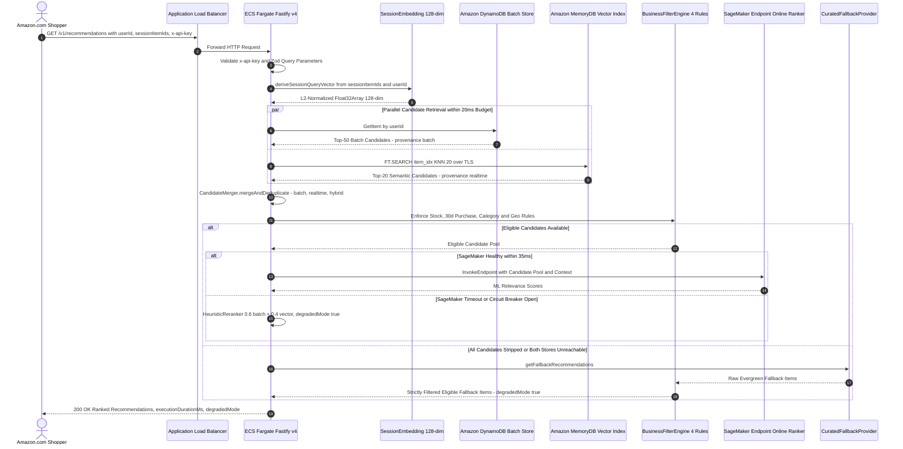
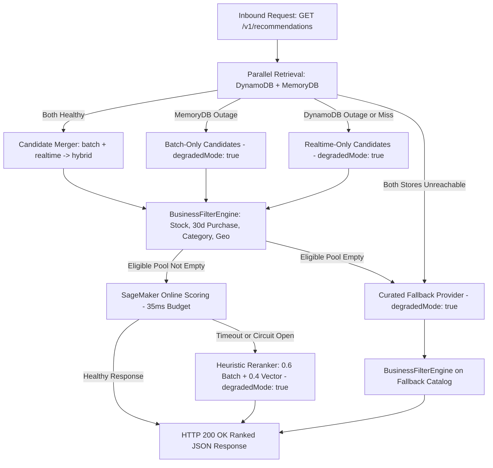

# AWS Reference Architecture Diagram (`T079`)

**Reference Architecture Alignment**:  
This document models the exact architecture implemented in this repository (`001-aws-recommendation-platform`) faithfully aligned with the official AWS Big Data Blog reference architecture:  
[Building a scalable, personalized recommendation system on AWS: From batch to real-time](https://aws.amazon.com/pt/blogs/big-data/building-a-scalable-personalized-recommendation-system-on-aws-from-batch-to-real-time/).

---

## 1. End-to-End Batch-to-Real-Time Architecture Diagram (Mermaid)

```mermaid
flowchart TD
    User(["Amazon.com Shopper / Client - userId, sessionItemIds, category, limit"])

    subgraph AWS_Cloud ["AWS Cloud - Region us-east-1 - VPC 10.0.0.0/16 Multi-AZ"]

        subgraph Data_Lake_Foundation ["1. Data Foundation and Governance - S3 VPC Gateway Endpoint"]
            S3[("Amazon S3 Golden Dataset - Parquet + Snappy, SSE-KMS, Public Access Blocked")]
            LF["AWS Lake Formation and Glue Data Catalog - Database ecommerce_golden_db"]
        end

        subgraph Offline_Batch_Pipeline ["2. Offline Batch and ML Training Pipeline - Scheduled Daily 02:00 UTC"]
            MWAA["Amazon MWAA Apache Airflow - DAG daily_hybrid_recommendation_pipeline"]
            Athena["Amazon Athena Engine v3 - Partition-Pruned SQL Views, 10 GB Scan Guard"]
            GlueETL["AWS Glue 4.0 Job 1: feature-engineering - 2x G.1X DPUs, Job Bookmarks and Broadcast Join"]
            SM_Train["Amazon SageMaker Managed Spot Training - Two-Tower and Collaborative Filtering"]
            GluePubDDB["AWS Glue 4.0 Job 2: publish-batch-dynamodb - Rate-Limited BatchWriter"]
            GluePubMem["AWS Glue 4.0 Job 3: publish-memorydb-vectors - Rate-Limited TLS Pipeline"]
        end

        subgraph Online_Data_And_ML_Stores ["3. Low-Latency Serving Stores and Online ML"]
            DynamoDB[("Amazon DynamoDB - user_recommendations, On-Demand, PITR, 7-Day TTL")]
            MemoryDB[("Amazon MemoryDB for Redis - HNSW Index item_idx, 128-dim Float32, TLS + ACL")]
            SM_Endpoint["Amazon SageMaker Endpoint - Serverless Inference or ml.t3.medium Re-Ranker"]
        end

        subgraph Ingress_Security ["4. Ingress, Container Registry and Observability"]
            ALB["Application Load Balancer - Public Subnets HTTP/HTTPS"]
            ECR["Amazon ECR Repository - scan_on_push enabled, AES256"]
            CW["Amazon CloudWatch - Structured JSON Logs, EMF Metrics and Alarms"]
        end

        subgraph Realtime_Serving_Layer ["5. Real-Time Serving Layer - Private Subnets, Sub-60ms P95 SLA"]
            ECS["Amazon ECS on AWS Fargate Spot - Node.js 20, Fastify v4, x-api-key Auth"]
            SessionEmb["Deterministic Session Embedding - SHA-256 to 128-dim Float32 L2-Normalized"]
            Merger["Candidate Merger and Deduplicator - Provenance: batch, realtime, hybrid"]
            FilterEngine["Strict Business Filter Engine - Stock, 30d Purchase, Category and Geo Rules"]
            Fallback["Multi-Tier Graceful Fallback - Heuristic 0.6/0.4 Reranker and Curated Top Sellers"]
        end
    end

    S3 -->|Registers and Governs| LF
    LF -->|Catalog Metadata and Column Grants| Athena
    LF -->|Catalog Metadata and Bookmarks| GlueETL
    S3 -->|Reads Partitioned Interactions and Catalog| Athena
    Athena -->|Materializes Curated Feature Views| S3
    S3 -->|Incremental DynamicFrame Read| GlueETL
    GlueETL -->|Writes Snappy Parquet Features| S3
    S3 -->|Reads User-Item Interaction Features| SM_Train
    SM_Train -->|Writes Model and JSON Artifacts| S3
    S3 -->|Reads user_recommendations.json| GluePubDDB
    S3 -->|Reads item_embeddings_128dim.json| GluePubMem
    GluePubDDB -->|BatchWriteItem Top-50 per User| DynamoDB
    GluePubMem -->|TLS HSET 512-Byte Float32 Vectors| MemoryDB

    MWAA -.->|1. S3KeySensor and AthenaOperator| Athena
    MWAA -.->|2. GlueJobOperator| GlueETL
    MWAA -.->|3. SageMakerTrainingOperator| SM_Train
    MWAA -.->|4a. GlueJobOperator| GluePubDDB
    MWAA -.->|4b. GlueJobOperator| GluePubMem

    ECR -.->|Pulls Container Image| ECS
    User -->|GET /v1/recommendations with x-api-key| ALB
    ALB -->|Forwards HTTP Port 8080| ECS
    ECS -->|1a. Derive 128-dim Query Vector| SessionEmb
    ECS -->|1b. Parallel GetItem 20ms Budget| DynamoDB
    SessionEmb -->|1c. Parallel FT.SEARCH KNN 20 15ms Budget| MemoryDB
    DynamoDB -->|Precomputed Batch Candidates| Merger
    MemoryDB -->|Real-Time Semantic Candidates| Merger
    Merger -->|Unified Deduplicated Pool| FilterEngine
    FilterEngine -->|Eligible Candidates Only| SM_Endpoint
    SM_Endpoint -->|Predicted Relevance Scores 35ms Budget| ECS
    SM_Endpoint -.->|Timeout or Circuit Open| Fallback
    Fallback -->|Filtered Degraded Candidates| FilterEngine
    ECS -->|200 OK Ranked JSON Response| User
    ECS -.->|Structured Telemetry and EMF Metrics| CW
```

---

## 2. Real-Time Hybrid Recommendation Sequence Diagram

---

## 3. Multi-Tier Operational Fallback Flowchart

---

## 4. Mapping to the Official AWS Big Data Reference Architecture

The table below maps each architectural pillar from the AWS Big Data Blog post (*Building a scalable, personalized recommendation system on AWS: From batch to real-time*) to its concrete implementation in this project:

| Architectural Stage (AWS Blog) | AWS Service Used | Concrete Implementation in This Repository |
| :--- | :--- | :--- |
| **1. Data Lake & Storage Foundation** | Amazon S3 (Parquet) | [`infra/terraform/modules/s3_golden_dataset`](file:///C:/Users/mrj84/Documents/Learning/exemplo-01-ecommerce-recomendations-aws-architecture/infra/terraform/modules/s3_golden_dataset/main.tf) — Snappy-compressed Parquet partitions (`interactions/`, `catalog/`, `user_features/`, `recommendations/`) encrypted with SSE-KMS. |
| **2. Data Lake Governance & Security** | AWS Lake Formation & Glue Data Catalog | [`infra/terraform/modules/lake_formation`](file:///C:/Users/mrj84/Documents/Learning/exemplo-01-ecommerce-recomendations-aws-architecture/infra/terraform/modules/lake_formation/main.tf) — Registers the S3 Golden Dataset bucket and governs the `ecommerce_golden_db` catalog database. |
| **3. Serverless Analytical Querying** | Amazon Athena | [`src/batch/athena/extract_curated_features.sql`](file:///C:/Users/mrj84/Documents/Learning/exemplo-01-ecommerce-recomendations-aws-architecture/src/batch/athena/extract_curated_features.sql) & [`infra/terraform/modules/athena_queries`](file:///C:/Users/mrj84/Documents/Learning/exemplo-01-ecommerce-recomendations-aws-architecture/infra/terraform/modules/athena_queries/main.tf) — Engine v3 workgroup with partition pruning and a 10 GB per-query scan guardrail. |
| **4. Incremental Feature Engineering** | AWS Glue (PySpark) | [`src/batch/glue/feature_engineering.py`](file:///C:/Users/mrj84/Documents/Learning/exemplo-01-ecommerce-recomendations-aws-architecture/src/batch/glue/feature_engineering.py) — Glue 4.0 job on 2x `G.1X` workers using `create_dynamic_frame.from_catalog(..., transformation_ctx=...)` for Job Bookmarks and `F.broadcast(catalog_df)` to prevent OOM shuffle spills. |
| **5. Offline Model & Embedding Training** | Amazon SageMaker Training | [`src/batch/sagemaker/train_model.py`](file:///C:/Users/mrj84/Documents/Learning/exemplo-01-ecommerce-recomendations-aws-architecture/src/batch/sagemaker/train_model.py) — Managed Spot Training producing 128-dim L2-normalized item embeddings (`item_embeddings_128dim.json`) and top-K user affinities (`user_recommendations.json`). |
| **6. Workflow Orchestration** | Amazon MWAA (Apache Airflow) | [`src/batch/airflow/dags/daily_hybrid_recommendation_pipeline.py`](file:///C:/Users/mrj84/Documents/Learning/exemplo-01-ecommerce-recomendations-aws-architecture/src/batch/airflow/dags/daily_hybrid_recommendation_pipeline.py) — Orchestrates the 6-step daily pipeline (`0 2 * * *`) across S3, Athena, Glue, and SageMaker. |
| **7. Batch Serving Store (Key-Value)** | Amazon DynamoDB | [`src/batch/glue/publish_dynamodb.py`](file:///C:/Users/mrj84/Documents/Learning/exemplo-01-ecommerce-recomendations-aws-architecture/src/batch/glue/publish_dynamodb.py) & [`infra/terraform/modules/dynamodb_table`](file:///C:/Users/mrj84/Documents/Learning/exemplo-01-ecommerce-recomendations-aws-architecture/infra/terraform/modules/dynamodb_table/main.tf) — On-Demand table `user_recommendations` with 7-day TTL (`604800`s) and rate-limited batch writer. |
| **8. Real-Time Vector Similarity Store (ANN)** | Amazon MemoryDB for Redis | [`src/batch/glue/publish_memorydb_vectors.py`](file:///C:/Users/mrj84/Documents/Learning/exemplo-01-ecommerce-recomendations-aws-architecture/src/batch/glue/publish_memorydb_vectors.py) & [`infra/terraform/modules/memorydb_cluster`](file:///C:/Users/mrj84/Documents/Learning/exemplo-01-ecommerce-recomendations-aws-architecture/infra/terraform/modules/memorydb_cluster/main.tf) — Single-shard `db.t4g.small` HNSW vector index (`item_idx`, 128-dim Float32) with TLS (`tls_enabled = true`) and ACL enforced. |
| **9. Real-Time ML Re-Ranking** | Amazon SageMaker Inference Endpoint | [`infra/terraform/modules/sagemaker_endpoint`](file:///C:/Users/mrj84/Documents/Learning/exemplo-01-ecommerce-recomendations-aws-architecture/infra/terraform/modules/sagemaker_endpoint/main.tf) — Dual-mode Terraform configuration supporting Serverless Inference ($0 idle cost for PoC) or provisioned `ml.t3.medium` instances for strict sub-20ms P95 SLA without cold starts. |
| **10. Real-Time Recommendation API** | Amazon ECS on AWS Fargate + ALB | [`src/serving/src/application/get-recommendations.use-case.ts`](file:///C:/Users/mrj84/Documents/Learning/exemplo-01-ecommerce-recomendations-aws-architecture/src/serving/src/application/get-recommendations.use-case.ts) — Hexagonal TypeScript service deriving deterministic 128-dim session vectors, fetching DynamoDB + MemoryDB in parallel, enforcing 4 business rules across normal and fallback paths, and re-ranking via SageMaker. |

---

## 5. Generating Official AWS Icon PNG/SVG Diagrams (Optional External Tooling)

- **Zero external paid dependencies are required** to view the architecture diagrams above — GitHub natively renders all Mermaid blocks in `README.md`, `specs/001-aws-recommendation-platform/plan.md`, and `docs/ARCHITECTURE_DIAGRAM.md`.
- If you wish to generate a high-resolution PNG/SVG using official AWS Architecture Icons, you can optionally use either:
  1. **AWS Diagram MCP Server (`awslabs.aws-diagram-mcp-server`)**: An open-source Model Context Protocol server published by AWS Labs that converts architecture prompts or Python `diagrams` code into official AWS icon diagrams.
  2. **Python `diagrams` Library (`pip install diagrams` + Graphviz `dot`)**: Run a script using `diagrams.aws.storage.S3`, `diagrams.aws.analytics.Glue`, `diagrams.aws.ml.Sagemaker`, `diagrams.aws.database.Dynamodb`, `diagrams.aws.database.MemorydbForRedis`, and `diagrams.aws.compute.ECS`.
