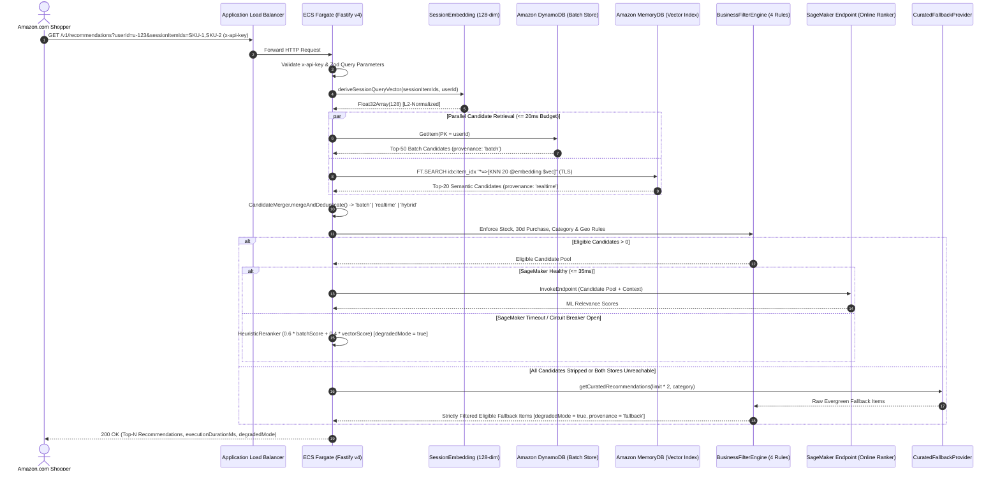

# AWS Reference Architecture Diagram (`T079`)

**Reference Architecture Alignment**:  
This document models the exact architecture implemented in this repository (`001-aws-recommendation-platform`) faithfully aligned with the official AWS Big Data Blog reference architecture:  
[Building a scalable, personalized recommendation system on AWS: From batch to real-time](https://aws.amazon.com/pt/blogs/big-data/building-a-scalable-personalized-recommendation-system-on-aws-from-batch-to-real-time/).

---

## 1. End-to-End Batch-to-Real-Time Architecture Diagram (Mermaid)

```mermaid
flowchart TB
    %% Styling aligned with AWS Architecture Icons & Layers
    classDef client fill:#232F3E,stroke:#FF9900,stroke-width:2px,color:#FFFFFF
    classDef storage fill:#3F8624,stroke:#232F3E,stroke-width:1.5px,color:#FFFFFF
    classDef governance fill:#C925D1,stroke:#232F3E,stroke-width:1.5px,color:#FFFFFF
    classDef analytics fill:#8C4FFF,stroke:#232F3E,stroke-width:1.5px,color:#FFFFFF
    classDef ml fill:#01A88D,stroke:#232F3E,stroke-width:1.5px,color:#FFFFFF
    classDef database fill:#3B48CC,stroke:#232F3E,stroke-width:1.5px,color:#FFFFFF
    classDef compute fill:#ED7100,stroke:#232F3E,stroke-width:1.5px,color:#FFFFFF
    classDef security fill:#DD344C,stroke:#232F3E,stroke-width:1.5px,color:#FFFFFF

    User(["Amazon.com Shopper / Client\n(userId, sessionItemIds, category, limit)"]):::client

    subgraph AWS_Cloud ["AWS Cloud (Region: us-east-1 | VPC 10.0.0.0/16 Across Multi-AZ)"]

        subgraph Ingress_Security ["Ingress, Container Registry & Observability"]
            ALB["Application Load Balancer\n(Public Subnets | HTTP/HTTPS)"]:::compute
            ECR["Amazon ECR Repository\n(scan_on_push = true, AES256)"]:::security
            CW["Amazon CloudWatch\n(Structured JSON Logs, Metrics & Alarms)"]:::governance
        end

        subgraph Realtime_Serving_Layer ["Real-Time Serving Layer (Private Subnets | Sub-60ms P95 SLA)"]
            ECS["Amazon ECS on AWS Fargate Spot\n(Node.js 20 / Fastify v4 / TypeScript)\n+ x-api-key Auth + Opossum Circuit Breakers"]:::compute
            SessionEmb["Deterministic Session Embedding\n(SHA-256 -> 128-dim Float32 L2-Normalized)"]:::compute
            Merger["Candidate Merger & Deduplicator\n(Provenance: batch | realtime | hybrid)"]:::compute
            FilterEngine["Strict Business Filter Engine\n(Stock, 30d Purchase, Category, Geo)\nApplied to Normal + Curated Fallback"]:::compute
            Fallback["Multi-Tier Graceful Fallback\n(Heuristic 0.6/0.4 Reranker & Curated Top Sellers)"]:::compute
        end

        subgraph Online_Data_And_ML_Stores ["Low-Latency Serving Stores & Online ML"]
            DynamoDB[("Amazon DynamoDB\n(user_recommendations)\nOn-Demand | PITR | 7-Day TTL")]:::database
            MemoryDB[("Amazon MemoryDB for Redis\n(HNSW Vector Index: item_idx)\n128-dim Float32 | TLS + ACL Enabled")]:::database
            SM_Endpoint["Amazon SageMaker Endpoint\n(Serverless Inference $0 Idle / ml.t3.medium)\nOnline Candidate Re-Ranking"]:::ml
        end

        subgraph Offline_Batch_Pipeline ["Offline Batch & ML Training Pipeline (Scheduled Daily 02:00 UTC)"]
            MWAA["Amazon MWAA (Apache Airflow)\nDAG: daily_hybrid_recommendation_pipeline\n(mw1.small | Ephemeral / Scheduled)"]:::analytics
            Athena["Amazon Athena (Engine v3)\nPartition-Pruned SQL Views\n(10 GB Scan Guardrail)"]:::analytics
            GlueETL["AWS Glue 4.0 Job 1: feature-engineering\n(2x G.1X DPUs | Job Bookmarks: transformation_ctx\n+ F.broadcast Catalog Join)"]:::analytics
            SM_Train["Amazon SageMaker Managed Spot Training\n(Two-Tower / Collaborative Filtering)\nOutputs: user_recommendations.json\n& item_embeddings_128dim.json"]:::ml
            GluePubDDB["AWS Glue 4.0 Job 2: publish-dynamodb\n(Rate-Limited BatchWriter -> 7-Day TTL)"]:::analytics
            GluePubMem["AWS Glue 4.0 Job 3: publish-memorydb-vectors\n(Rate-Limited TLS Pipeline -> 512B Float32 Blobs)"]:::analytics
        end

        subgraph Data_Lake_Foundation ["Data Foundation & Governance (S3 VPC Gateway Endpoint)"]
            S3[("Amazon S3 Golden Dataset\n(Parquet + Snappy | Partitioned YYYY/MM/DD)\nSSE-KMS Customer Key + Public Access Blocked")]:::storage
            LF["AWS Lake Formation & Glue Data Catalog\n(Database: ecommerce_golden_db\nColumn-Level Access Control & LF-Tags)"]:::governance
        end
    end

    %% Data Foundation & Batch Flows
    S3 <-->|Registers & Governs| LF
    LF -->|Catalog Metadata & Column Grants| Athena
    LF -->|Catalog Metadata & Bookmarks| GlueETL
    S3 -->|Reads Partitioned Interactions & Catalog| Athena
    Athena -->|Materializes Curated Feature Views| S3
    S3 -->|Incremental DynamicFrame Read| GlueETL
    GlueETL -->|Writes Snappy Parquet Features| S3
    S3 -->|Reads User-Item Interaction Features| SM_Train
    SM_Train -->|Writes Model & JSON Artifacts| S3
    S3 -->|Reads user_recommendations.json| GluePubDDB
    S3 -->|Reads item_embeddings_128dim.json| GluePubMem
    GluePubDDB -->|BatchWriteItem (Upsert Top-50/User)| DynamoDB
    GluePubMem -->|TLS HSET item:<id> (512B Vector)| MemoryDB

    %% MWAA Orchestration Links
    MWAA -.->|1. S3KeySensor & AthenaOperator| Athena
    MWAA -.->|2. GlueJobOperator| GlueETL
    MWAA -.->|3. SageMakerTrainingOperator| SM_Train
    MWAA -.->|4a. GlueJobOperator| GluePubDDB
    MWAA -.->|4b. GlueJobOperator| GluePubMem

    %% Real-Time Serving Flows
    ECR -.->|Pulls Container Image| ECS
    User ==>|GET /v1/recommendations\n(x-api-key)| ALB
    ALB ==>|Forwards HTTP :3000| ECS
    ECS -->|1a. Derive 128-dim Query Vector\nfrom sessionItemIds / userId| SessionEmb
    ECS -->|1b. Parallel GetItem (20ms budget)| DynamoDB
    SessionEmb -->|1c. Parallel FT.SEARCH KNN 20 (15ms budget)| MemoryDB
    DynamoDB -->|Precomputed Batch Candidates| Merger
    MemoryDB -->|Real-Time Semantic Candidates| Merger
    Merger -->|Unified Deduplicated Pool| FilterEngine
    FilterEngine -->|Eligible Candidates Only| SM_Endpoint
    SM_Endpoint -->|Predicted Relevance Scores (35ms budget)| ECS
    SM_Endpoint -.->|Timeout / Circuit Open| Fallback
    Fallback -->|Filtered Degraded Candidates| FilterEngine
    ECS ==>|200 OK Ranked JSON Response\n(provenance, score, degradedMode)| User
    ECS -.->|Structured Telemetry & EMF Metrics| CW
```

---

## 2. Real-Time Hybrid Recommendation Sequence Diagram



---

## 3. Mapping to the Official AWS Big Data Reference Architecture

The table below maps each architectural pillar from the AWS Big Data Blog post (*Building a scalable, personalized recommendation system on AWS: From batch to real-time*) to its concrete implementation in this project:

| Architectural Stage (AWS Blog) | AWS Service Used | Concrete Implementation in This Repository |
| :--- | :--- | :--- |
| **1. Data Lake & Storage Foundation** | Amazon S3 (Parquet) | [`infra/terraform/modules/s3_golden_dataset`](file:///C:/Users/mrj84/Documents/Learning/exemplo-01-ecommerce-recomendations-aws-architecture/infra/terraform/modules/s3_golden_dataset/main.tf) — Snappy-compressed Parquet partitions (`interactions/`, `catalog/`, `user_features/`, `recommendations/`) encrypted with SSE-KMS. |
| **2. Data Lake Governance & Security** | AWS Lake Formation & Glue Data Catalog | [`infra/terraform/modules/lake_formation`](file:///C:/Users/mrj84/Documents/Learning/exemplo-01-ecommerce-recomendations-aws-architecture/infra/terraform/modules/lake_formation/main.tf) — Registers the S3 Golden Dataset bucket and governs the `ecommerce_golden_db` catalog database. |
| **3. Serverless Analytical Querying** | Amazon Athena | [`src/batch/athena/extract_curated_features.sql`](file:///C:/Users/mrj84/Documents/Learning/exemplo-01-ecommerce-recomendations-aws-architecture/src/batch/athena/extract_curated_features.sql) & [`infra/terraform/modules/athena_workgroup`](file:///C:/Users/mrj84/Documents/Learning/exemplo-01-ecommerce-recomendations-aws-architecture/infra/terraform/modules/athena_workgroup/main.tf) — Engine v3 workgroup with partition pruning and a 10 GB per-query scan guardrail. |
| **4. Incremental Feature Engineering** | AWS Glue (PySpark) | [`src/batch/glue/feature_engineering.py`](file:///C:/Users/mrj84/Documents/Learning/exemplo-01-ecommerce-recomendations-aws-architecture/src/batch/glue/feature_engineering.py) — Glue 4.0 job on 2x `G.1X` workers using `create_dynamic_frame.from_catalog(..., transformation_ctx=...)` for Job Bookmarks and `F.broadcast(catalog_df)` to prevent OOM shuffle spills. |
| **5. Offline Model & Embedding Training** | Amazon SageMaker Training | [`src/batch/sagemaker/train_model.py`](file:///C:/Users/mrj84/Documents/Learning/exemplo-01-ecommerce-recomendations-aws-architecture/src/batch/sagemaker/train_model.py) — Managed Spot Training producing 128-dim L2-normalized item embeddings (`item_embeddings_128dim.json`) and top-K user affinities (`user_recommendations.json`). |
| **6. Workflow Orchestration** | Amazon MWAA (Apache Airflow) | [`src/batch/airflow/dags/daily_hybrid_recommendation_pipeline.py`](file:///C:/Users/mrj84/Documents/Learning/exemplo-01-ecommerce-recomendations-aws-architecture/src/batch/airflow/dags/daily_hybrid_recommendation_pipeline.py) — Orchestrates the 6-step daily pipeline (`0 2 * * *`) across S3, Athena, Glue, and SageMaker. |
| **7. Batch Serving Store (Key-Value)** | Amazon DynamoDB | [`src/batch/glue/publish_dynamodb.py`](file:///C:/Users/mrj84/Documents/Learning/exemplo-01-ecommerce-recomendations-aws-architecture/src/batch/glue/publish_dynamodb.py) & [`infra/terraform/modules/dynamodb_recommendations`](file:///C:/Users/mrj84/Documents/Learning/exemplo-01-ecommerce-recomendations-aws-architecture/infra/terraform/modules/dynamodb_recommendations/main.tf) — On-Demand table `user_recommendations` with 7-day TTL (`604800`s) and rate-limited batch writer. |
| **8. Real-Time Vector Similarity Store (ANN)** | Amazon MemoryDB for Redis | [`src/batch/glue/publish_memorydb_vectors.py`](file:///C:/Users/mrj84/Documents/Learning/exemplo-01-ecommerce-recomendations-aws-architecture/src/batch/glue/publish_memorydb_vectors.py) & [`infra/terraform/modules/memorydb_cluster`](file:///C:/Users/mrj84/Documents/Learning/exemplo-01-ecommerce-recomendations-aws-architecture/infra/terraform/modules/memorydb_cluster/main.tf) — Single-shard `db.t4g.small` HNSW vector index (`item_idx`, 128-dim Float32) with TLS (`tls_enabled = true`) and ACL enforced. |
| **9. Real-Time ML Re-Ranking** | Amazon SageMaker Inference Endpoint | [`infra/terraform/modules/sagemaker_ranking`](file:///C:/Users/mrj84/Documents/Learning/exemplo-01-ecommerce-recomendations-aws-architecture/infra/terraform/modules/sagemaker_ranking/main.tf) — Dual-mode Terraform configuration supporting Serverless Inference ($0 idle cost for PoC) or provisioned `ml.t3.medium` instances for strict sub-20ms P95 SLA without cold starts. |
| **10. Real-Time Recommendation API** | Amazon ECS on AWS Fargate + ALB | [`src/serving/src/application/get-recommendations.use-case.ts`](file:///C:/Users/mrj84/Documents/Learning/exemplo-01-ecommerce-recomendations-aws-architecture/src/serving/src/application/get-recommendations.use-case.ts) — Hexagonal TypeScript service deriving deterministic 128-dim session vectors, fetching DynamoDB + MemoryDB in parallel, enforcing 4 business rules across normal and fallback paths, and re-ranking via SageMaker. |

---

## 4. Generating Official AWS Icon PNG/SVG Diagrams (Optional External Tooling)

As requested in the planning phase:
- **Zero external paid dependencies are required** to view the architecture diagrams above — GitHub natively renders all Mermaid blocks in `README.md`, `specs/001-aws-recommendation-platform/plan.md`, and `docs/ARCHITECTURE_DIAGRAM.md`.
- If you wish to generate a high-resolution PNG/SVG using official AWS Architecture Icons, you can optionally use either:
  1. **AWS Diagram MCP Server (`awslabs.aws-diagram-mcp-server`)**: An open-source Model Context Protocol server published by AWS Labs that converts architecture prompts or Python `diagrams` code into official AWS icon diagrams.
  2. **Python `diagrams` Library (`pip install diagrams` + Graphviz `dot`)**: Run a script using `diagrams.aws.storage.S3`, `diagrams.aws.analytics.Glue`, `diagrams.aws.ml.Sagemaker`, `diagrams.aws.database.Dynamodb`, `diagrams.aws.database.MemorydbForRedis`, and `diagrams.aws.compute.ECS`.
