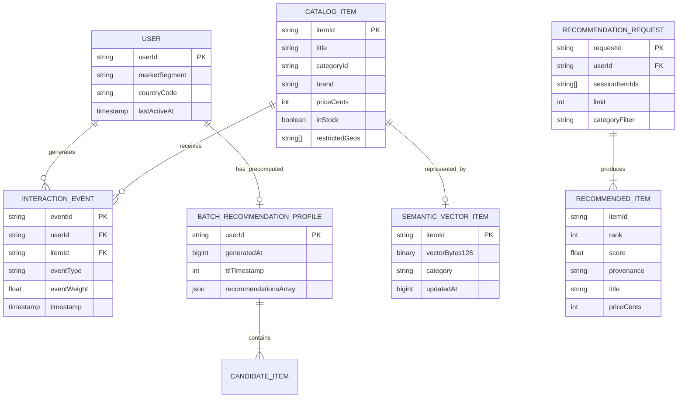
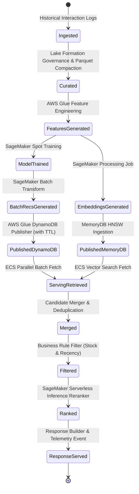

# Phase 1 Data Model: AWS Hybrid Recommendation Platform

**Feature**: AWS Hybrid Recommendation Platform  
**Branch**: `001-aws-recommendation-platform`  
**Status**: Completed  
**Author**: Principal Solutions Architect, Staff ML Engineer, Staff Platform Engineer  

---

## 1. Entity Overview & Relationship Diagram



---

## 2. Storage & Entity Schemas

### Entity 1: S3 Golden Dataset - Interaction Event (`interactions`)
- **Storage Target**: Amazon S3 (`s3://<prefix>-golden-dataset/interactions/`)
- **Format**: Apache Parquet with Snappy compression, partitioned by `year=YYYY/month=MM/day=DD/`
- **Fields**:
  | Field Name | Type | Nullable | Description |
  | :--- | :--- | :---: | :--- |
  | `event_id` | `STRING` | No | UUIDv4 identifier of the event. |
  | `user_id` | `STRING` | No | Identifier of the customer. |
  | `item_id` | `STRING` | No | Identifier of the product interacted with. |
  | `event_type` | `STRING` | No | Enum: `view`, `click`, `add_to_cart`, `purchase`. |
  | `event_weight`| `FLOAT` | No | Computed weight (e.g., purchase=5.0, cart=3.0, click=1.0). |
  | `timestamp` | `BIGINT` | No | Milliseconds since Unix epoch. |
  | `context` | `STRING` | Yes | JSON string of device/session context. |

---

### Entity 2: S3 Golden Dataset - Product Catalog (`catalog`)
- **Storage Target**: Amazon S3 (`s3://<prefix>-golden-dataset/catalog/`)
- **Format**: Apache Parquet, snapshot date partitioning `snapshot_date=YYYY-MM-DD/`
- **Fields**:
  | Field Name | Type | Nullable | Description |
  | :--- | :--- | :---: | :--- |
  | `item_id` | `STRING` | No | Canonical product SKU ID. |
  | `title` | `STRING` | No | Product title string (up to 255 chars). |
  | `category_id`| `STRING` | No | Taxonomy category path (e.g., `Electronics > Audio > Headphones`). |
  | `brand` | `STRING` | Yes | Brand or manufacturer name. |
  | `price_cents`| `INT` | No | Price in integer cents (e.g., 19999 for $199.99). |
  | `in_stock` | `BOOLEAN` | No | Current stock status. |
  | `restricted_geos`| `ARRAY<STRING>` | Yes | Country codes where item is prohibited. |
  | `updated_at` | `BIGINT` | No | Epoch timestamp of last catalog sync. |

---

### Entity 3: Amazon DynamoDB - Batch Recommendation Profile
- **Storage Target**: Amazon DynamoDB table `user_recommendations`
- **Billing Mode**: `PAY_PER_REQUEST` (On-Demand)
- **Primary Key**: Partition Key `userId` (`STRING`)
- **TTL Attribute**: `ttlTimestamp` (`NUMBER`, epoch seconds)
- **Document Structure**:
```json
{
  "userId": "u-12345",
  "generatedAt": 1730689200,
  "ttlTimestamp": 1731294000,
  "recommendations": [
    {
      "itemId": "SKU-9021",
      "score": 0.945,
      "rank": 1,
      "modelId": "cf-two-tower-v1.4"
    },
    {
      "itemId": "SKU-4412",
      "score": 0.892,
      "rank": 2,
      "modelId": "cf-two-tower-v1.4"
    }
  ]
}
```
- **Validation Rules**:
  - `userId` must match regex `^[a-zA-Z0-9_\-]+$`.
  - `recommendations` array length must be between 1 and 50.
  - `ttlTimestamp` must be set to `generatedAt + 604800` (7 days).

---

### Entity 4: Amazon MemoryDB - Semantic Vector Hash & Index
- **Storage Target**: Amazon MemoryDB for Redis (Redis 7.1+)
- **Key Pattern**: `item:<itemId>`
- **Data Structure**: Redis HASH
- **Hash Fields**:
  | Field | Type | Description |
  | :--- | :--- | :--- |
  | `v` | Binary (`FLOAT32[128]`) | 128-dimensional L2-normalized float vector (512 bytes). |
  | `cat` | String | Product category string for pre-filtering. |
  | `price` | Integer | Price tier or cents. |
  | `ts` | Integer | Epoch timestamp of embedding update. |
- **RediSearch Index Schema**:
```text
FT.CREATE item_idx ON HASH PREFIX 1 item: SCHEMA
  v VECTOR HNSW 6 TYPE FLOAT32 DIM 128 DISTANCE_METRIC COSINE M 16 EF_CONSTRUCTION 64
  cat TAG
  price NUMERIC
```

---

### Entity 5: Internal Serving Domain Models

#### 5.1 Merged Candidate (`MergedCandidate`)
```typescript
export interface MergedCandidate {
  itemId: string;
  provenance: 'batch' | 'realtime' | 'hybrid';
  batchScore?: number;
  batchRank?: number;
  vectorScore?: number; // Cosine similarity
  initialCombinedScore: number;
}
```

#### 5.2 Business Filter Context (`FilterContext`)
```typescript
export interface FilterContext {
  userId: string;
  countryCode: string;
  recentPurchasedItemIds: Set<string>;
  suppressedCategoryIds: Set<string>;
  maxCandidateCount: number;
}
```

#### 5.3 Online Scoring Payload (`OnlineScoringRequest`)
```typescript
export interface OnlineScoringRequest {
  userId: string;
  sessionSignals: {
    deviceType?: string;
    recentItemIds: string[];
  };
  candidateItems: Array<{
    itemId: string;
    features: {
      initialScore: number;
      provenance: string;
      category?: string;
    };
  }>;
}
```

---

## 3. State Transitions & Lifecycle

### Recommendation Lifecycle State Machine



### Expiration & Retention Policies

| Data Asset | Storage Medium | Retention Policy | Purge Mechanism |
| :--- | :--- | :--- | :--- |
| **Raw Ingest Telemetry** | S3 Standard | 90 days → Glacier Flexible Retrieval | S3 Bucket Lifecycle Rule |
| **ETL Scratch & Temp Files** | S3 Standard | 7 days | S3 Bucket Lifecycle Rule |
| **Athena Query Results** | S3 Standard | 7 days | S3 Workgroup Output Lifecycle |
| **DynamoDB User Profiles** | DynamoDB Table | 7 days from batch generation | DynamoDB Native TTL (`ttlTimestamp`) |
| **CloudWatch Log Events** | CloudWatch Logs | 14 days (PoC) / 30 days (Prod) | CloudWatch Log Group Retention |
| **SageMaker Data Capture** | S3 Standard | 14 days | S3 Bucket Lifecycle Rule |
