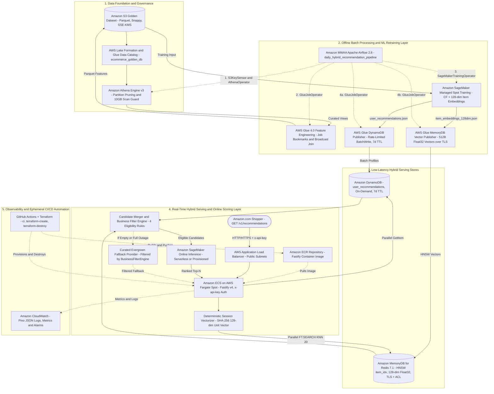

# Implementation Plan: AWS Hybrid Recommendation Platform

**Branch**: `001-aws-recommendation-platform` | **Date**: 2026-11-04 | **Spec**: [`specs/001-aws-recommendation-platform/spec.md`](./spec.md)  
**Input**: Feature specification from `/specs/001-aws-recommendation-platform/spec.md`  

---

## Summary

The AWS Hybrid Recommendation Platform implements an enterprise-grade, low-latency personalization engine combining offline batch precomputation with real-time semantic retrieval, online ML re-ranking, and business-rule filtering for Amazon.com users.

The implementation realizes the approved 11-service AWS architecture:
1. **Batch Pipeline**: Amazon S3 (Snappy-compressed Parquet Golden Dataset), AWS Lake Formation (Governance), Amazon MWAA (Airflow DAGs), Amazon Athena (Curated SQL views), AWS Glue (Incremental feature engineering ETL & publishers), Amazon SageMaker (Managed Spot collaborative filtering training & batch transform), and Amazon DynamoDB (On-Demand batch profile store with 7-day TTL).
2. **Realtime Serving**: Amazon MemoryDB (Redis 7.1+ single-shard HNSW vector search index), Amazon SageMaker Serverless Inference (real-time scoring with $0 idle cost), and Amazon ECS on AWS Fargate Spot (Node.js/TypeScript Clean Architecture REST API).
3. **Serving Flow**: ECS receives requests → fetches batch candidates from DynamoDB and semantic candidates from MemoryDB in parallel → deduplicates and tags provenance (`batch`, `realtime`, `hybrid`) → applies strict inventory stock and suppression filters → scores candidates via SageMaker Serverless Inference → enriches catalog metadata and returns Top-N recommendations within 60ms P95, with deterministic graceful fallback on downstream component outages.

All infrastructure is parameterized in Terraform with automated create and destroy capabilities in GitHub Actions to enforce the **Minimum-Cost PoC Posture** (<$25/month ephemeral, ~$150–$200/month scheduled).

---

## Technical Context

**Language/Version**:
- Serving Service: Node.js 20 LTS with TypeScript 5.4+
- Batch / ML Pipelines: Python 3.10+ (Apache Spark 3.3 for AWS Glue 4.0, PyTorch/XGBoost for SageMaker, Airflow 2.8+ for MWAA)
- Infrastructure as Code: Terraform >= 1.5.0 with AWS Provider >= 5.0

**Primary Dependencies**:
- Web Framework: Fastify v4.x (sub-millisecond routing and native schema validation)
- AWS SDK: AWS SDK for JavaScript v3 (`@aws-sdk/client-dynamodb`, `@aws-sdk/lib-dynamodb`, `@aws-sdk/client-sagemaker-runtime`)
- Redis / Vector Client: `ioredis` v5.x with cluster mode and RediSearch commands
- Resiliency: `opossum` (circuit breaker pattern) and exponential backoff retry utilities
- Logging & Observability: `pino` (structured JSON logging) with AWS CloudWatch and AWS X-Ray SDK

**Storage**:
- Amazon S3: Columnar Snappy-compressed Parquet datasets (curated golden datasets, features, models, embeddings)
- Amazon DynamoDB: `user_recommendations` table in `PAY_PER_REQUEST` mode with 7-day TTL
- Amazon MemoryDB: 1-shard `db.t4g.small` cluster with HNSW vector search index (`item_idx`)
- AWS Glue Data Catalog: Managed metadata governed by AWS Lake Formation LF-Tags

**Testing**:
- Serving Layer: Vitest / Jest for unit and integration testing; Supertest for API contract testing
- Batch Layer: `pytest` and `pyspark` for Glue transformation and data contract validation
- Infrastructure: `tflint`, `terraform fmt -check`, and `terraform validate` in GitHub Actions quality gates

**Target Platform**:
- Serving: Amazon ECS running on AWS Fargate Spot (Linux x86_64, 0.5 vCPU, 1 GB RAM) behind Application Load Balancer
- Inference: Amazon SageMaker Serverless Inference (2048 MB memory, MaxConcurrency 5)
- Orchestration: Amazon MWAA (`mw1.small` with ephemeral lifecycle controls)
- Processing: AWS Glue 4.0 (`G.1X` workers, 2 DPUs)

**Performance Goals**:
- End-to-end API response time: <60ms P95 at 500 RPS
- DynamoDB point read latency: <5ms P95
- MemoryDB vector search latency: <10ms P95
- SageMaker inference scoring latency: <20ms P95
- Candidate merging and business filtering: <3ms in-memory

**Constraints**:
- Approved Architecture is FIXED: No components may be replaced, merged, or removed.
- Minimum-Cost PoC Posture (NON-NEGOTIABLE): Zero idle compute waste; ephemeral lifecycle management for high-cost components (MWAA 71.2% cost driver, MemoryDB, SageMaker).
- Zero Customer-Facing 500s: Deterministic degradation to DynamoDB batch or static fallback on downstream failures.
- Strict Business Governance: 100% of out-of-stock items and recently purchased items must be filtered out regardless of ML score.

**Scale/Scope**:
- PoC/MVP: 100,000 active users, 50,000 catalog items, ~10M historical interactions.
- Production: 10M+ users, 1M+ catalog items, 5,000+ RPS.

---

## Constitution Check

*GATE: Must pass before Phase 0 research. Re-checked after Phase 1 design.*

| Principle | Requirement | Plan Alignment & Status |
| :--- | :--- | :--- |
| **I. AWS Cloud-Native & Minimum-Cost PoC Posture** | Default to smallest viable compute/memory footprint, spot instances, on-demand/serverless billing; parameterize high-cost components for ephemeral teardown. | **PASS**: Configured Fargate Spot (70% savings), SageMaker Serverless Inference ($0 idle), DynamoDB On-Demand (Free Tier storage), MemoryDB 0-replicas (`db.t4g.small`), Glue 2 DPUs, and parameterized MWAA ephemeral teardown to address the 71.2% ($447.90/mo) cost driver. |
| **II. Clean Architecture & Hybrid Modularity** | Isolate core orchestration logic (candidate retrieval, merging, business filtering, reranking) from infrastructure SDK clients. Explicit, versioned data contracts for batch jobs. | **PASS**: Node.js Recommendation Service designed with Hexagonal/Clean Architecture (`domain/`, `application/`, `infrastructure/`). Contracts defined in `contracts/` and `data-model.md`. |
| **III. Test-First & Exhaustive Edge-Case Proof** | Automated tests must prove the 7-step Request Execution Flow, all 5 Decision Priorities, and all 5 operational edge cases (hybrid flow, SageMaker timeout fallback, MemoryDB outage fallback, DynamoDB empty fallback, strict business suppression). | **PASS**: Test suite explicitly designed with mock adapters covering all 5 edge cases, guaranteeing test-driven validation without live AWS dependencies. |
| **IV. Operational Resilience & Observability** | Deterministic fallback hierarchy; structured JSON logging with correlation IDs; stage-level latency metrics; provenance tags (`batch`, `realtime`, `hybrid`). | **PASS**: Resilience Degradation Matrix defined; CloudWatch structured logging with stage latencies and correlation IDs specified in Feature 4.7 & 5.4. |
| **V. Reproducible & Ephemeral IaC** | 100% declarative Terraform (`>= 1.5`); automated create and destroy GitHub Actions workflows; zero orphaned billing artifacts (`force_destroy = true`). | **PASS**: Dedicated Terraform modules for all 11 AWS services; automated create and destroy workflows mapped in CI/CD structure. |
| **VI. Pragmatic Simplicity & YAGNI** | Lean codebase focused on demonstrating the batch-to-realtime lifecycle without speculative enterprise bloat. | **PASS**: Modular monorepo with clean separation between `serving/`, `batch/`, and `infra/`. |

---

## Project Structure

### Documentation (`specs/001-aws-recommendation-platform/`)

```text
specs/001-aws-recommendation-platform/
├── spec.md                  # Comprehensive platform specification (Epics 1-5, 23 features)
├── plan.md                  # This implementation plan
├── research.md              # Phase 0 research findings & technical decisions
├── data-model.md            # Phase 1 data models, entity schemas, and state transitions
├── quickstart.md            # Phase 1 runnable validation guide & test commands
├── contracts/               # Phase 1 interface and schema contracts
│   ├── recommendations-api.yaml           # OpenAPI 3.0 specification for ECS REST API
│   ├── sagemaker-inference-contract.json  # SageMaker Serverless Inference JSON Schema
│   ├── dynamodb-batch-recs-contract.json  # DynamoDB user_recommendations item schema
│   └── memorydb-vector-contract.md        # MemoryDB Redis HNSW index & FT.SEARCH commands
└── checklists/
    └── requirements.md      # Specification quality checklist
```

### Source Code Repository Structure

```text
.
├── src/
│   ├── serving/                     # Node.js/TypeScript Recommendation Service on ECS
│   │   ├── src/
│   │   │   ├── domain/              # Pure domain logic (entities, scoring formulas, provenance)
│   │   │   │   ├── candidate.ts
│   │   │   │   ├── filter-rule.ts
│   │   │   │   └── recommendation.ts
│   │   │   ├── application/         # Orchestration use cases
│   │   │   │   ├── get-recommendations.use-case.ts
│   │   │   │   ├── candidate-merger.ts
│   │   │   │   ├── business-filter-engine.ts
│   │   │   │   └── reranker.ts
│   │   │   ├── infrastructure/      # AWS SDK adapters & external clients
│   │   │   │   ├── dynamodb/
│   │   │   │   │   └── dynamodb-batch-candidate.repository.ts
│   │   │   │   ├── memorydb/
│   │   │   │   │   └── memorydb-vector-candidate.repository.ts
│   │   │   │   ├── sagemaker/
│   │   │   │   │   └── sagemaker-scoring.client.ts
│   │   │   │   └── cache/
│   │   │   │       └── lru-cache.provider.ts
│   │   │   └── presentation/        # Fastify HTTP controllers & schemas
│   │   │       ├── controllers/
│   │   │       │   ├── recommendation.controller.ts
│   │   │       │   └── health.controller.ts
│   │   │       └── server.ts
│   │   ├── Dockerfile
│   │   ├── package.json
│   │   └── tsconfig.json
│   │
│   └── batch/                       # Python data & ML pipelines
│       ├── glue/                    # AWS Glue PySpark jobs
│       │   ├── feature_engineering.py
│       │   ├── publish_dynamodb.py
│       │   └── publish_memorydb_vectors.py
│       ├── sagemaker/               # SageMaker training & embedding scripts
│       │   ├── train_model.py
│       │   ├── generate_embeddings.py
│       │   └── batch_inference.py
│       └── airflow/                 # MWAA Airflow DAGs
│           └── dags/
│               └── daily_hybrid_recommendation_pipeline.py
│
├── infra/
│   └── terraform/                   # Ephemeral Infrastructure as Code
│       ├── main.tf
│       ├── variables.tf
│       ├── outputs.tf
│       ├── terraform.tfvars.example
│       └── modules/
│           ├── s3_golden_dataset/
│           ├── lake_formation/
│           ├── mwaa_orchestration/
│           ├── athena_queries/
│           ├── glue_pipeline/
│           ├── sagemaker_training/
│           ├── dynamodb_table/
│           ├── memorydb_cluster/
│           ├── sagemaker_endpoint/
│           ├── ecs_service/
│           └── cloudwatch_monitoring/
│
├── tests/
│   ├── unit/                        # Pure domain tests (candidate merging, provenance, rules)
│   │   ├── candidate-merger.test.ts
│   │   ├── business-filter-engine.test.ts
│   │   └── reranker.test.ts
│   ├── integration/                 # Fallback resilience & adapter tests (mocked AWS SDKs)
│   │   ├── fallback-resilience.test.ts
│   │   ├── dynamodb-repository.test.ts
│   │   └── memorydb-repository.test.ts
│   └── contract/                    # OpenAPI and payload contract validation
│       └── recommendations-api.contract.test.ts
│
├── .github/
│   └── workflows/
│       ├── ci.yml                   # Lint, typecheck, unit & contract tests
│       ├── terraform-create.yml     # On-demand ephemeral cloud provisioning
│       └── terraform-destroy.yml    # On-demand ephemeral cloud teardown
│
├── package.json                     # Monorepo root scripts & linting
└── README.md
```

**Structure Decision**:
A clean monorepo architecture separating the real-time serving application (`src/serving/`), offline batch processing pipelines (`src/batch/`), declarative Terraform infrastructure (`infra/terraform/`), and unified test suites (`tests/`). This separation strictly reflects Principle II (Clean Architecture) and Principle V (Reproducible & Ephemeral IaC).

---

## Complexity Tracking

> **Constitution Check**: Evaluated against all 6 principles. Zero unjustified violations exist.

| Principle / Rule | Implementation Decision | Justification |
| :--- | :--- | :--- |
| **Minimum-Cost PoC Posture** | Parameterized MWAA ephemeral teardown via Terraform. | Directly targets and eliminates the 71.2% ($447.90/mo) MWAA idle cost without violating the fixed approved architecture. |
| **Minimum-Cost PoC Posture** | SageMaker Serverless Inference ($0 idle) for MVP. | Replaces 24/7 dedicated `ml.t3.medium` ($39.13/mo), reducing endpoint cost to <$1.00/mo while supporting low-traffic PoC validation. |
| **Resilience & Fallback** | Hexagonal Architecture for ECS Service. | Allows complete local mocking of DynamoDB, MemoryDB, and SageMaker clients, enabling fast automated verification of all 5 operational fallback edge cases. |

---

## Phase 9: External Audit Remediation, Security Hardening, GitHub Actions Guide & Reference Architecture Plan

### 1. Remediation of Serving Layer (`C3` & `C7`)
- **Deterministic Session Vector Derivation (`C3`)**:
  - Implement `deriveSessionQueryVector(sessionItemIds?: string[], userId?: string): Float32Array` in `src/serving/src/application/session-embedding.ts`.
  - Uses SHA-256 hashing over each `itemId` in `sessionItemIds` (weighted by recency `1 / (idx + 1)`) or falls back to `userId` hash when `sessionItemIds` is empty, producing a deterministic, L2-normalized 128-dimensional `Float32Array` (`||v||₂ = 1.0`).
  - Replaces the static zero-filled `new Float32Array(128)` in `GetRecommendationsUseCase.execute()`, ensuring valid cosine similarity search in MemoryDB `FT.SEARCH`.
- **Complete Business Rule Enforcement on All Paths (`C7`)**:
  - Register all 4 rules (`OutOfStockFilterRule`, `RecentPurchaseSuppressionRule`, `CategorySuppressionRule`, `GeoRestrictionRule`) in `GetRecommendationsUseCase` default `BusinessFilterEngine`.
  - Apply `BusinessFilterEngine.filter()` to the items returned by `CuratedFallbackProvider` before constructing `RecommendedItem[]`, ensuring degraded/fallback responses never leak out-of-stock, recently purchased (30 days), category-suppressed, or geo-restricted items.

### 2. Remediation of Terraform Infrastructure & Security (`C1`, `C4`, `C6`, `C8`)
- **ECR Repository & Container Image Wiring (`C1`)**:
  - Add `aws_ecr_repository` (`${var.project_name}-${var.environment}-serving`) with `force_delete = true` and image scanning enabled in `infra/terraform/modules/ecs_service/main.tf`.
  - Default `container_image` to `${aws_ecr_repository.app.repository_url}:latest` instead of `public.ecr.aws/amazonlinux/amazonlinux:latest`, and add Docker build/push steps to `.github/workflows/terraform-create.yml`.
- **Complete AWS Glue Module Definitions (`C4`)**:
  - Declare `aws_s3_object` and `aws_glue_job` resources for `publish_batch_dynamodb` (`publish_dynamodb.py`) and `publish_memorydb_vectors` (`publish_memorydb_vectors.py`) alongside `feature_engineering` in `infra/terraform/modules/glue_pipeline/main.tf`.
- **Least-Privilege IAM, MemoryDB TLS/ACL & API Authentication (`C6`)**:
  - Replace wildcard `Resource = "*"` in `infra/terraform/modules/ecs_service/main.tf` and `infra/terraform/modules/glue_pipeline/main.tf` with explicit resource ARNs (`dynamodb_table_arn`, `sagemaker_endpoint_arn`, `s3_bucket_arn`).
  - Enable `tls_enabled = true` and provision a dedicated `aws_memorydb_acl` in `infra/terraform/modules/memorydb_cluster/main.tf`.
  - Add configurable `x-api-key` authentication middleware (`API_AUTH_TOKEN`) in `src/serving/src/presentation/server.ts`.

### 3. Remediation of Batch Pipeline & Behavioral Testing (`C2`, `C4`, `C9` & 3 Glue Risks)
- **Glue Job Bookmark `transformation_ctx` & Broadcast Join (`Glue Risks 1 & 3`)**:
  - Update `src/batch/glue/feature_engineering.py` to ingest via `glue_context.create_dynamic_frame.from_catalog(..., transformation_ctx="datasource_interactions")` (with fallback to Spark Parquet when catalog is absent) and apply `F.broadcast(catalog_df)` before joining with `interactions_df` to prevent 2-DPU `G.1X` shuffle OOM.
- **Connected End-to-End Batch Artifact Flow & Parameterized Names (`C2`, `C4`, `Glue Risk 2`)**:
  - Parameterize bucket, table, and endpoint names via environment variables / CLI arguments across `daily_hybrid_recommendation_pipeline.py`, `feature_engineering.py`, `train_model.py`, `publish_dynamodb.py`, and `publish_memorydb_vectors.py`.
  - Update `train_model.py` to consume feature weights and output both `item_embeddings_128dim.json` and `user_recommendations.json`, which `publish_memorydb_vectors.py` and `publish_dynamodb.py` read and publish with rate-limited batching and Redis TLS support.
- **Behavioral Python Test Suite (`C9`)**:
  - Upgrade `tests/integration/test_glue_transformations.py`, `tests/contract/test_dynamodb_publish_contract.py`, and `tests/contract/test_memorydb_vector_contract.py` to execute the Python transformation, training, and publishing functions against temporary artifacts/mocks rather than only checking source code strings.

### 4. Post-Remediation Security Audit, GitHub Actions AWS Setup Guide & Reference Architecture
- **Security Audit Report (`docs/SECURITY_AUDIT.md`)**:
  - Comprehensive verification of IAM least privilege, network isolation, encryption at rest (KMS) and in transit (TLS), API authentication, and secret management.
- **GitHub + AWS CI/CD Setup & Secrets Guide (`docs/GITHUB_AWS_SETUP.md`)**:
  - Complete step-by-step guide detailing how to connect any GitHub repository fork to AWS using GitHub Actions and Repository Secrets (supporting both OIDC IAM Role Federation and IAM Access Keys), with a full reference table of every required secret and variable.
- **Faithful AWS Reference Architecture Diagram (`docs/ARCHITECTURE_DIAGRAM.md`)**:
  - High-precision Mermaid architecture diagrams (plus optional Python `diagrams` / AWS Diagram MCP instructions) faithfully reflecting the AWS Big Data Blog reference architecture (*"Building a scalable, personalized recommendation system on AWS: From batch to real-time"*):


