# Feature Specification: AWS Hybrid Recommendation Platform

**Feature Branch**: `001-aws-recommendation-platform`  
**Created**: 2026-11-04  
**Status**: Approved Specification  
**Input**: Complete AWS recommendation platform specification based on approved hybrid architecture  

---

## Executive Summary & System Overview

The AWS Hybrid Recommendation Platform provides low-latency, personalized e-commerce product recommendations to Amazon.com users by blending offline precomputed batch intelligence with real-time semantic retrieval, dynamic ML scoring, and rigorous business-rule governance.

### Architectural Blueprint (Fixed & Approved — Aligned with AWS Batch-to-Real-Time Reference)

See [`docs/ARCHITECTURE_DIAGRAM.md`](../../docs/ARCHITECTURE_DIAGRAM.md) for the detailed sequence and component diagrams.

```mermaid
flowchart TD
    subgraph Data_Foundation ["Data Foundation & Lake"]
        S3["Amazon S3\nGolden Dataset (Parquet + SSE-KMS)"] --> LF["AWS Lake Formation\nGovernance & Access"]
        LF --> Athena["Amazon Athena\nCurated Queries"]
    end

    subgraph Batch_Layer ["Offline Batch Layer"]
        Athena --> GlueETL["AWS Glue 4.0\nFeature Engineering ETL\n(Job Bookmarks + Broadcast Join)"]
        GlueETL --> SageMakerTrain["Amazon SageMaker\nSpot Model & Embedding Training"]
        SageMakerTrain -->|user_recommendations.json| GluePublish["AWS Glue 4.0\nDynamoDB Batch Publisher"]
        SageMakerTrain -->|item_embeddings_128dim.json| GlueEmbed["AWS Glue 4.0\nMemoryDB Vector Publisher"]
        MWAA["Amazon MWAA\n(Apache Airflow Orchestration)"] -.->|Triggers & Coordinates| GlueETL
        MWAA -.->|Triggers| SageMakerTrain
        MWAA -.->|Triggers| GluePublish
        MWAA -.->|Triggers| GlueEmbed
        GluePublish --> DynamoDB[("Amazon DynamoDB\nBatch Recs (7d TTL)")]
        GlueEmbed --> MemoryDB[("Amazon MemoryDB\nVector Search Index (TLS + ACL)")]
    end

    subgraph Realtime_Layer ["Real-time Serving Layer"]
        User(["Client / Amazon.com User"]) --> ALB["Application Load Balancer"]
        ECR["Amazon ECR\n(Fastify Image)"] -.-> ECS["Amazon ECS (Fargate Spot)\nRecommendation Service (x-api-key)"]
        ALB --> ECS
        ECS -->|1. Fetch Precomputed Recs| DynamoDB
        ECS -->|2. Query 128-dim Session Vector KNN| MemoryDB
        ECS -->|3. Business Rules (Normal & Fallback) & Deduplication| ECS
        ECS -->|4. Score / Rerank Eligible Candidates| SM_Endpoint["Amazon SageMaker\nOnline Inference Endpoint"]
        ECS -->|5. Return Ranked Recommendations| User
    end
```

### End-to-End Canonical Request Flow

1. **User Request Reception**: The Recommendation Service on ECS receives a recommendation query containing `userId`, session signals, device context, and query intent.
2. **Batch Candidate Retrieval**: The service queries Amazon DynamoDB for precomputed high-affinity recommendations generated by the offline batch pipeline.
3. **Semantic Candidate Retrieval**: Concurrently, the service queries the Amazon MemoryDB Vector Search Index with real-time user intent or item embeddings to retrieve Top-K semantically relevant candidates.
4. **Candidate Merging & Deduplication**: The candidate sets from DynamoDB and MemoryDB are merged into a unified set, removing duplicates and tagging each item with its provenance (`batch`, `realtime`, or `hybrid`).
5. **Business-Rule Filtering**: Ineligible items (e.g., out-of-stock items, restricted categories, items recently purchased by the user, marketplace geo-restrictions) are strictly stripped out.
6. **Online ML Scoring & Re-ranking**: The filtered candidate pool is scored via the Amazon SageMaker Endpoint using the real-time inference model, optimizing for user relevance, context, and diversity.
7. **Response Serialization & Telemetry**: The final Top-N ranked recommendations are returned to the user with structured metadata, while asynchronous telemetry events are logged to Amazon CloudWatch.

### Graceful Fallback Strategy (Resilience Matrix)

| Operational State | Primary Source | Secondary Source | Scoring Mode | Response Provenance | Degradation Impact |
| :--- | :--- | :--- | :--- | :--- | :--- |
| **Normal (Healthy)** | DynamoDB (Batch) | MemoryDB (Vector) | SageMaker Endpoint | `hybrid` | None (Full personalization) |
| **SageMaker Endpoint Degraded** | DynamoDB (Batch) | MemoryDB (Vector) | Heuristic Reranker (Cosine/Weight) | `hybrid` (heuristic) | Latency preserved; slight relevance trade-off |
| **MemoryDB Degraded** | DynamoDB (Batch) | None | SageMaker Endpoint | `batch` | Semantic freshness reduced; precomputed batch served |
| **DynamoDB Degraded** | None | MemoryDB (Vector) | SageMaker Endpoint | `realtime` | Historical batch affinity unavailable; real-time intent served |
| **Complete Downstream Outage** | S3 / Local Memory Fallback | None | Curated Fallback (Top Trending) | `fallback` | Zero customer-facing 500 errors; static high-seller recommendations served |

---

## User Scenarios & Testing *(mandatory)*

### User Story 1 - Personalized Hybrid E-Commerce Recommendations (Priority: P1)

As an active Amazon.com shopper browsing the storefront, I want to see personalized product recommendations combining my long-term purchasing history with my current in-session interests, so that I discover relevant products immediately.

- **Why this priority**: Core revenue driver and primary platform purpose. Demonstrates end-to-end integration across DynamoDB, MemoryDB, SageMaker, and ECS.
- **Independent Test**: Deploy ECS service with seeded DynamoDB batch profiles and MemoryDB embeddings. Send user request with active session signals. Verify response returns Top-10 items with `provenance` metadata and relevance scores within 60ms P95.

**Acceptance Scenarios**:
1. **Given** a registered user with precomputed batch recommendations in DynamoDB and active session signals in MemoryDB, **When** the client issues `GET /v1/recommendations?userId=u-12345`, **Then** the service returns a 200 OK response with 10 ranked products containing items with `batch`, `realtime`, and `hybrid` provenance tags.
2. **Given** an active shopper query, **When** both candidates sets are retrieved, **Then** all items are evaluated by the SageMaker online endpoint and ordered by descending predicted relevance score.

---

### User Story 2 - Resilient Real-Time Degradation & Fallback (Priority: P2)

As a platform operator and customer, I want the recommendation service to gracefully degrade to precomputed batch recommendations when the online ML endpoint or vector index experiences high latency or downtime, so that users never experience broken pages or empty widgets.

- **Why this priority**: Non-negotiable operational resiliency. Ensures zero customer-facing outage during downstream service failures.
- **Independent Test**: Simulate 100% error rate or timeout on SageMaker Endpoint and MemoryDB. Send user recommendation requests. Verify response falls back to DynamoDB precomputed recommendations with HTTP 200 OK and degraded status flag within 25ms.

**Acceptance Scenarios**:
1. **Given** the SageMaker endpoint times out (>35ms), **When** a user recommendation request arrives, **Then** the service bypasses online re-ranking, sorts candidates using DynamoDB batch scores and MemoryDB vector similarity weights, returns HTTP 200 OK, and emits a CloudWatch degradation metric.
2. **Given** MemoryDB is unreachable, **When** a recommendation request arrives, **Then** the service immediately returns DynamoDB batch recommendations tagged as `provenance: batch` without blocking on vector retrieval.

---

### User Story 3 - Strict Business Rule & Eligibility Filtering (Priority: P3)

As an e-commerce merchandiser and compliance manager, I want out-of-stock items, regionally restricted items, and items already purchased by the user in the past 30 days to be unconditionally stripped before recommendations are presented, so that customers are never recommended products they cannot buy.

- **Why this priority**: Compliance, inventory integrity, and customer trust. Items violating eligibility must never leak to the customer regardless of ML score.
- **Independent Test**: Inject high-scoring candidate items that are flagged as out-of-stock or in the user's recent order history. Verify zero ineligible items appear in the final response payload.

**Acceptance Scenarios**:
1. **Given** candidate item `SKU-999` has the highest SageMaker relevance score (0.99) but has zero inventory stock, **When** recommendations are filtered, **Then** `SKU-999` is removed from the candidate pool and does not appear in the response payload.
2. **Given** user `u-54321` purchased `SKU-456` 3 days ago, **When** recommendations are requested, **Then** `SKU-456` is filtered out under the recent purchase suppression rule.

---

### User Story 4 - Automated Batch Retraining & Publishing Workflow (Priority: P4)

As a Machine Learning Engineer, I want the MWAA Airflow DAG to autonomously coordinate data extraction from S3 via Athena, feature engineering via AWS Glue, model training in SageMaker, and artifact publishing to DynamoDB and MemoryDB, so that recommendations and embeddings are refreshed incrementally without manual intervention.

- **Why this priority**: Ensures recommendations stay fresh, captures new catalog items, and maintains model accuracy while respecting the minimum-cost incremental processing posture.
- **Independent Test**: Trigger MWAA DAG execution on a scheduled or ad-hoc basis. Verify execution completes end-to-end, writing updated partition keys to DynamoDB and updating vector indices in MemoryDB.

**Acceptance Scenarios**:
1. **Given** new user interaction partitions in S3, **When** the scheduled MWAA DAG executes, **Then** AWS Glue jobs process only incremental partitions using job bookmarks and publish updated batch recommendations to DynamoDB within the allocated batch window.
2. **Given** new catalog products, **When** the embedding job runs, **Then** new item vectors are published to MemoryDB without re-indexing unchanged catalog items.

---

### Edge Cases

- **Cold-Start User**: What happens when a user has no historical interactions in S3/DynamoDB and no active session context?  
  *Resolution*: Service falls back to category-level popular items and regional trending products retrieved from a dedicated DynamoDB default profile partition.
- **Cold-Start Item**: What happens when a newly introduced product has no collaborative interaction data?  
  *Resolution*: Item is embedded using its catalog text/attributes and retrieved via MemoryDB semantic similarity, allowing it to be surfaced immediately via the real-time layer.
- **MemoryDB / DynamoDB Partition Skew**: What happens if hot partition keys create throttling?  
  *Resolution*: Client implements exponential backoff with jitter; DynamoDB uses synthetic sub-partition keys (`userId#shard`) if required; MemoryDB utilizes multi-slot cluster hashing.
- **Empty Merged Set**: What happens if business filtering strips 100% of candidate items?  
  *Resolution*: The service invokes a safe curated fallback provider that injects evergreen, high-stock essentials, guaranteeing the response array is never empty.
- **Malformed Payload**: What happens if `userId` is empty or headers are corrupt?  
  *Resolution*: API returns HTTP 400 Bad Request with standardized error envelope and increments `ClientErrorCount` CloudWatch metric.

---

## Requirements *(mandatory)*

### Functional Requirements

- **FR-001**: System MUST ingest, partition, and version curated interaction, user, and catalog datasets in Amazon S3 Golden Dataset storage using columnar Parquet format with Snappy compression.
- **FR-002**: System MUST enforce fine-grained access control, column-level security, and data cataloging across all analytical tables using AWS Lake Formation.
- **FR-003**: System MUST orchestrate offline batch workflows, dependency chains, retries, and alerting via Amazon MWAA (Apache Airflow) using smallest viable worker profiles.
- **FR-004**: System MUST execute interactive and batch analytical queries against S3 curated datasets using Amazon Athena with partition pruning to minimize scanned bytes.
- **FR-005**: System MUST perform incremental feature engineering, aggregations, and data cleansing using AWS Glue with Job Bookmarks enabled and minimal DPUs.
- **FR-006**: System MUST train collaborative filtering and ranking models using Amazon SageMaker training jobs leveraging Managed Spot Instances and automated checkpointing.
- **FR-007**: System MUST generate offline batch recommendations for active users and publish them incrementally to Amazon DynamoDB using On-Demand capacity and TTL.
- **FR-008**: System MUST generate high-dimensional embeddings for product catalog items and publish them into Amazon MemoryDB Vector Search Index with incremental updates.
- **FR-009**: System MUST perform Top-K real-time approximate nearest neighbor (ANN) vector similarity search in Amazon MemoryDB with sub-10ms query latency.
- **FR-010**: System MUST deploy an online ML scoring model onto Amazon SageMaker Endpoint with aggressive autoscaling and sub-20ms P95 inference latency.
- **FR-011**: System MUST provide a high-throughput, low-latency REST recommendation API hosted on Amazon ECS Fargate Spot.
- **FR-012**: System MUST retrieve precomputed batch recommendations from DynamoDB and semantic candidates from MemoryDB in parallel.
- **FR-013**: System MUST deduplicate and consolidate candidates from both sources, assigning clear provenance metadata (`batch`, `realtime`, `hybrid`).
- **FR-014**: System MUST apply deterministic business rule filters (out-of-stock exclusion, category suppression, recent purchase de-duplication) prior to scoring.
- **FR-015**: System MUST re-rank filtered candidates using SageMaker Endpoint inference scores balanced against business priorities and diversity targets.
- **FR-016**: System MUST return structured JSON responses containing ranked product IDs, confidence scores, provenance, and correlation metadata.
- **FR-017**: System MUST provide deterministic graceful degradation to batch-only or curated fallback when downstream vector or ML endpoints are unreachable.
- **FR-018**: System MUST emit structured JSON logs, CloudWatch metrics, and OpenTelemetry-compatible traces for every execution stage.
- **FR-019**: System MUST continuously monitor model prediction quality, inference drift, and data distribution drift using Amazon SageMaker Model Monitor.
- **FR-020**: System MUST define 100% of infrastructure as code using Terraform with automated create and destroy capabilities in GitHub Actions workflows.

### Key Entities

- **User**: Represents an Amazon.com shopper. Key attributes: `userId`, `marketSegment`, `countryCode`, `preferredCategories`, `lastInteractionTimestamp`.
- **Item (Product)**: Represents a catalog product. Key attributes: `itemId`, `title`, `categoryPath`, `brand`, `priceCents`, `inStockStatus`, `restrictedGeos`, `embeddingVector`.
- **User Interaction Event**: User behavior event. Key attributes: `eventId`, `userId`, `itemId`, `eventType` (`view`, `click`, `add_to_cart`, `purchase`), `eventTimestamp`, `context`.
- **Batch Recommendation Profile**: Precomputed user recommendations. Key attributes: `userId` (PK), `generatedAt`, `recommendations` (array of `itemId`, `batchScore`, `modelId`), `ttlTimestamp`.
- **Semantic Vector Item**: Searchable index entry in MemoryDB. Key attributes: `vectorId` (`itemId`), `embedding` (Float32Array[128|256]), `category`, `priceTier`, `updatedAt`.
- **Recommendation Request**: Inbound runtime query. Key attributes: `requestId`, `userId`, `sessionItemIds`, `limit`, `locale`, `filterPreferences`.
- **Recommendation Response**: Outbound response payload. Key attributes: `requestId`, `userId`, `items` (array of `itemId`, `rank`, `score`, `provenance`), `processingTimeMs`, `degradedMode`.

---

## Success Criteria *(mandatory)*

### Measurable Outcomes

- **SC-001 (End-to-End Latency)**: 95% of recommendation API requests respond in under 60 milliseconds under standard load (500 RPS).
- **SC-002 (Availability & Resiliency)**: Platform achieves 99.95% uptime, maintaining zero 5xx server errors during complete SageMaker Endpoint or MemoryDB outages via graceful fallback.
- **SC-003 (Recommendation Relevance)**: Hybrid recommendation ranking achieves at least a 15% increase in Click-Through Rate (CTR) and a 10% increase in conversion compared to static or single-source baselines.
- **SC-004 (Cost Efficiency & Budget Posture)**: PoC architecture adheres to a validated multi-tier budget model: 24/7 always-on baseline at ~$629.35/month, optimized serverless/scheduled PoC at ~$150–$200/month, and on-demand ephemeral CI/CD runs at <$25/month, with 100% of cloud resources provisioned and destroyed via automated Terraform pipelines.
- **SC-005 (Batch Processing SLA)**: Daily offline batch recommendation generation and catalog embedding publishing complete within a 3-hour processing window using minimum Glue DPUs and Spot training instances.
- **SC-006 (Strict Filter Compliance)**: 100% of out-of-stock or suppressed items are filtered out; zero ineligible items leak to end users across all automated test suites.
- **SC-007 (Asset & Dataset Reuse)**: 100% of feature pipelines reuse existing S3 Golden Dataset, catalog metadata, and historical interaction tables with zero duplicate data lakes created.

---

## Assumptions & Cost Optimization Posture

### Platform Assumptions
1. **Pre-existing Data Assets**: High-quality historical interaction logs (clicks, purchases), catalog metadata (titles, categories, attributes), and user behavior logs already exist in S3 Golden Dataset storage.
2. **Traffic Profile**: MVP / PoC phase targets up to 500 peak requests per second (RPS) with ~100,000 active users and ~50,000 catalog items. Production scales to 5,000+ RPS with millions of users.
3. **Network Topology**: All AWS resources reside within a secure dedicated Virtual Private Cloud (VPC) across 3 Availability Zones, using VPC Endpoints to avoid NAT Gateway data transfer charges for internal AWS service communication.
4. **Model Architecture**: Batch model utilizes matrix factorization / two-tower architecture; real-time semantic model uses lightweight product text/attribute embeddings (128 or 256 dimensions); online scoring endpoint utilizes a compact GBDT or neural ranker.

### Cost Optimization Principles (Non-Negotiable)
1. **MWAA (71.2% Cost Driver)**: Deployed on `mw1.small` with 1-2 workers. Parameterized in Terraform for ephemeral execution or scheduled off-hours pause, preventing 24/7 scheduler/webserver idle burn ($447.90/mo → ~$20–$50/mo).
2. **SageMaker Endpoint (Dual-Mode Infrastructure)**: Configured with a Terraform variable flag (`enable_serverless_inference = true`) defaulting to SageMaker Serverless Inference for MVP/PoC with $0 idle cost (<$1.00/mo vs $39.13/mo provisioned), with parameterized support for compact provisioned instances (`ml.t3.medium`) when dedicated compute or latency predictability is required.
3. **MemoryDB (11.5% Cost Driver)**: 1 shard, 0 replicas, 128-dimensional dense vectors to minimize memory footprint (<250 MB), with ephemeral lifecycle management in Terraform.
4. **DynamoDB (Permanent Free Tier)**: Configured with `PAY_PER_REQUEST` (On-Demand) mode for MVP; 1 GB storage falls within the 25 GB permanent free tier; On-Demand reads/writes cost ~$0.19/month for PoC.
5. **AWS Lake Formation**: $0.00 direct charge; table cataloging absorbed by the AWS Glue Data Catalog Free Tier.
6. **Athena**: All analytical queries run against partitioned Snappy-compressed Parquet tables with explicit partition pruning and projection clauses (never `SELECT *`), capping daily spend at ~$1.50/month.
7. **AWS Glue**: Incremental processing enforced using Job Bookmarks. Standard worker type `G.1X` with minimal worker count (2 DPUs) and automatic job timeouts (30 minutes), costing ~$26.40/month.
8. **SageMaker Training & Transform**: 100% of model training, batch transform, and embedding processing executed on Managed Spot Instances (`train_use_spot_instances = true`) with S3 checkpoints, capturing ~70% compute discounts.
9. **ECS Fargate**: Recommendation service hosted on AWS Fargate with Fargate Spot capacity provider (80% Spot, 20% On-Demand), minimal task sizing (0.5 vCPU, 1 GB RAM), costing ~$10.81/month.


---

# Detailed Architectural & Feature Specifications

This section specifies all 23 features across the 5 Epics of the AWS Hybrid Recommendation Platform. Each feature strictly adheres to the 32-point engineering specification standard.

---

# Epic 1 – Data Foundation

## Feature 1.1 – Golden Dataset Storage

### 1. Executive Summary
Feature 1.1 establishes the foundational storage layer in Amazon S3 for curated golden datasets (catalog metadata, historical interactions, user features, and recommendation artifacts) in compressed columnar Apache Parquet format.

### 2. Business Objective
Provide a highly durable, cost-effective, and standardized single source of truth for all downstream analytical queries, ETL pipelines, and model training tasks.

### 3. Problem Statement
Raw e-commerce event streams and catalog updates arrive in disparate formats and unpartitioned directories. Without standardized storage, query performance degrades exponentially and storage costs inflate due to redundant data dumps.

### 4. Assumptions
- Historical interaction events and catalog data already exist and will be ingested from upstream sources.
- Datasets are partitioned by date (`year=YYYY/month=MM/day=DD`) and category.
- Parquet with Snappy compression is the mandatory storage standard.

### 5. Existing Assets Reused
- Existing historical user interaction logs (views, clicks, purchases).
- Existing product catalog metadata dump.
- Existing user demographic/behavior attributes.
- No new datasets created; all pipelines consume these existing assets.

### 6. Functional Requirements
- **FR-1.1.1**: S3 bucket MUST store partitioned datasets in `s3://<prefix>-golden-dataset/` with separate prefixes for `catalog/`, `interactions/`, `user_features/`, and `recommendations/`.
- **FR-1.1.2**: Objects MUST be stored in Apache Parquet format with Snappy compression.
- **FR-1.1.3**: S3 Lifecycle rules MUST transition raw ingest data to Glacier Flexible Retrieval after 90 days and expire staging scratch data after 14 days.

### 7. Non-Functional Requirements
- **NFR-1.1.1**: S3 durability must be 99.999999999% (11 9s).
- **NFR-1.1.2**: Ingestion throughput must support up to 50 MB/s sustained burst.

### 8. Architecture Design
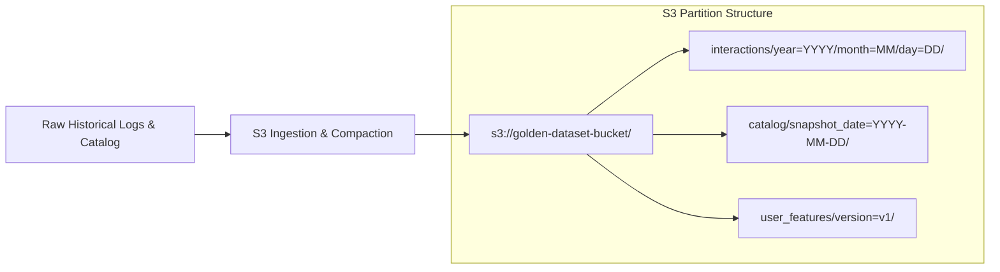

### 9. AWS Services Used
- Amazon S3 (Standard for active partitions, Intelligent-Tiering / Glacier for cold history).
- AWS KMS (Customer Managed Key for server-side encryption).

### 10. Data Inputs
- Raw interaction event logs (JSON/CSV) from e-commerce telemetry.
- Product catalog snapshots from core catalog databases.

### 11. Data Outputs
- Snappy-compressed Parquet datasets organized into Hive-compliant partition paths.

### 12. Data Contracts
- Schema:
  - `interactions`: `event_id: string`, `user_id: string`, `item_id: string`, `event_type: string`, `timestamp: bigint`, `context: string`.
  - `catalog`: `item_id: string`, `title: string`, `category_id: string`, `brand: string`, `price_cents: int`, `in_stock: boolean`, `attributes_json: string`.

### 13. API Contracts
- Not applicable (S3 Object Storage interface / AWS SDK).

### 14. Security Requirements
- Server-Side Encryption with KMS (SSE-KMS) enforced via bucket policy.
- S3 Block Public Access enabled unconditionally across the account and bucket.
- TLS 1.3 enforced for all transport requests (`aws:SecureTransport: true`).

### 15. IAM Considerations
- Least privilege bucket policies granting read access only to Lake Formation, Glue execution roles, and Athena service principal.

### 16. Networking Considerations
- S3 Gateway VPC Endpoint enabled in the VPC route tables to avoid NAT Gateway data egress charges.

### 17. Scalability Design
- Hive-style date partitioning distributes object keys evenly across S3 internal prefixes, preventing prefix-level throttling (3,500 PUT/5,500 GET per second per prefix).

### 18. Resiliency Design
- S3 Cross-AZ replication enabled by default in Standard storage.
- S3 Object Versioning enabled to protect against accidental deletions.

### 19. Cost Optimization Decisions
- **S3 Intelligent-Tiering**: Applied to historical interaction partitions older than 30 days.
- **Lifecycle Expiration**: Scratch and temporary ETL folders automatically purged after 7 days.
- **VPC Gateway Endpoint**: Direct internal routing eliminates NAT data transfer costs.

### 20. MVP Configuration
- S3 Standard bucket in primary region (`us-east-1`).
- Initial dataset size ~50 GB.
- Lifecycle rule: delete temp files after 7 days.

### 21. Production Configuration
- S3 Standard + Intelligent Tiering.
- Multi-terabyte scaling with Cross-Region Replication (CRR) for disaster recovery.

### 22. Monitoring Requirements
- S3 Storage Lens enabled for cost, usage, and security posture monitoring.

### 23. Logging Requirements
- S3 Server Access Logging sent to a centralized logging bucket.
- AWS CloudTrail data events logged for sensitive data prefix access.

### 24. Metrics
- `BucketSizeBytes`, `NumberOfObjects`, `4xxErrors`, `5xxErrors`.

### 25. Alarms
- CloudWatch Alarm on unencrypted object PUT attempts or unauthorized 403 access spikes.

### 26. Dependencies
- AWS KMS Key creation and account-level S3 Public Access Block.

### 27. Risks
- Uncompacted small files (the "small file problem") causing query degradation in Athena and Glue.  
  *Mitigation*: Automated compaction job targets 128 MB-512 MB file sizes.

### 28. Trade-Offs
- Parquet format requires schema definition upfront, trading ad-hoc schema mutability for 10x query speed and 75% storage savings.

### 29. Acceptance Criteria
- Bucket exists with SSE-KMS, Block Public Access, and TLS 1.2+ mandatory policies.
- Validated Parquet datasets readable by Athena and Glue without schema errors.

### 30. Open Questions
- None. Bucket architecture and prefix hierarchy are completely defined.

### 31. Future Enhancements
- Integration with Apache Iceberg tables for ACID transactions and row-level deletes.

### 32. Out of Scope
- Real-time streaming ingestion into S3 (managed via existing event bus; S3 stores landed batches).

---

## Feature 1.2 – Data Lake Governance

### 1. Executive Summary
Feature 1.2 implements AWS Lake Formation to enforce fine-grained access governance, centralize cataloging via AWS Glue Data Catalog, and provide column-level security across the S3 Golden Datasets.

### 2. Business Objective
Guarantee strict data privacy, prevent unauthorized access to sensitive customer attributes, and provide auditable data sharing across ML and analytics workloads.

### 3. Problem Statement
Direct S3 bucket policies only provide coarse bucket- or prefix-level access. Multiple consumers (Glue, Athena, SageMaker) require distinct column permissions without duplicating datasets into separate silos.

### 4. Assumptions
- AWS Lake Formation acts as the central authorization layer for Athena and Glue.
- Data Lake Administrators configure permissions via IAM principals and Lake Formation tags (LF-Tags).

### 5. Existing Assets Reused
- Governs the existing S3 Golden Dataset bucket defined in Feature 1.1.
- Reuses existing Glue Data Catalog databases.

### 6. Functional Requirements
- **FR-1.2.1**: Lake Formation MUST register `s3://<prefix>-golden-dataset/` as a managed data lake location.
- **FR-1.2.2**: Lake Formation MUST manage database and table permissions using LF-Tags (`Environment: PoC/Prod`, `Sensitivity: Public/Internal/Restricted`).
- **FR-1.2.3**: Lake Formation MUST grant SageMaker and Glue execution roles read-only column-level access to non-PII features while masking customer identifying attributes.

### 7. Non-Functional Requirements
- **NFR-1.2.1**: Permission verification overhead MUST add less than 5ms to query planning.
- **NFR-1.2.2**: 100% of data access attempts must be logged in AWS CloudTrail.

### 8. Architecture Design
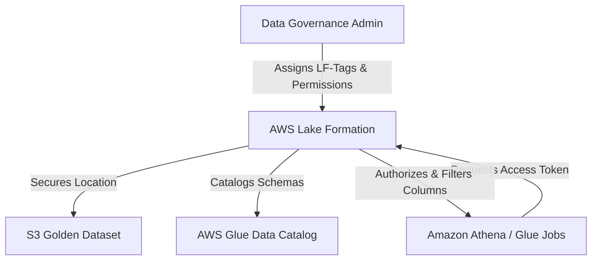

### 9. AWS Services Used
- AWS Lake Formation.
- AWS Glue Data Catalog.
- AWS IAM.

### 10. Data Inputs
- S3 bucket location paths and Glue catalog database definitions.

### 11. Data Outputs
- Governed Glue Data Catalog metadata and column access filters.

### 12. Data Contracts
- LF-Tag Taxonomy:
  - `Confidentiality`: `Public` | `Internal` | `Restricted`
  - `Domain`: `Interactions` | `Catalog` | `Recommendations`

### 13. API Contracts
- AWS Lake Formation SDK / CLI (`lakeformation:GrantPermissions`, `lakeformation:GetDataAccess`).

### 14. Security Requirements
- All default IAM `IAMAllowedPrincipals` permissions on S3 locations removed upon registration.
- Column-level filtering hides sensitive user identifiers (`email`, `ip_address`) from ML training roles.

### 15. IAM Considerations
- Lake Formation Admin role granted to DevOps / Platform Engineer.
- Service roles for Glue and Athena configured with `lakeformation:GetDataAccess`.

### 16. Networking Considerations
- Operates via AWS Control Plane within the secure AWS backbone.

### 17. Scalability Design
- LF-Tag based access control (TBAC) allows scaling to hundreds of tables without hitting individual permission policy size limits.

### 18. Resiliency Design
- Native AWS managed service with multi-AZ metadata replication.

### 19. Cost Optimization Decisions
- **Zero Additional Service Surcharge**: AWS Lake Formation does not charge extra beyond underlying S3 and Glue Catalog usage.
- **Eliminates Data Duplication**: Column-level filtering avoids creating separate "sanitized" S3 copies.

### 20. MVP Configuration
- Single Data Lake Admin IAM role.
- 1 database (`ecommerce_golden_db`) with 3 tables (`catalog`, `interactions`, `user_features`).
- Direct tag-based grants to Athena and Glue roles.

### 21. Production Configuration
- Multi-account governance via AWS RAM (Resource Access Manager) sharing cross-account catalogs.

### 22. Monitoring Requirements
- Lake Formation audit logs reviewed in CloudTrail.

### 23. Logging Requirements
- CloudTrail events for all `GrantPermissions`, `RevokePermissions`, and data access grants.

### 24. Metrics
- CloudTrail event count: `LakeFormationDataAccessCount`, `UnauthorizedAccessAttempts`.

### 25. Alarms
- Alert on any `AccessDenied` error from Lake Formation in CloudTrail.

### 26. Dependencies
- Feature 1.1 (S3 Golden Dataset).

### 27. Risks
- Misconfigured permissions blocking Athena queries.  
  *Mitigation*: Automated Terraform tests verify read access for pipeline roles.

### 28. Trade-Offs
- Requires transitioning away from direct S3 IAM policies to Lake Formation permissions.

### 29. Acceptance Criteria
- Glue tables cataloged under Lake Formation.
- Athena query using ML role verifies restricted columns are omitted or masked.

### 30. Open Questions
- None.

### 31. Future Enhancements
- Automated sensitive data discovery using Lake Formation pattern matching.

### 32. Out of Scope
- Cross-region data lake federation.

---

# Epic 2 – Batch Recommendation Pipeline

## Feature 2.1 – Workflow Orchestration

### 1. Executive Summary
Feature 2.1 implements automated workflow orchestration using Amazon MWAA (Apache Airflow) to schedule, sequence, monitor, and retry all offline batch recommendation pipeline tasks.

### 2. Business Objective
Ensure reliable, scheduled, and dependency-ordered execution of data preparation, model training, candidate generation, and index publishing with zero manual intervention.

### 3. Problem Statement
The offline recommendation pipeline involves interdependent steps spanning Athena, Glue, and SageMaker. Failures in one step must halt downstream publishing, trigger notifications, and support idempotent re-runs.

### 4. Assumptions
- Pipeline runs on a daily cadence during off-peak hours (e.g., 02:00 UTC).
- Airflow DAGs are version-controlled in Git and synchronized to the MWAA S3 DAG folder.

### 5. Existing Assets Reused
- Existing historical interaction partitions in S3.
- Existing Glue jobs and SageMaker training scripts.

### 6. Functional Requirements
- **FR-2.1.1**: MWAA MUST execute the primary DAG `daily_hybrid_recommendation_pipeline` on a daily cron schedule (`0 2 * * *`).
- **FR-2.1.2**: DAG MUST sequence tasks: `Verify_Data_Arrival` → `Athena_Extraction` → `Glue_Feature_Engineering` → `SageMaker_Training` → `Glue_Publish_DynamoDB` & `Publish_MemoryDB_Vectors`.
- **FR-2.1.3**: Failed tasks MUST automatically retry up to 2 times with exponential backoff before sending an SNS failure alert.

### 7. Non-Functional Requirements
- **NFR-2.1.1**: MWAA environment MUST maintain 99.9% scheduling availability.
- **NFR-2.1.2**: Task state transitions MUST execute within 30 seconds of upstream completion.

### 8. Architecture Design
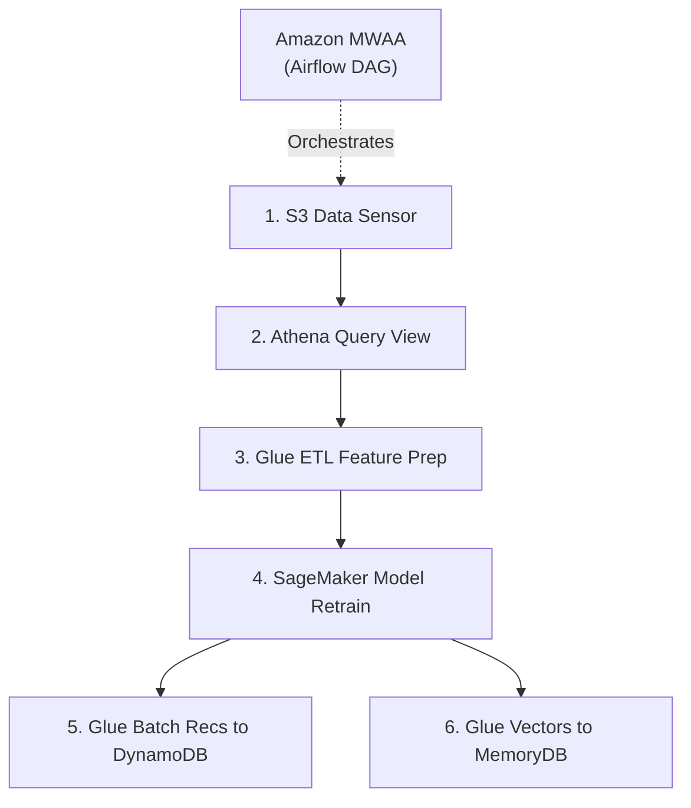

### 9. AWS Services Used
- Amazon Managed Workflows for Apache Airflow (MWAA).
- Amazon SNS (Pipeline alerting).
- Amazon S3 (DAGs and plugins storage).

### 10. Data Inputs
- DAG definition scripts and task parameters stored in `s3://<prefix>-mwaa-dags/`.

### 11. Data Outputs
- Task execution metadata stored in MWAA backend; SNS execution status notifications.

### 12. Data Contracts
- Airflow `DagRun` execution schema; task status payloads (`success`, `failed`, `upstream_failed`).

### 13. API Contracts
- Airflow REST API / AWS CLI MWAA trigger endpoints.

### 14. Security Requirements
- MWAA Web Server access restricted via IAM authentication and VPC Private Network mode.
- Worker IAM role restricted to trigger specific Glue, Athena, and SageMaker jobs.

### 15. IAM Considerations
- `MWAAExecutionRole` with scoped permissions: `glue:StartJobRun`, `sagemaker:CreateTrainingJob`, `athena:StartQueryExecution`.

### 16. Networking Considerations
- MWAA deployed in private VPC subnets with AWS VPC Endpoints for S3, Glue, SageMaker, and CloudWatch.

### 17. Scalability Design
- MWAA auto-scaling workers configured to scale out from 1 to 2 workers only when queue load increases.

### 18. Resiliency Design
- Airflow task state persisted in AWS-managed multi-AZ PostgreSQL backend.

### 19. Cost Optimization Decisions
- **Cost Reality**: MWAA represents 71.2% ($447.90/month) of the total 24/7 PoC infrastructure cost because even an `mw1.small` environment runs the underlying Apache Airflow web server and scheduler 24/7 (~$0.49/hour base).
- **Ephemeral Infrastructure Lifecycle (Primary PoC Strategy)**: Parameterize MWAA in Terraform to create only during active integration/verification runs and destroy immediately after, reducing monthly spend from $447.90 to under $15-$30/month for testing windows.
- **Worker Auto-Scaling Limit**: Set `min_workers = 1`, `max_workers = 2` with short autoscaling cooldowns to prevent runaway worker billing during batch spikes.
- **Scheduled vs Continuous**: DAGs execute strictly once daily or on-demand; zero continuous polling DAGs.
- **MWAA Serverless / Scheduled Startup**: Automate MWAA environment pausing/creation via AWS CLI or Terraform during off-hours to eliminate idle 24/7 scheduler charges.

### 20. MVP Configuration
- `mw1.small`, Private Network access, 1 min worker, 2 max workers, ephemeral lifecycle parameterization.

### 21. Production Configuration
- `mw1.medium`, multi-AZ private subnets, integration with corporate PagerDuty via SNS, 24/7 dedicated availability.

### 22. Monitoring Requirements
- MWAA environment health status in AWS CloudWatch.

### 23. Logging Requirements
- DAG processing logs, Task instance logs, and Webserver logs routed to CloudWatch Log Groups with 14-day expiration.

### 24. Metrics
- `QueuedTasks`, `RunningTasks`, `TaskInstanceFailures`, `ClusterHeartbeat`.

### 25. Alarms
- CloudWatch Alarm on `TaskInstanceFailures > 0` triggers SNS notification to engineering on-call.

### 26. Dependencies
- Features 1.1, 1.2, 2.2, 2.3, 2.4, 2.6, 2.8.

### 27. Risks
- Airflow dependency version conflicts in `requirements.txt`.  
  *Mitigation*: Pre-bake and validate wheels in test pipeline before deploying to S3.

### 28. Trade-Offs
- **MWAA vs AWS Step Functions**: MWAA is fixed in the approved architecture and provides superior open-source portability and native Airflow operator ecosystem, but incurs a ~$447.90/mo base cost if run 24/7. In contrast, AWS Step Functions + EventBridge Scheduler would cost <$2/month for daily runs. The platform reconciles this via ephemeral Terraform lifecycle management without changing the approved architecture.

### 29. Acceptance Criteria
- Primary DAG triggers automatically on schedule, runs all steps to completion, and logs status to CloudWatch.

### 30. Open Questions
- None.

### 31. Future Enhancements
- Event-driven DAG execution triggered via S3 EventBridge notifications on new dataset landing.

### 32. Out of Scope
- Ad-hoc workflow creation by external business users.

---

## Feature 2.2 – Dataset Query Layer

### 1. Executive Summary
Feature 2.2 configures Amazon Athena as a serverless query engine to perform analytical exploration, dataset validation, and create materialized feature views from S3 Golden Datasets without managing infrastructure.

### 2. Business Objective
Provide an instant, zero-maintenance SQL interface to extract training subsets, validate data completeness, and supply curated query views for feature engineering.

### 3. Problem Statement
Running dedicated analytics clusters (like EMR/Spark) 24/7 for intermittent data extraction is prohibitively expensive. Teams need on-demand SQL capability that scales down to zero cost when idle.

### 4. Assumptions
- All queries target partitioned Parquet datasets registered in the Glue Data Catalog.
- Queries always apply partition filters (`year`, `month`, `day`).

### 5. Existing Assets Reused
- Existing Glue Data Catalog tables (`interactions`, `catalog`).
- Existing Parquet files in S3 Golden Dataset.

### 6. Functional Requirements
- **FR-2.2.1**: Athena MUST execute scheduled and ad-hoc analytical queries using Athena engine version 3.
- **FR-2.2.2**: Athena Workgroup `wg-recommendations` MUST enforce query result location in `s3://<prefix>-athena-results/` with a 7-day expiration lifecycle.
- **FR-2.2.3**: Athena queries MUST utilize partition pruning to restrict data scanning strictly to the required time windows.

### 7. Non-Functional Requirements
- **NFR-2.2.1**: Analytical queries scanning < 10 GB MUST complete within 15 seconds.
- **NFR-2.2.2**: Unpartitioned full-table scans MUST be blocked by query guardrails.

### 8. Architecture Design
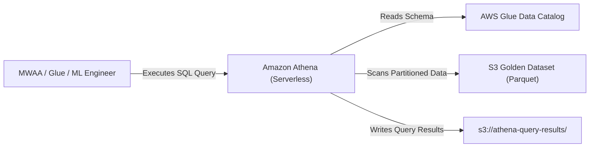

### 9. AWS Services Used
- Amazon Athena (Serverless Query Engine).
- AWS Glue Data Catalog.
- Amazon S3.

### 10. Data Inputs
- SQL queries submitted by MWAA or engineers.
- Parquet tables in S3 Golden Dataset.

### 11. Data Outputs
- Query result sets (CSV/Parquet) written to S3 query result bucket.

### 12. Data Contracts
- Schema-on-read determined by Glue Data Catalog tables. Output schemas match SQL projection.

### 13. API Contracts
- Athena JDBC/ODBC and AWS SDK (`athena:StartQueryExecution`, `athena:GetQueryResults`).

### 14. Security Requirements
- Athena Workgroup enforces client-side result encryption with KMS.
- Query results bucket protected by strict IAM policies.

### 15. IAM Considerations
- IAM roles granted `athena:StartQueryExecution`, `glue:GetTable`, and scoped S3 read access.

### 16. Networking Considerations
- Athena communicates natively with S3 via AWS internal network; results bucket accessed via S3 VPC Endpoint.

### 17. Scalability Design
- Serverless execution scales query processing automatically up to service concurrency quotas.

### 18. Resiliency Design
- Fully managed multi-AZ serverless execution with automatic retry on transient internal errors.

### 19. Cost Optimization Decisions
- **Parquet + Snappy**: Columnar pruning reduces data scanned by up to 90% compared to raw JSON.
- **Athena Workgroup Per-Query Data Limit**: Cap maximum scanned bytes per query (e.g., 50 GB) to prevent accidental runaway queries.
- **Result Expiration**: S3 Lifecycle rule purges query results after 7 days.

### 20. MVP Configuration
- Single dedicated workgroup `recommendations_poc` with 10 GB scan limit per query.

### 21. Production Configuration
- Separate workgroups for automated pipelines and interactive analyst queries with customized scan limits.

### 22. Monitoring Requirements
- Athena query metrics monitored via CloudWatch.

### 23. Logging Requirements
- Query execution history and error logs maintained in Athena console and CloudWatch.

### 24. Metrics
- `DataScannedInBytes`, `TotalExecutionTime`, `EngineExecutionTime`.

### 25. Alarms
- CloudWatch Alarm if daily scanned bytes exceed 100 GB in the PoC workgroup.

### 26. Dependencies
- Features 1.1 (S3), 1.2 (Lake Formation / Catalog).

### 27. Risks
- Large unpartitioned scans inflating costs.  
  *Mitigation*: Workgroup byte scan caps and mandatory partition keys in view definitions.

### 28. Trade-Offs
- Pay-per-query model is cheaper for batch/ad-hoc usage than dedicated EMR, but less cost-effective for continuous 24/7 stream querying.

### 29. Acceptance Criteria
- Partitioned query against 30-day interaction window scans < 2 GB and returns valid results in < 10 seconds.

### 30. Open Questions
- None.

### 31. Future Enhancements
- Integration with Athena Query Federation for external metadata sources if required.

### 32. Out of Scope
- Serving real-time customer-facing queries directly from Athena.


---

## Feature 2.3 – Feature Engineering Pipeline

### 1. Executive Summary
Feature 2.3 implements a serverless Apache Spark ETL job using AWS Glue to cleanse, aggregate, and transform raw interaction events and catalog metadata into ML-ready training datasets and feature tables.

### 2. Business Objective
Automate the extraction of user behavioral features (interaction counts, category affinities, recency scores) and item features for collaborative filtering and neural ranking models.

### 3. Problem Statement
Raw telemetry contains noise, bot traffic, missing attributes, and unaggregated logs that cannot be directly fed to SageMaker. An elastic, incremental ETL process is required to prepare clean features.

### 4. Assumptions
- Feature engineering runs incrementally on newly arrived daily interaction partitions.
- Glue Job Bookmarks are utilized to track state and process only delta records.

### 5. Existing Assets Reused
- Existing interaction tables in S3 Golden Dataset.
- Existing catalog metadata in Glue Data Catalog.
- Existing user demographic attributes. No redundant feature stores created.

### 6. Functional Requirements
- **FR-2.3.1**: Glue job `etl-recommendation-feature-engineering` MUST execute using Glue 4.0 runtime (Python 3 / Spark 3.3).
- **FR-2.3.2**: Job MUST compute user-item interaction matrices, weighted interaction scores (purchase=5.0, cart=3.0, click=1.0), and item co-occurrence counts.
- **FR-2.3.3**: Job MUST output normalized training records to `s3://<prefix>-golden-dataset/features/training/` in Parquet format.

### 7. Non-Functional Requirements
- **NFR-2.3.1**: Incremental daily feature generation MUST complete in less than 45 minutes.
- **NFR-2.3.2**: Job memory usage per worker must remain below 80% to avoid Out-Of-Memory (OOM) failures.

### 8. Architecture Design
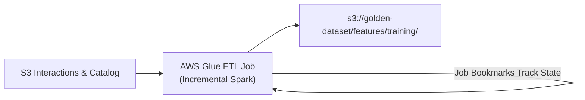

### 9. AWS Services Used
- AWS Glue (Spark ETL Job).
- Amazon S3.
- AWS Glue Data Catalog.

### 10. Data Inputs
- Incremental interaction partitions and product catalog snapshots.

### 11. Data Outputs
- Parquet feature tables: `user_features`, `item_features`, `interaction_matrix`.

### 12. Data Contracts
- Schema:
  - `user_id: string`, `item_id: string`, `interaction_weight: float`, `interaction_count: int`, `last_interacted_ts: bigint`.

### 13. API Contracts
- AWS Glue SDK (`glue:StartJobRun`, `glue:GetJobRun`).

### 14. Security Requirements
- Job executes under dedicated IAM service role with scoped S3 and Glue permissions.
- Temporary shuffle files encrypted at rest via AWS Glue security configuration.

### 15. IAM Considerations
- `GlueServiceRole` with read access to source prefixes and write access strictly to feature output prefix.

### 16. Networking Considerations
- Job executes within private VPC subnets with S3 Gateway Endpoint.

### 17. Scalability Design
- Spark partitions dynamically distributed based on data volume; partition size targeted at 128 MB.

### 18. Resiliency Design
- Glue job configured with automatic retries (`max_retries = 1`) and timeout set to 60 minutes.

### 19. Cost Optimization Decisions
- **Worker Sizing**: Use `G.1X` workers (4 vCPU, 16 GB RAM).
- **Minimal DPUs**: Allocate only 2 DPUs for PoC/MVP (1 driver, 1 executor).
- **Job Bookmarks**: Enforces processing only new S3 objects, avoiding costly full reloads.
- **Auto-Scaling**: Set `max_capacity = 4` DPUs to scale only during traffic surges.

### 20. MVP Configuration
- 2 DPUs, `G.1X`, Python 3.10, Spark 3.3, Job Bookmark enabled.

### 21. Production Configuration
- 10 DPUs with dynamic auto-scaling up to 30 DPUs for large catalog seasons (e.g., Prime Day).

### 22. Monitoring Requirements
- AWS Glue CloudWatch metrics (job duration, memory profile, CPU load).

### 23. Logging Requirements
- Standard and error logs written to `/aws-glue/jobs/output` and `/aws-glue/jobs/error` in CloudWatch.

### 24. Metrics
- `glue.driver.aggregate.memoryPercentage`, `glue.executor.aggregate.cpuTime`, `glue.ALL.numCompletedTasks`.

### 25. Alarms
- CloudWatch Alarm if Glue Job state changes to `FAILED` or `TIMEOUT`.

### 26. Dependencies
- Features 1.1, 1.2, 2.2.

### 27. Risks
- Data skew on popular items ("Harry Potter effect") causing Spark partition stragglers.  
  *Mitigation*: Salted keys applied to high-frequency items during aggregations.

### 28. Trade-Offs
- AWS Glue startup latency (~1-2 minutes) is acceptable for scheduled batch processing versus keeping an EMR cluster hot.

### 29. Acceptance Criteria
- Glue job executes, reads delta records, and outputs validated Parquet files to the feature prefix without errors.

### 30. Open Questions
- None.

### 31. Future Enhancements
- Glue Streaming ETL for continuous near-real-time feature updates if batch SLA tightens.

### 32. Out of Scope
- Direct real-time feature transformation during API request serving.

---

## Feature 2.4 – Recommendation Model Training

### 1. Executive Summary
Feature 2.4 manages offline recommendation model training using Amazon SageMaker, training matrix factorization and ranking algorithms on curated feature sets with automated model artifact versioning in S3.

### 2. Business Objective
Produce highly accurate collaborative filtering and contextual ranking model weights to drive personalization, continually refreshed with recent user interactions.

### 3. Problem Statement
Training complex recommendation models on large interaction datasets requires significant compute power. Without strict instance management and spot scheduling, training costs become unmanageable.

### 4. Assumptions
- Model training runs on a scheduled weekly or bi-weekly cadence (or on significant interaction drift).
- SageMaker training uses Docker containers with automated checkpointing.

### 5. Existing Assets Reused
- Reuses feature datasets in `s3://golden-dataset/features/training/` prepared by Glue in Feature 2.3.
- Reuses existing model baseline hyperparameter configs.

### 6. Functional Requirements
- **FR-2.4.1**: SageMaker training job MUST ingest training Parquet datasets directly from S3 using Pipe Mode or FastFile mode.
- **FR-2.4.2**: Training job MUST train a collaborative filtering/two-tower model and evaluate against validation holdout data, computing NDCG@10, HitRate@10, and MAP.
- **FR-2.4.3**: Model artifacts (`model.tar.gz`) MUST be registered in the SageMaker Model Registry with performance metrics and evaluation lineage.

### 7. Non-Functional Requirements
- **NFR-2.4.1**: Model training on MVP dataset (~10M interactions) MUST complete in under 2 hours.
- **NFR-2.4.2**: Checkpoints MUST be written to S3 every 15 minutes to guarantee resumption on spot interruption.

### 8. Architecture Design
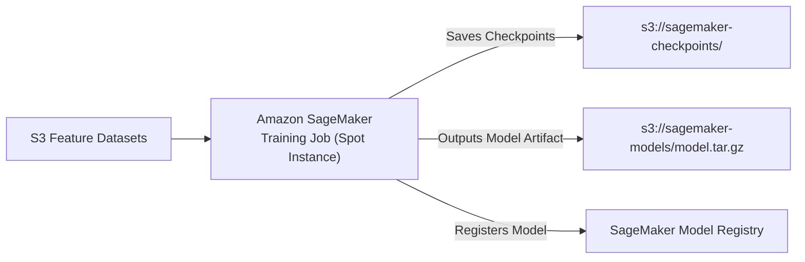

### 9. AWS Services Used
- Amazon SageMaker Training (Managed Training Cluster).
- Amazon S3.
- AWS KMS.

### 10. Data Inputs
- Training feature tables and validation splits from S3 Golden Dataset.

### 11. Data Outputs
- Trained model weights (`model.tar.gz`) in S3; model package registered in Model Registry.

### 12. Data Contracts
- Model evaluation JSON payload: `{ "ndcg_10": float, "hit_rate_10": float, "map": float, "loss": float }`.

### 13. API Contracts
- SageMaker SDK / Boto3 (`sagemaker:CreateTrainingJob`, `sagemaker:CreateModelPackage`).

### 14. Security Requirements
- Training containers execute in private VPC subnets with no public internet access.
- S3 inputs and model artifacts encrypted with Customer Managed KMS key.

### 15. IAM Considerations
- `SageMakerExecutionRole` granted read access to training S3 bucket and write access to model artifact bucket.

### 16. Networking Considerations
- SageMaker VPC configuration connects training instances to VPC subnets via S3 VPC Endpoint.

### 17. Scalability Design
- Distributed data parallel training supported across multiple GPU/CPU nodes as data scales.

### 18. Resiliency Design
- Spot instance interruptions handled transparently via automated checkpoint reloading from S3.

### 19. Cost Optimization Decisions
- **Managed Spot Training**: `EnableManagedSpotTraining = true` achieves up to 70% cost reduction over On-Demand.
- **Small Compute Sizing**: Use `ml.m5.xlarge` (CPU) or `ml.g4dn.xlarge` (single GPU) for MVP; avoid oversized P3/P4 clusters.
- **MaxWaitTimeInSeconds**: Strict training job timeout (e.g., 7,200 seconds) prevents stalled jobs from billing indefinitely.

### 20. MVP Configuration
- 1x `ml.m5.xlarge` Managed Spot Instance, FastFile input mode, 2-hour max run time.

### 21. Production Configuration
- 2x `ml.g4dn.2xlarge` Spot Instances with distributed data parallelism.

### 22. Monitoring Requirements
- Real-time CPU, GPU, memory, and loss curve metrics emitted to CloudWatch.

### 23. Logging Requirements
- Training algorithm stdout and stderr captured in `/aws/sagemaker/TrainingJobs`.

### 24. Metrics
- `TrainingLoss`, `ValidationNDCG`, `CPUMemoryUtilization`, `GPUMemoryUtilization`.

### 25. Alarms
- CloudWatch Alarm on training job status = `Failed`.

### 26. Dependencies
- Features 1.1, 2.3.

### 27. Risks
- Spot instance termination during training.  
  *Mitigation*: Checkpointing every 15 minutes ensures training resumes seamlessly from last epoch.

### 28. Trade-Offs
- Spot training introduces potential queue wait times (minutes), which is completely acceptable for offline batch models.

### 29. Acceptance Criteria
- SageMaker training completes, outputs valid `model.tar.gz` to S3, and registers package in Model Registry with NDCG@10 >= 0.15.

### 30. Open Questions
- None.

### 31. Future Enhancements
- Automated hyperparameter tuning (HPO) jobs using SageMaker Hyperband.

### 32. Out of Scope
- Online continuous real-time model retraining.

---

## Feature 2.5 – Batch Recommendation Generation

### 1. Executive Summary
Feature 2.5 executes scalable offline batch scoring across the entire user base using SageMaker Batch Transform or high-throughput batch scoring scripts to generate Top-50 candidate recommendation lists per user.

### 2. Business Objective
Precompute high-confidence recommendations offline so that user profiles can be instantly retrieved at runtime with minimal latency and zero online ML inference overhead.

### 3. Problem Statement
Scoring millions of user-item pairs in real-time at the moment of request is computationally impractical and introduces unacceptable latency (>500ms). Precomputing candidates offline decouples scoring throughput from request latency.

### 4. Assumptions
- Batch recommendations are refreshed daily for active users (users who interacted within the last 90 days).
- Inactive users rely on cold-start trending fallback.

### 5. Existing Assets Reused
- Reuses trained model artifact from Feature 2.4.
- Reuses user feature tables from Feature 2.3.

### 6. Functional Requirements
- **FR-2.5.1**: Batch inference job MUST compute Top-50 candidate product IDs with predicted affinity scores for all active users.
- **FR-2.5.2**: Output format MUST be structured as partitioned Parquet records containing `userId`, `generatedAt`, and array of candidate objects `[{itemId, score, rank}]`.
- **FR-2.5.3**: Candidates MUST exclude items the user already purchased within the historical lookback window.

### 7. Non-Functional Requirements
- **NFR-2.5.1**: Batch generation for 100,000 active users MUST complete within 60 minutes.
- **NFR-2.5.2**: Output dataset must be validated for schema conformance before downstream publishing.

### 8. Architecture Design
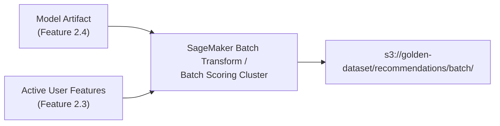

### 9. AWS Services Used
- Amazon SageMaker Batch Transform / Batch Inference.
- Amazon S3.

### 10. Data Inputs
- Trained model artifact from S3.
- Active user feature matrix.

### 11. Data Outputs
- Parquet files containing precomputed user recommendation arrays in `s3://golden-dataset/recommendations/batch/`.

### 12. Data Contracts
- Schema:
  - `user_id: string`, `generated_at: bigint`, `recommendations: array<struct<item_id:string, score:float, rank:int>>`.

### 13. API Contracts
- SageMaker SDK (`sagemaker:CreateTransformJob`).

### 14. Security Requirements
- Batch transform instances operate within VPC without external network egress.
- Intermediate inference outputs encrypted with KMS.

### 15. IAM Considerations
- Execution role restricted to read model artifact and write to recommendations S3 prefix.

### 16. Networking Considerations
- VPC Endpoint for S3 and SageMaker API.

### 17. Scalability Design
- SageMaker Batch Transform automatically shards input datasets across worker instances.

### 18. Resiliency Design
- Batch Transform automatically retries transient record errors and reports failed lines in error logs.

### 19. Cost Optimization Decisions
- **Target Active Users Only**: Exclude dormant users (>90 days inactive), reducing batch inference volume by up to 60%.
- **Spot Instances for Batch Transform**: Utilize cost-effective compute instances (`ml.c5.xlarge`).
- **Batch Sharding**: Right-size split type to `Line` or `RecordIO` to distribute workload evenly without idle instances.

### 20. MVP Configuration
- 1x `ml.c5.xlarge` instance, batch processing ~100k users.

### 21. Production Configuration
- Auto-scaling cluster of 4x `ml.c5.2xlarge` instances processing millions of users.

### 22. Monitoring Requirements
- CloudWatch metrics tracking transform job progress and instance utilization.

### 23. Logging Requirements
- Logs captured in CloudWatch Log Group `/aws/sagemaker/TransformJobs`.

### 24. Metrics
- `BatchTransformDuration`, `RecordsProcessed`, `TransformFailureCount`.

### 25. Alarms
- CloudWatch Alarm if batch transform job fails.

### 26. Dependencies
- Features 2.3, 2.4.

### 27. Risks
- Data explosion if too many candidates per user are precomputed.  
  *Mitigation*: Strict Top-50 cutoff per user.

### 28. Trade-Offs
- Precomputing recommendations means recommendations do not reflect intraday interactions until next batch cycle; addressed by real-time layer.

### 29. Acceptance Criteria
- Batch job completes, generating Top-50 recommendations for all active users in S3 with valid scores.

### 30. Open Questions
- None.

### 31. Future Enhancements
- Multi-objective batch scoring combining relevance with profit margin weighting.

### 32. Out of Scope
- Writing directly to DynamoDB (handled by Feature 2.6).

---

## Feature 2.6 – Batch Recommendation Publishing

### 1. Executive Summary
Feature 2.6 implements an incremental publishing job using AWS Glue to ingest precomputed batch recommendation Parquet files from S3 and publish them directly into Amazon DynamoDB with optimized partition keys and automatic TTL.

### 2. Business Objective
Deliver sub-10ms point-lookup retrieval for user batch recommendations at runtime by synchronizing S3 artifacts into Amazon DynamoDB.

### 3. Problem Statement
Writing millions of records to DynamoDB during batch processing can cause write throttling, excessive capacity consumption, and stale records if old recommendations are not expired.

### 4. Assumptions
- DynamoDB table `user_recommendations` is provisioned with `userId` as the Partition Key.
- TTL attribute `ttlTimestamp` is set to 7 days from generation.

### 5. Existing Assets Reused
- Ingests batch recommendation Parquet datasets produced in Feature 2.5.
- Reuses DynamoDB table definition.

### 6. Functional Requirements
- **FR-2.6.1**: Glue job `publish-batch-recommendations-dynamodb` MUST read precomputed recommendations from S3.
- **FR-2.6.2**: Job MUST transform records into DynamoDB item format: `{ "userId": string, "generatedAt": number, "recommendations": list, "ttlTimestamp": number }`.
- **FR-2.6.3**: Job MUST batch-write items to DynamoDB using exponential backoff and retry handling for throttled writes.

### 7. Non-Functional Requirements
- **NFR-2.6.1**: Publishing 100,000 user profiles MUST complete within 20 minutes.
- **NFR-2.6.2**: Error rate during write MUST be 0% after retries.

### 8. Architecture Design
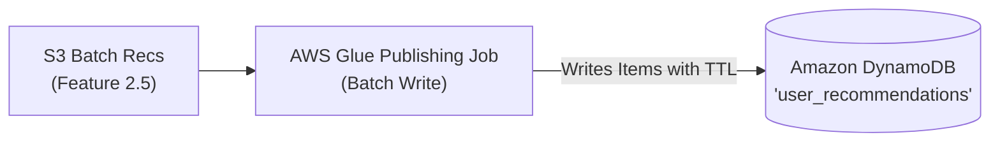

### 9. AWS Services Used
- AWS Glue.
- Amazon DynamoDB.
- Amazon S3.

### 10. Data Inputs
- Parquet batch recommendation files from S3.

### 11. Data Outputs
- DynamoDB items populated in `user_recommendations` table.

### 12. Data Contracts
- DynamoDB Item Schema:
  - `userId` (PK, String): User identifier.
  - `generatedAt` (Number): Epoch timestamp (seconds).
  - `recommendations` (List of Maps): `[{ "itemId": "SKU-1", "score": 0.88, "rank": 1 }]`.
  - `ttlTimestamp` (Number): Epoch timestamp for automatic DynamoDB item expiration.

### 13. API Contracts
- DynamoDB `BatchWriteItem` / `PutItem` via AWS SDK.

### 14. Security Requirements
- DynamoDB table encrypted with KMS Customer Managed Key.
- Point-In-Time Recovery (PITR) enabled.

### 15. IAM Considerations
- Glue IAM execution role granted `dynamodb:BatchWriteItem`, `dynamodb:PutItem`, and `dynamodb:DescribeTable`.

### 16. Networking Considerations
- DynamoDB Gateway VPC Endpoint utilized to prevent internet/NAT data egress charges.

### 17. Scalability Design
- Direct write parallelism configured to match DynamoDB On-Demand capacity without causing partition throttles.

### 18. Resiliency Design
- Unprocessed items in `BatchWriteItem` retried using truncated binary exponential backoff.

### 19. Cost Optimization Decisions
- **DynamoDB On-Demand Mode**: `PAY_PER_REQUEST` billing selected for MVP/PoC to incur zero charges during idle periods between batch publishes.
- **Compact List Storage**: Recommendations stored as a compact JSON/Map array in a single item rather than multiple items per user, reducing write request units by 90%.
- **DynamoDB TTL**: Automatic expiration removes stale items at zero additional cost, avoiding manual scan-and-delete operations.

### 20. MVP Configuration
- DynamoDB On-Demand table, Glue job with 2 `G.1X` DPUs, 7-day TTL.

### 21. Production Configuration
- Provisioned capacity with Auto Scaling if daily volume exceeds 50M writes, switching back to On-Demand during off-hours.

### 22. Monitoring Requirements
- DynamoDB CloudWatch metrics (throttled write requests, consumed write units).

### 23. Logging Requirements
- Glue job execution logs in CloudWatch.

### 24. Metrics
- `ConsumedWriteCapacityUnits`, `WriteThrottleEvents`, `SystemErrors`.

### 25. Alarms
- CloudWatch Alarm on `WriteThrottleEvents > 10` or Glue job failure.

### 26. Dependencies
- Features 1.1, 2.5.

### 27. Risks
- Throttling during massive batch writes if concurrency is too high.  
  *Mitigation*: Controlled executor count and adaptive backoff in Glue Spark connector.

### 28. Trade-Offs
- Overwriting entire user recommendation item rather than incremental patch; acceptable because batch recommendations represent complete snapshot replacement.

### 29. Acceptance Criteria
- 100% of generated user recommendation profiles published to DynamoDB; verified via sample point reads.

### 30. Open Questions
- None.

### 31. Future Enhancements
- DynamoDB Streams integration to trigger downstream cache warming if needed.

### 32. Out of Scope
- Real-time user event ingestion directly into DynamoDB recommendation table.


---

## Feature 2.7 – Embedding Generation

### 1. Executive Summary
Feature 2.7 generates dense semantic vector embeddings for product catalog items (and optional user intent vectors) using pre-trained neural encoders or fine-tuned two-tower embeddings on SageMaker, storing the output in S3.

### 2. Business Objective
Enable real-time semantic retrieval of relevant products based on item similarities and unstructured user session intent (e.g., titles, categories, visual/text attributes).

### 3. Problem Statement
Collaborative filtering fails for new products (cold-start) and cannot capture semantic nuances in product descriptions. Dense embeddings bridge this gap by encoding conceptual similarity in a low-dimensional vector space.

### 4. Assumptions
- Catalog product titles, categories, and attributes are ingested from S3 Golden Dataset.
- Embeddings are generated using a 128-dimensional (or 256-dimensional) dense float array for optimal memory efficiency.

### 5. Existing Assets Reused
- Existing catalog metadata in `s3://golden-dataset/catalog/`.
- Reuses base transformer / embedding model weights.

### 6. Functional Requirements
- **FR-2.7.1**: SageMaker processing/transform job MUST generate L2-normalized 128-dimensional dense float embeddings for each catalog item.
- **FR-2.7.2**: Incremental execution MUST process only new or updated catalog items identified by timestamp metadata.
- **FR-2.7.3**: Embeddings MUST be saved to `s3://<prefix>-golden-dataset/embeddings/catalog/` in Parquet format containing `itemId`, `category`, and `embeddingVector`.

### 7. Non-Functional Requirements
- **NFR-2.7.1**: Embedding generation throughput MUST exceed 1,000 items/second per worker node.
- **NFR-2.7.2**: Vector dimensionality MUST not exceed 256 to minimize MemoryDB RAM consumption.

### 8. Architecture Design
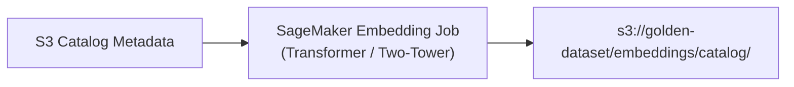

### 9. AWS Services Used
- Amazon SageMaker Processing / Transform.
- Amazon S3.

### 10. Data Inputs
- Product catalog metadata (JSON/Parquet) from S3 Golden Dataset.

### 11. Data Outputs
- Parquet dataset containing item IDs and normalized float vectors.

### 12. Data Contracts
- Schema:
  - `item_id: string`, `category: string`, `embedding: array<float>`, `version: string`, `updated_at: bigint`.

### 13. API Contracts
- SageMaker Processing API (`sagemaker:CreateProcessingJob`).

### 14. Security Requirements
- Processing instances operate in isolated VPC subnets without internet access.
- S3 inputs and outputs encrypted via KMS.

### 15. IAM Considerations
- SageMaker execution role granted read access to catalog bucket and write access to embeddings prefix.

### 16. Networking Considerations
- VPC Endpoint for S3 and SageMaker.

### 17. Scalability Design
- Data sharded across multiple processing instances using S3 key prefix distribution.

### 18. Resiliency Design
- Job automatically restarts on failure; idempotent output overwrites previous partition versions.

### 19. Cost Optimization Decisions
- **Quantization & Compact Dimensionality**: 128 dimensions chosen over 768/1536 dimensions, saving 80%+ RAM in MemoryDB.
- **Incremental Processing**: Only embed catalog deltas; skip re-embedding unchanged products.
- **Spot Instances**: Use Spot CPU instances (`ml.c5.xlarge`) for batch embedding inference.

### 20. MVP Configuration
- 1x `ml.c5.xlarge` Spot Instance, 128-dim vectors, ~50,000 catalog items.

### 21. Production Configuration
- Distributed cluster of 2x `ml.g4dn.xlarge` GPU Spot instances processing millions of catalog items.

### 22. Monitoring Requirements
- Processing job execution status and throughput tracked in CloudWatch.

### 23. Logging Requirements
- Container logs written to `/aws/sagemaker/ProcessingJobs`.

### 24. Metrics
- `ProcessingTime`, `ItemsEmbeddedCount`, `MemoryUtilization`.

### 25. Alarms
- CloudWatch Alarm on job failure or abnormal drop in processed item count.

### 26. Dependencies
- Features 1.1, 1.2.

### 27. Risks
- Model drift causing vector space misalignment between catalog items and queries.  
  *Mitigation*: Version metadata tracked in each record; synchronized re-indexing.

### 28. Trade-Offs
- 128-dim vectors have slightly lower semantic resolution than 768-dim models, but drastically lower in-memory infrastructure costs.

### 29. Acceptance Criteria
- 100% of active catalog items have valid, normalized 128-dim vectors stored in S3.

### 30. Open Questions
- None.

### 31. Future Enhancements
- Multimodal embeddings combining product images and textual descriptions.

### 32. Out of Scope
- Real-time on-the-fly embedding of arbitrary free-form text queries.

---

## Feature 2.8 – Vector Index Publishing

### 1. Executive Summary
Feature 2.8 synchronizes catalog embeddings from S3 into Amazon MemoryDB, creating and updating the HNSW vector search index to support real-time sub-10ms approximate nearest neighbor queries.

### 2. Business Objective
Maintain a high-performance in-memory vector index that enables the real-time serving layer to retrieve semantic candidates instantly.

### 3. Problem Statement
Raw vectors in S3 cannot be queried interactively. They must be ingested into an ultra-low-latency in-memory vector database configured with vector similarity index structures (HNSW).

### 4. Assumptions
- Amazon MemoryDB cluster supports Redis OSS 7.1+ with vector search capabilities.
- Index metric is Cosine Similarity or Euclidean Distance.

### 5. Existing Assets Reused
- Ingests embedding datasets in `s3://golden-dataset/embeddings/catalog/` from Feature 2.7.
- Reuses MemoryDB cluster connection parameters.

### 6. Functional Requirements
- **FR-2.8.1**: Publishing job MUST read new/updated embedding records from S3 and populate MemoryDB Redis hashes: `HSET item:<itemId> v <binary_vector> cat <category>`.
- **FR-2.8.2**: Index creation script MUST configure HNSW vector index: `FT.CREATE item_idx ON HASH PREFIX 1 item: SCHEMA v VECTOR HNSW 6 TYPE FLOAT32 DIM 128 DISTANCE_METRIC COSINE M 16 EF_CONSTRUCTION 64`.
- **FR-2.8.3**: Job MUST support upserting updated catalog vectors without dropping the active index.

### 7. Non-Functional Requirements
- **NFR-2.8.1**: Publishing 50,000 vectors MUST complete within 10 minutes.
- **NFR-2.8.2**: Vector index memory overhead MUST remain under 500 MB in MemoryDB.

### 8. Architecture Design
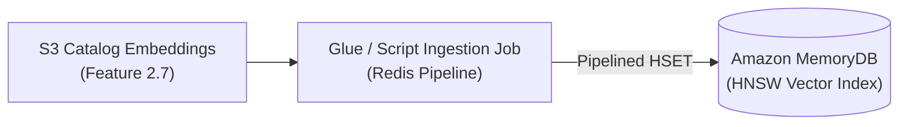

### 9. AWS Services Used
- AWS Glue / Amazon ECS Task (Ingestion script).
- Amazon MemoryDB (Redis-compatible with Vector Search).
- Amazon S3.

### 10. Data Inputs
- Parquet embedding files from S3.

### 11. Data Outputs
- In-memory Redis hashes and HNSW index in MemoryDB.

### 12. Data Contracts
- Redis Data Model:
  - Key: `item:<itemId>`
  - Hash Fields: `v` (bytes: float32[128]), `cat` (string), `ts` (integer).

### 13. API Contracts
- Redis protocol (`FT.CREATE`, `HSET`, `FT.INFO`).

### 14. Security Requirements
- MemoryDB cluster encrypted at rest via KMS and in-transit via TLS.
- Redis AUTH / ACL enabled with dedicated secret stored in AWS Secrets Manager.

### 15. IAM Considerations
- Publishing execution role granted `secretsmanager:GetSecretValue` for MemoryDB credentials.

### 16. Networking Considerations
- Glue / ECS publishing job runs inside private VPC subnets with Security Group access to MemoryDB port 6379.

### 17. Scalability Design
- Redis pipelining (`pipeline.execute()`) batches 500 keys per command to maximize network efficiency.

### 18. Resiliency Design
- Ingestion job is idempotent; re-running simply updates hash values without corrupting index state.

### 19. Cost Optimization Decisions
- **Minimal Shard Count**: 1 shard for MVP/PoC (`db.t4g.small`).
- **Quantized / Compact Vectors**: 128 dimensions reduces index memory consumption by 75%.
- **Zero Replicas for MVP**: Set replicas to 0 in PoC to halve instance costs.

### 20. MVP Configuration
- 1 shard, 0 replicas, node type `db.t4g.small`, HNSW M=16, EF_CONSTRUCTION=64.

### 21. Production Configuration
- 2 shards with 1 replica each (`db.r6g.large`), Multi-AZ enabled.

### 22. Monitoring Requirements
- MemoryDB CloudWatch metrics (used memory, CPU, engine CPU).

### 23. Logging Requirements
- Command metrics and slow logs monitored in MemoryDB.

### 24. Metrics
- `DatabaseMemoryUsagePercentage`, `EngineCPUUtilization`, `TotalCommandsProcessed`.

### 25. Alarms
- CloudWatch Alarm if `DatabaseMemoryUsagePercentage > 80%`.

### 26. Dependencies
- Features 2.7, 3.1.

### 27. Risks
- Memory exhaustion during large index build.  
  *Mitigation*: Validate total vector payload size against available RAM before starting sync.

### 28. Trade-Offs
- HNSW index requires ~1.5x raw vector size in RAM; balanced by tuning M=16 and EF_CONSTRUCTION=64.

### 29. Acceptance Criteria
- 50,000 vectors loaded; `FT.INFO item_idx` returns `num_docs = 50000` and indexing status complete.

### 30. Open Questions
- None.

### 31. Future Enhancements
- MemoryDB background snapshot export to S3 for disaster recovery.

### 32. Out of Scope
- Full-text lexical search indexing (handled by vector similarity).

---

# Epic 3 – Realtime Recommendation Infrastructure

## Feature 3.1 – Vector Search Service

### 1. Executive Summary
Feature 3.1 establishes the real-time vector retrieval capability on Amazon MemoryDB, allowing the Recommendation Service to execute approximate nearest neighbor (ANN) queries with sub-10ms response times.

### 2. Business Objective
Retrieve relevant candidate products based on active in-session user behavior and real-time context, enabling the system to react instantly to intent changes.

### 3. Problem Statement
Traditional SQL and NoSQL databases cannot perform high-dimensional vector similarity lookups at sub-10ms latencies. A dedicated in-memory vector search engine is required.

### 4. Assumptions
- MemoryDB cluster is provisioned and populated with vectors via Feature 2.8.
- Retrieval queries use KNN vector search with cosine distance metric.

### 5. Existing Assets Reused
- Reuses vector index `item_idx` populated in MemoryDB.
- Reuses product catalog IDs.

### 6. Functional Requirements
- **FR-3.1.1**: MemoryDB MUST execute KNN search query: `FT.SEARCH item_idx "*=>[KNN 50 @v $vec AS vector_score]" PARAMS 2 vec <query_vector_bytes> SORTBY vector_score DIALECT 2`.
- **FR-3.1.2**: Search service MUST support pre-filtering by category: `(@cat:{Electronics})=>[KNN 50 @v $vec AS vector_score]`.
- **FR-3.1.3**: Query response MUST return Top-K candidate item IDs with similarity distances.

### 7. Non-Functional Requirements
- **NFR-3.1.1**: Vector search latency MUST be under 10ms P95 at 500 QPS.
- **NFR-3.1.2**: MemoryDB cluster availability MUST be 99.9%.

### 8. Architecture Design
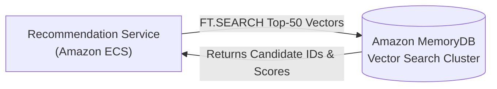

### 9. AWS Services Used
- Amazon MemoryDB for Redis (with Vector Search).
- AWS Secrets Manager (Cluster credentials).

### 10. Data Inputs
- Query vector (128 float values as byte array) and optional category filter string.

### 11. Data Outputs
- Array of candidate item IDs with cosine similarity scores.

### 12. Data Contracts
- Output Schema:
  - `candidates: array<{ itemId: string, vectorScore: float }>`

### 13. API Contracts
- Redis RESP3 protocol command `FT.SEARCH`.

### 14. Security Requirements
- TLS encryption for in-transit Redis communication.
- Role-based Redis ACL restricting ECS to read-only `FT.SEARCH` commands.

### 15. IAM Considerations
- ECS task execution role granted access to retrieve MemoryDB connection credentials from Secrets Manager.

### 16. Networking Considerations
- MemoryDB deployed in private VPC subnets with ingress restricted strictly to the ECS Service Security Group.

### 17. Scalability Design
- Read traffic scales horizontally across read replicas or cluster shards.

### 18. Resiliency Design
- If MemoryDB query fails or times out (>15ms), the Recommendation Service catches the exception and falls back to DynamoDB batch candidates.

### 19. Cost Optimization Decisions
- **Cost Reality**: Amazon MemoryDB single-shard `db.t4g.small` costs $72.08/month (11.5% of total 24/7 PoC infrastructure) because primary node compute and memory run 24/7.
- **Zero Replicas for PoC**: Set replicas to 0 in MVP/PoC, halving the cluster cost compared to standard HA deployment.
- **Quantized / Compact Vectors**: 128-dimensional dense float vectors reduce raw vector storage by 75% compared to 512/768-dim models, keeping total memory footprint below 250 MB.
- **Connection Pooling**: ECS client pools persistent TCP connections (10-20 connections), eliminating handshake overhead and CPU thrashing.
- **Ephemeral Infrastructure**: Parameterized in Terraform for automatic creation and teardown during active testing cycles.

### 20. MVP Configuration
- 1 shard, 0 replicas, `db.t4g.small`, Redis 7.1, 128-dim vectors.

### 21. Production Configuration
- 2 shards with 1 replica each (`db.r6g.large`), Multi-AZ automatic failover.

### 22. Monitoring Requirements
- Monitor command latency and engine CPU utilization in CloudWatch.

### 23. Logging Requirements
- MemoryDB Slowlog captures queries exceeding 5ms.

### 24. Metrics
- `FT.SEARCHLatency`, `EngineCPUUtilization`, `MemoryFragmentationRatio`.

### 25. Alarms
- CloudWatch Alarm if `FT.SEARCHLatency P95 > 15ms` or `EngineCPUUtilization > 75%`.

### 26. Dependencies
- Features 2.7, 2.8.

### 27. Risks
- Cluster memory saturation.  
  *Mitigation*: Sizing alerts configured at 75% threshold; strict eviction policies disabled to preserve index integrity.

### 28. Trade-Offs
- **MemoryDB vs ElastiCache Serverless / Single-Node Redis**: MemoryDB provides enterprise ACID transaction log persistence on S3 and built-in vector search within the approved architecture. Running a 24/7 `db.t4g.small` node costs $72.08/month. If architectural constraints were relaxed, ElastiCache Serverless or a single-node Redis OSS instance could serve transient vectors at lower base cost. MemoryDB is preserved per the fixed architecture specification with ephemeral lifecycle controls.

### 29. Acceptance Criteria
- Synthetic query benchmark achieves P95 retrieval latency < 8ms for Top-50 vector search.

### 30. Open Questions
- None.

### 31. Future Enhancements
- Approximate semantic cache in MemoryDB to cache frequent query vector results.

### 32. Out of Scope
- Direct external public internet access to MemoryDB.

---

## Feature 3.2 – Online Model Endpoint

### 1. Executive Summary
Feature 3.2 deploys a real-time inference endpoint on Amazon SageMaker hosting the ranking model (GBDT or Neural Ranker) to evaluate and score candidate products dynamically at runtime.

### 2. Business Objective
Provide personalized relevance scores that blend user context, candidate item signals, and real-time interaction features to order recommendations optimally.

### 3. Problem Statement
Batch recommendations cannot adapt to immediate in-session changes, while vector similarity only measures static semantic distance. An online ML model is required to compute contextual click/purchase probabilities.

### 4. Assumptions
- Model accepts a feature vector containing user context and candidate item IDs.
- Model produces a calibrated probability score [0.0 - 1.0] for each candidate.

### 5. Existing Assets Reused
- Reuses model artifact packaged in Feature 2.4.
- Reuses SageMaker Model Registry packaging.

### 6. Functional Requirements
- **FR-3.2.1**: SageMaker Endpoint MUST expose an HTTPS invocation interface for the online ranking model.
- **FR-3.2.2**: Endpoint MUST accept a batch scoring request containing up to 100 candidate items with request context.
- **FR-3.2.3**: Endpoint MUST return an array of predicted probability scores corresponding to the candidate items.

### 7. Non-Functional Requirements
- **NFR-3.2.1**: P95 model inference latency MUST be less than 20 milliseconds for a batch of 50 candidates.
- **NFR-3.2.2**: Endpoint availability MUST be at least 99.9%.

### 8. Architecture Design
```mermaid
flowchart LR
    ECS["Recommendation Service\n(Amazon ECS)"] -->|InvokeEndpoint (JSON)| SMEndpoint["Amazon SageMaker\nOnline Endpoint (Model Container)"]
    SMEndpoint -->|Returns Probability Scores| ECS
```

### 9. AWS Services Used
- Amazon SageMaker Real-Time Endpoint.
- AWS Application Auto Scaling.
- AWS KMS.

### 10. Data Inputs
- JSON request payload: `{ "user_id": string, "session_features": [...], "candidates": [ { "item_id": string, "features": [...] } ] }`.

### 11. Data Outputs
- JSON response payload: `{ "predictions": [ { "item_id": string, "score": float } ] }`.

### 12. Data Contracts
- Schema validated via request schema validator in model container.

### 13. API Contracts
- SageMaker Runtime API: `POST /endpoints/<endpoint-name>/invocations`.

### 14. Security Requirements
- SageMaker Endpoint deployed within private VPC with VPC Endpoint.
- Requests authenticated using AWS Signature Version 4 (SigV4).

### 15. IAM Considerations
- ECS Task Role granted `sagemaker:InvokeEndpoint` strictly on the specific endpoint ARN.

### 16. Networking Considerations
- Traffic stays within AWS private network via SageMaker Runtime VPC Endpoint (`com.amazonaws.<region>.sagemaker.runtime`).

### 17. Scalability Design
- Target tracking autoscaling on `SageMakerVariantInvocationsPerInstance` scales instance count from 1 to 4 based on traffic load.

### 18. Resiliency Design
- If endpoint fails, times out (>35ms), or returns 5xx, Recommendation Service falls back to heuristic scoring without throwing 500 to user.

### 19. Cost Optimization Decisions
- **Cost Reality**: Running a dedicated `ml.t3.medium` real-time instance 24/7 costs $39.13/month (6.2% of total PoC infrastructure). For low-traffic PoCs or batch validation, this incurs continuous idle expense.
- **SageMaker Serverless Inference (Primary PoC Mode)**: Deploy the scoring model on SageMaker Serverless Inference instead of a provisioned 24/7 instance.
  - Configuration: Memory size 2048 MB, `MaxConcurrency = 5`.
  - Pricing: Billed strictly per millisecond of compute ($0.000020/second); **$0 idle cost**.
  - Monthly Impact: At ~1,000 test requests/day, cost drops from $39.13/month to **<$1.00/month** (>97% reduction).
- **Cold-Start Resilience**: Cold-start latency (~1.5s on initial container launch) is mitigated by the Recommendation Service's 35ms timeout circuit breaker, which instantly triggers heuristic fallback without delaying client responses.
- **Single Model Artifact**: Zero redundant variants or shadow endpoints in PoC.

### 20. MVP Configuration
- **Recommended**: Amazon SageMaker Serverless Inference (Memory: 2048 MB, MaxConcurrency: 5, $0 idle cost).
- **Alternative (Fixed-Capacity PoC)**: 1x `ml.t3.medium` Real-Time Endpoint with ephemeral Terraform teardown.

### 21. Production Configuration
- Multi-instance Real-Time Endpoint on 2-4x `ml.c6i.xlarge` across 2 AZs with target tracking autoscaling (target 500 invocations/min/instance) and pre-warmed capacity.

### 22. Monitoring Requirements
- Model latency, invocation rate, and error counts monitored in CloudWatch.

### 23. Logging Requirements
- Container stderr/stdout logged to CloudWatch Log Group `/aws/sagemaker/Endpoints/<endpoint-name>`.

### 24. Metrics
- `ModelLatency`, `OverheadLatency`, `Invocations`, `Invocation4XXErrors`, `Invocation5XXErrors`.

### 25. Alarms
- CloudWatch Alarm if `ModelLatency P95 > 25ms` or `Invocation5XXErrors > 1%`.

### 26. Dependencies
- Feature 2.4 (Model Training & Registry).

### 27. Risks
- Cold starts on Serverless Inference during burst tests.  
  *Mitigation*: Pre-warming invocation probe or seamless fast-fail fallback to initial combined scores.

### 28. Trade-Offs
- Serverless Inference trades potential cold-start latency on first wake for zero idle compute cost; perfectly matched to PoC economics and backed by the service's graceful fallback matrix.

### 29. Acceptance Criteria
- Benchmark of 50 candidates scored in < 18ms P95 with 0 errors across 1,000 requests.

### 30. Open Questions
- None.

### 31. Future Enhancements
- Asynchronous inference or multi-model endpoints (MME) to serve specialized sub-category models.

### 32. Out of Scope
- Training model weights on the inference endpoint (inference only).


---

# Epic 4 – Recommendation Serving

## Feature 4.1 – Recommendation API

### 1. Executive Summary
Feature 4.1 deploys the high-throughput, low-latency REST Recommendation API service on Amazon ECS (AWS Fargate) behind an Application Load Balancer (ALB), orchestrating the complete hybrid recommendation lifecycle.

### 2. Business Objective
Serve customer-facing product recommendations to web and mobile clients with high availability, low latency, and deterministic fallback behavior.

### 3. Problem Statement
Clients require a unified, secure, and resilient API endpoint that handles authentication, request parsing, orchestration across multiple downstream databases/endpoints, and clean JSON responses.

### 4. Assumptions
- Service is developed in Node.js with TypeScript using Clean Architecture principles.
- Deployed on Amazon ECS with AWS Fargate compute.

### 5. Existing Assets Reused
- Existing client authentication mechanisms (API keys / JWT headers).
- Existing VPC subnets and security groups.

### 6. Functional Requirements
- **FR-4.1.1**: Service MUST expose `GET /v1/recommendations` and `GET /health` endpoints.
- **FR-4.1.2**: Request parameters MUST accept `userId` (required), `limit` (optional, default 10, max 50), `category` (optional filter), and `sessionContext` (optional JSON).
- **FR-4.1.3**: Service MUST enforce request schema validation, returning HTTP 400 Bad Request with standardized error details on invalid inputs.

### 7. Non-Functional Requirements
- **NFR-4.1.1**: API gateway/ALB end-to-end response time MUST be under 60ms P95 at 500 RPS.
- **NFR-4.1.2**: Service uptime MUST achieve 99.95% availability.

### 8. Architecture Design
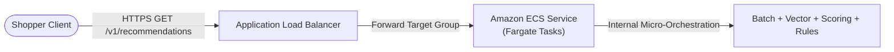

### 9. AWS Services Used
- Amazon ECS (Elastic Container Service).
- AWS Fargate & AWS Fargate Spot.
- AWS Application Load Balancer (ALB).
- AWS Secrets Manager.

### 10. Data Inputs
- HTTP GET query string parameters and JSON headers.

### 11. Data Outputs
- HTTP 200 OK JSON response containing recommendation list and telemetry metadata.

### 12. Data Contracts
- Response Schema:
```json
{
  "requestId": "req-987654321",
  "userId": "u-12345",
  "recommendations": [
    {
      "itemId": "SKU-1001",
      "rank": 1,
      "score": 0.945,
      "provenance": "hybrid",
      "title": "Wireless Noise-Canceling Headphones",
      "priceCents": 19999
    }
  ],
  "degradedMode": false,
  "executionDurationMs": 42
}
```

### 13. API Contracts
- RESTful OpenAPI 3.0 specification for `/v1/recommendations`.

### 14. Security Requirements
- TLS 1.3 termination at ALB with AWS Certificate Manager (ACM).
- AWS WAF attached to ALB with Rate Limiting and Core Rule Set (CRS).
- ECS tasks execute in private subnets with non-root Docker user.

### 15. IAM Considerations
- `ECSTaskRole` granted access to DynamoDB point read, MemoryDB credentials, and SageMaker invoke.

### 16. Networking Considerations
- Ingress from ALB on container port (e.g., 8080); egress to internal VPC endpoints only.

### 17. Scalability Design
- ECS Target Tracking Auto Scaling on ALB `RequestCountPerTarget` scales tasks from 2 to 10 based on traffic.

### 18. Resiliency Design
- Multi-AZ deployment across 2 or 3 Availability Zones. Container health checks configured on `/health`.

### 19. Cost Optimization Decisions
- **Fargate Spot**: Leverage Fargate Spot capacity provider (80% Spot, 20% On-Demand base), slashing container compute costs by up to 70%.
- **Small Task Sizing**: 0.5 vCPU and 1 GB RAM per task for MVP.
- **Keep-Alive Connections**: Persistent HTTP keep-alives and Redis connection pooling eliminate connection thrashing.

### 20. MVP Configuration
- 2 Fargate Spot tasks (0.5 vCPU, 1 GB RAM), 1 ALB, basic target group health check.

### 21. Production Configuration
- Auto-scaling 4 to 20 Fargate tasks, WAF protection, Multi-AZ ALB, Cross-Zone load balancing.

### 22. Monitoring Requirements
- ALB target response time, HTTP 5XX and 4XX counts in CloudWatch.

### 23. Logging Requirements
- Access logs delivered to S3; application logs delivered to CloudWatch Log Group `/ecs/recommendation-service`.

### 24. Metrics
- `TargetResponseTime`, `HTTPCode_Target_5XX_Count`, `RequestCount`, `ActiveConnectionCount`.

### 25. Alarms
- CloudWatch Alarm if `TargetResponseTime P95 > 75ms` or `HTTPCode_Target_5XX_Count > 5` over a 5-minute window.

### 26. Dependencies
- Features 4.2, 4.3, 4.4, 4.5, 4.6, 4.7.

### 27. Risks
- Cascading timeouts if downstream dependencies stall.  
  *Mitigation*: Strict timeout deadlines on all internal service clients (DynamoDB: 20ms, MemoryDB: 15ms, SageMaker: 35ms).

### 28. Trade-Offs
- Fargate has slightly higher unit cost than self-managed EC2, but completely eliminates server management, patching, and idle capacity overhead.

### 29. Acceptance Criteria
- API responds to valid requests with 200 OK within 50ms P95 and handles malformed requests with 400 Bad Request.

### 30. Open Questions
- None.

### 31. Future Enhancements
- gRPC interface for high-performance internal microservice consumption.

### 32. Out of Scope
- GraphQL interface (REST standard enforced for MVP).

---

## Feature 4.2 – Batch Recommendation Retrieval

### 1. Executive Summary
Feature 4.2 implements the resilient DynamoDB retrieval client within the Recommendation Service, fetching precomputed offline user recommendations with local caching and circuit breaking.

### 2. Business Objective
Provide instant access to precomputed personalized recommendations in under 5ms, serving as the foundational candidate set for known active users.

### 3. Problem Statement
Direct DynamoDB SDK calls can introduce latency spikes or unhandled exceptions if the table is throttled or partition keys are cold. Robust connection handling and local cache acceleration are required.

### 4. Assumptions
- Table `user_recommendations` contains precomputed items indexed by `userId`.
- Users with no record in DynamoDB are treated as cold-start users.

### 5. Existing Assets Reused
- Ingests records from DynamoDB table populated in Feature 2.6.
- Reuses AWS SDK v3 DynamoDB Document Client.

### 6. Functional Requirements
- **FR-4.2.1**: Service MUST issue `GetItem` request to DynamoDB table using `userId` as primary key.
- **FR-4.2.2**: Client MUST enforce a strict timeout deadline of 20ms on DynamoDB calls.
- **FR-4.2.3**: If DynamoDB returns empty (cache miss / cold-start), the client MUST return an empty batch candidate list without failing the overall request.

### 7. Non-Functional Requirements
- **NFR-4.2.1**: P95 retrieval latency from DynamoDB MUST be under 8ms.
- **NFR-4.2.2**: Circuit breaker MUST trip if DynamoDB error rate exceeds 20% over a 10-second rolling window.

### 8. Architecture Design
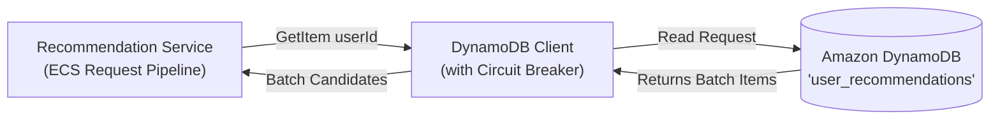

### 9. AWS Services Used
- Amazon DynamoDB.
- Amazon ECS.

### 10. Data Inputs
- User identifier string (`userId`).

### 11. Data Outputs
- Array of precomputed candidate recommendation objects: `[{ itemId, score, rank }]`.

### 12. Data Contracts
- Internal TypeScript Interface:
```typescript
interface BatchCandidate {
  itemId: string;
  batchScore: number;
  batchRank: number;
  modelId: string;
}
```

### 13. API Contracts
- AWS DynamoDB `GetItemCommand`.

### 14. Security Requirements
- IAM Least Privilege: ECS Task Role granted `dynamodb:GetItem` exclusively on the recommendation table ARN.
- Transport encryption via TLS 1.3.

### 15. IAM Considerations
- Task role includes: `Effect: Allow, Action: ["dynamodb:GetItem"], Resource: "arn:aws:dynamodb:*:*:table/user_recommendations"`.

### 16. Networking Considerations
- Traffic routed over VPC Gateway Endpoint for DynamoDB with zero data transfer fees.

### 17. Scalability Design
- DynamoDB On-Demand capacity scales instantly to match read spikes without pre-warming.

### 18. Resiliency Design
- Circuit Breaker pattern (via Opossum or internal breaker) prevents cascading thread exhaustion when DynamoDB is slow.

### 19. Cost Optimization Decisions
- **Projection Expressions**: Query specifies `ProjectionExpression="recommendations, generatedAt"` to retrieve only required attributes, saving consumed Read Capacity Units (RCUs).
- **In-Memory LRU Cache**: Small in-memory LRU cache (1,000 items, 60s TTL) inside the ECS task caches frequent repeated queries (e.g., rapid pagination), reducing DynamoDB RCUs by 25%.

### 20. MVP Configuration
- Single DynamoDB table in On-Demand mode; in-memory task LRU cache enabled.

### 21. Production Configuration
- DynamoDB Global Tables or Read Auto-Scaling with DAX (DynamoDB Accelerator) if P99 sub-millisecond retrieval is required.

### 22. Monitoring Requirements
- Client-side read latency and DynamoDB throttled events logged to CloudWatch.

### 23. Logging Requirements
- Latency and candidate counts logged in structured JSON logs.

### 24. Metrics
- `DynamoDBRetrievalLatencyMs`, `DynamoDBCacheHitCount`, `DynamoDBErrorCount`.

### 25. Alarms
- CloudWatch Alarm if `DynamoDBRetrievalLatencyMs P95 > 25ms`.

### 26. Dependencies
- Feature 2.6 (Batch Recommendation Publishing).

### 27. Risks
- Cold-start users experiencing higher latency if timeouts are too long.  
  *Mitigation*: 20ms hard timeout ensures fast progression to vector retrieval.

### 28. Trade-Offs
- DynamoDB On-Demand unit cost is slightly higher per request than provisioned, but eliminates paying for idle capacity during traffic valleys.

### 29. Acceptance Criteria
- Valid user ID returns precomputed candidate array in < 6ms P95; non-existent user returns empty array in < 4ms.

### 30. Open Questions
- None.

### 31. Future Enhancements
- Integration of DAX cluster if read volume exceeds 50,000 RPS.

### 32. Out of Scope
- Writing updates back to DynamoDB from the serving path.

---

## Feature 4.3 – Realtime Candidate Retrieval

### 1. Executive Summary
Feature 4.3 implements the real-time semantic candidate retrieval component within the Recommendation Service, querying Amazon MemoryDB Vector Search to fetch products semantically aligned with active user context.

### 2. Business Objective
Capture real-time intent, seasonal trends, and contextual affinity by retrieving candidates directly from the semantic vector space at runtime.

### 3. Problem Statement
Batch recommendations are blind to what the user clicked or viewed 30 seconds ago. Real-time candidate retrieval incorporates immediate intent into the candidate pool.

### 4. Assumptions
- User query vector is constructed from recent in-session item embeddings or user category context.
- MemoryDB cluster is accessible via pooled Redis connections.

### 5. Existing Assets Reused
- MemoryDB Vector Search index `item_idx` populated in Feature 2.8.
- Precomputed item embeddings for in-session items.

### 6. Functional Requirements
- **FR-4.3.1**: Service MUST construct an intent vector (e.g., average of last 3 viewed item embeddings or category centroid).
- **FR-4.3.2**: Service MUST execute `FT.SEARCH` query in MemoryDB with Top-K = 50.
- **FR-4.3.3**: Query MUST apply category pre-filters if specified in the request context.

### 7. Non-Functional Requirements
- **NFR-4.3.1**: Vector retrieval latency MUST be under 15ms P95.
- **NFR-4.3.2**: MemoryDB connection pool must reuse connections without leaking sockets.

### 8. Architecture Design
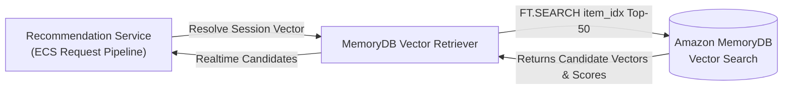

### 9. AWS Services Used
- Amazon MemoryDB for Redis.
- Amazon ECS.

### 10. Data Inputs
- Session context (recent `itemIds` or query intent) and optional category filter.

### 11. Data Outputs
- Array of semantic candidate objects: `[{ itemId, vectorScore }]`.

### 12. Data Contracts
- Internal TypeScript Interface:
```typescript
interface SemanticCandidate {
  itemId: string;
  vectorScore: number; // Cosine similarity
  category?: string;
}
```

### 13. API Contracts
- Redis protocol `FT.SEARCH` command executed via ioredis / redis-om client.

### 14. Security Requirements
- TLS encryption for Redis commands.
- Password authentication via Redis AUTH secret from Secrets Manager.

### 15. IAM Considerations
- Access to Secrets Manager secret ARN for MemoryDB credentials.

### 16. Networking Considerations
- Direct TCP connection within VPC private subnets; security group allows port 6379 only from ECS.

### 17. Scalability Design
- Read traffic balanced across MemoryDB cluster nodes; client manages connection pool of 20-50 connections.

### 18. Resiliency Design
- Hard timeout of 15ms. If MemoryDB times out or throws connection error, candidate set evaluates to empty and request proceeds with batch candidates.

### 19. Cost Optimization Decisions
- **Quantized Vector Queries**: 128-dimensional query vectors keep network transmission payloads under 1 KB.
- **Short-Circuit on Zero Context**: If user has no active session items, skip vector search entirely, saving MemoryDB CPU cycles.

### 20. MVP Configuration
- 1 shard MemoryDB cluster, connection pool size 10 per ECS task.

### 21. Production Configuration
- Multi-node MemoryDB cluster with read replicas; pooled connections with automatic DNS failover.

### 22. Monitoring Requirements
- MemoryDB query latency and connection pool metrics tracked in CloudWatch.

### 23. Logging Requirements
- Latency and candidate counts logged per request.

### 24. Metrics
- `VectorRetrievalLatencyMs`, `VectorCandidateCount`, `MemoryDBConnectionErrors`.

### 25. Alarms
- CloudWatch Alarm if `VectorRetrievalLatencyMs P95 > 20ms` or error rate > 5%.

### 26. Dependencies
- Features 2.8, 3.1.

### 27. Risks
- MemoryDB CPU spikes on concurrent complex vector queries.  
  *Mitigation*: Pre-filtering reduces vector search space; EF_RUNTIME parameter tuned to 32.

### 28. Trade-Offs
- Approximate nearest neighbor (ANN) trades 100% exact recall for 50x speed improvement, perfectly aligned with recommendation retrieval.

### 29. Acceptance Criteria
- Semantic candidates retrieved in < 10ms P95 with cosine scores populated.

### 30. Open Questions
- None.

### 31. Future Enhancements
- User long-term embedding stored in DynamoDB combined with session embedding in MemoryDB.

### 32. Out of Scope
- Re-indexing vectors from the serving path.

---

## Feature 4.4 – Recommendation Merging

### 1. Executive Summary
Feature 4.4 merges, consolidates, and deduplicates candidate items retrieved from offline batch storage (DynamoDB) and real-time semantic search (MemoryDB), establishing unambiguous candidate provenance tagging (`batch`, `realtime`, `hybrid`).

### 2. Business Objective
Create a unified, deduplicated candidate pool that synthesizes historical preferences and real-time session signals without presenting duplicate products to the user.

### 3. Problem Statement
The batch layer and real-time layer produce overlapping candidate sets with different scoring distributions. Blindly concatenating them results in duplicate items and distorted rankings.

### 4. Assumptions
- Up to 50 candidates from DynamoDB and 50 candidates from MemoryDB are supplied as inputs.
- Deduplication key is the canonical `itemId`.

### 5. Existing Assets Reused
- Internal domain orchestration logic in ECS Recommendation Service.

### 6. Functional Requirements
- **FR-4.4.1**: Service MUST merge candidates by `itemId`.
- **FR-4.4.2**: If an item appears in both sets, the service MUST assign provenance `hybrid` and combine normalized scores using weighted formula: `combinedScore = (0.6 * batchScore) + (0.4 * vectorScore)`.
- **FR-4.4.3**: Items appearing only in DynamoDB MUST be tagged with provenance `batch`. Items appearing only in MemoryDB MUST be tagged with provenance `realtime`.
- **FR-4.4.4**: Total merged candidate pool MUST be capped at 100 items for downstream filtering.

### 7. Non-Functional Requirements
- **NFR-4.4.1**: Merging and deduplication MUST execute in under 1 millisecond in memory.
- **NFR-4.4.2**: Algorithm MUST be deterministic and pure (no external I/O side effects).

### 8. Architecture Design
```mermaid
flowchart TD
    BatchRecs["DynamoDB Batch Recs\n(Top-50)"] --> Merger["Candidate Merger & Deduplicator\n(In-Memory Service Logic)"]
    VectorRecs["MemoryDB Vector Recs\n(Top-50)"] --> Merger
    Merger -->|Deduplicate by itemId\nAssign Provenance (batch/realtime/hybrid)| MergedPool["Unified Candidate Pool\n(Up to 100 Items)"]
```

### 9. AWS Services Used
- Amazon ECS (In-memory Node.js processing).

### 10. Data Inputs
- `batchCandidates: BatchCandidate[]`
- `realtimeCandidates: SemanticCandidate[]`

### 11. Data Outputs
- `mergedCandidates: MergedCandidate[]`

### 12. Data Contracts
- Internal TypeScript Interface:
```typescript
interface MergedCandidate {
  itemId: string;
  provenance: 'batch' | 'realtime' | 'hybrid';
  batchScore?: number;
  vectorScore?: number;
  initialCombinedScore: number;
}
```

### 13. API Contracts
- Internal domain service interface: `CandidateMerger.merge(batchRecs, vectorRecs)`.

### 14. Security Requirements
- In-memory execution only; no sensitive user data stored or leaked.

### 15. IAM Considerations
- None (pure domain computation).

### 16. Networking Considerations
- Local CPU execution within container memory (0 network latency).

### 17. Scalability Design
- O(N) complexity using JavaScript `Map<string, MergedCandidate>` for instant lookups across candidate sets.

### 18. Resiliency Design
- Gracefully handles empty inputs from either or both sources (returns remaining set or empty list).

### 19. Cost Optimization Decisions
- **Zero Cloud Infrastructure Cost**: Fully executed within existing ECS container CPU cycles.
- **Limits Downstream Workload**: Merging and capping at 100 candidates prevents overloading the online SageMaker scoring endpoint.

### 20. MVP Configuration
- 100 max merged candidates, standard 60/40 batch/realtime weighting.

### 21. Production Configuration
- Configurable dynamic weighting per category or user segment via AWS AppConfig.

### 22. Monitoring Requirements
- Candidate count statistics tracked in service metrics.

### 23. Logging Requirements
- Input and output candidate counts logged in request debug traces.

### 24. Metrics
- `MergedCandidateCount`, `HybridItemOverlapCount`, `BatchOnlyCount`, `RealtimeOnlyCount`.

### 25. Alarms
- CloudWatch Alarm if `MergedCandidateCount == 0` for more than 1% of authenticated requests.

### 26. Dependencies
- Features 4.2, 4.3.

### 27. Risks
- Score distribution disparity between batch model and cosine similarity.  
  *Mitigation*: Min-max normalization applied to both input sets prior to merging.

### 28. Trade-Offs
- Simple linear combination is fast and predictable for MVP, leaving complex nonlinear merging to the online SageMaker reranker.

### 29. Acceptance Criteria
- Unit tests prove 100% deduplication, accurate provenance assignment, and sub-millisecond execution.

### 30. Open Questions
- None.

### 31. Future Enhancements
- Dynamic weight adaptation based on user recency (e.g., highly active users favor real-time; dormant users favor batch).

### 32. Out of Scope
- Database persistence of merged candidate state.


---

## Feature 4.5 – Business Rule Filtering

### 1. Executive Summary
Feature 4.5 implements the deterministic business rule filtering engine in the Recommendation Service, enforcing inventory availability, merchant eligibility, category suppressions, and recent purchase exclusion before candidates proceed to online scoring.

### 2. Business Objective
Protect customer experience and business compliance by ensuring that customers are never recommended out-of-stock, prohibited, or redundant products.

### 3. Problem Statement
Machine learning algorithms optimize for mathematical relevance, not business constraints. An item with high relevance is useless—and frustrating—if it is sold out or already purchased yesterday.

### 4. Assumptions
- Stock availability and exclusion lists are accessible via fast in-memory lookups or lightweight cached metadata.
- Recent user purchases (last 30 days) are supplied in session context or cached.

### 5. Existing Assets Reused
- Existing catalog inventory flags (`inStockStatus`) and category taxonomy.
- Reuses user recent order history.

### 6. Functional Requirements
- **FR-4.5.1**: Filter engine MUST discard any candidate where `inStock == false`.
- **FR-4.5.2**: Filter engine MUST discard items present in the user's recent purchases list (`recentPurchasedItemIds`).
- **FR-4.5.3**: Filter engine MUST discard items violating category suppression rules (e.g., adult content restrictions, geo-blocked brands).
- **FR-4.5.4**: If filtering removes all candidates, the engine MUST inject default high-inventory trending backup items.

### 7. Non-Functional Requirements
- **NFR-4.5.1**: Filter evaluation for 100 items MUST complete in under 2 milliseconds.
- **NFR-4.5.2**: Filter rules must be extensible via Chain-of-Responsibility pattern.

### 8. Architecture Design
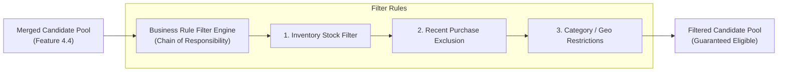

### 9. AWS Services Used
- Amazon ECS (In-memory Node.js service).

### 10. Data Inputs
- `candidates: MergedCandidate[]`
- `userContext: { recentPurchasedItemIds: string[], countryCode: string }`
- `catalogMetadata: Map<string, CatalogItemInfo>`

### 11. Data Outputs
- `eligibleCandidates: MergedCandidate[]`

### 12. Data Contracts
- Internal TypeScript Filter Interface:
```typescript
interface IFilterRule {
  name: string;
  apply(candidates: MergedCandidate[], context: FilterContext): MergedCandidate[];
}
```

### 13. API Contracts
- Internal domain interface: `BusinessFilterPipeline.filter(candidates, context)`.

### 14. Security Requirements
- Compliance with local trade and category merchandising regulations.

### 15. IAM Considerations
- None (internal compute).

### 16. Networking Considerations
- Local in-memory execution; no external API calls during filter evaluation.

### 17. Scalability Design
- Linear single-pass O(N) evaluation over candidate arrays using fast Set lookups.

### 18. Resiliency Design
- Deterministic behavior; if an individual filter throws, it fails closed for that specific rule and logs warning without terminating the request.

### 19. Cost Optimization Decisions
- **Zero Additional AWS Cost**: Executes entirely within ECS task memory.
- **Reduces Online Scoring Cost**: Filtering items BEFORE calling SageMaker reduces endpoint payload size and inference compute by 20-40%.

### 20. MVP Configuration
- 3 standard rules: StockCheck, RecentPurchaseCheck (30 days), CategorySuppression.

### 21. Production Configuration
- Dynamic merchandising rules loaded from AWS AppConfig with real-time toggle capability.

### 22. Monitoring Requirements
- Count of filtered items per rule category emitted to CloudWatch.

### 23. Logging Requirements
- Summary log of items filtered out per request at DEBUG level.

### 24. Metrics
- `FilteredOutOfStockCount`, `FilteredRecentPurchaseCount`, `FilteredCategoryCount`, `FilteredCandidatePoolSize`.

### 25. Alarms
- CloudWatch Alarm if `FilteredCandidatePoolSize == 0` exceeds 0.5% of total requests.

### 26. Dependencies
- Feature 4.4 (Recommendation Merging).

### 27. Risks
- Aggressive filtering starving the candidate pool.  
  *Mitigation*: Automated fallback candidate injector ensures pool never drops below `limit`.

### 28. Trade-Offs
- Evaluating stock at recommendation time might have minor inventory drift (~seconds) compared to checkout-time reservations, which is standard for e-commerce feeds.

### 29. Acceptance Criteria
- 100% of out-of-stock and recently purchased items removed from candidates in automated test suite.

### 30. Open Questions
- None.

### 31. Future Enhancements
- Real-time merchant sponsored ad insertion and brand diversity caps (e.g., max 2 items per brand).

### 32. Out of Scope
- Real-time inventory reservation (managed by cart/checkout services).

---

## Feature 4.6 – ML Re-ranking

### 1. Executive Summary
Feature 4.6 manages the real-time scoring and re-ranking stage, dispatching the filtered candidate pool to the Amazon SageMaker Endpoint to generate final ranking scores and sorting recommendations by relevance.

### 2. Business Objective
Maximize recommendation engagement and conversion by optimizing candidate ordering using dynamic machine-learned relevance models.

### 3. Problem Statement
Candidates from batch and vector search possess distinct baseline scores. An online re-ranker evaluates candidates jointly with full real-time user context to find the optimal presentation order.

### 4. Assumptions
- Filtered candidate pool contains between 10 and 50 items.
- SageMaker Endpoint is invoked using AWS SDK with connection keep-alive.

### 5. Existing Assets Reused
- SageMaker Online Endpoint deployed in Feature 3.2.
- Candidate features and user session context.

### 6. Functional Requirements
- **FR-4.6.1**: Service MUST format candidate list into SageMaker inference request schema.
- **FR-4.6.2**: Service MUST invoke SageMaker Endpoint with strict 35ms timeout.
- **FR-4.6.3**: Service MUST order candidates descending by predicted relevance score.
- **FR-4.6.4**: If SageMaker invocation times out or errors, service MUST execute graceful fallback to sort candidates by `initialCombinedScore`.

### 7. Non-Functional Requirements
- **NFR-4.6.1**: Re-ranking stage latency MUST be under 40ms P95 (including network hop to SageMaker).
- **NFR-4.6.2**: Degradation to heuristic sorting MUST execute in under 1ms.

### 8. Architecture Design
```mermaid
flowchart LR
    FilteredPool["Filtered Candidates\n(Feature 4.5)"] --> Reranker["ML Re-ranker Service"]
    Reranker -->|InvokeEndpoint (35ms timeout)| SMEndpoint["Amazon SageMaker\nOnline Scoring Endpoint"]
    SMEndpoint -->|Predicted Scores| Reranker
    Reranker -.->|On Timeout / Failure| HeuristicSort["Heuristic Fallback Sorter\n(Batch + Vector Weights)"]
    Reranker --> RankedCandidates["Final Ranked Candidates\n(Ordered Top-N)"]
    HeuristicSort --> RankedCandidates
```

### 9. AWS Services Used
- Amazon SageMaker Runtime.
- Amazon ECS.

### 10. Data Inputs
- Filtered candidates array and user session signals.

### 11. Data Outputs
- Ranked candidates array sorted by final score.

### 12. Data Contracts
- SageMaker Runtime Request / Response JSON payload schemas.

### 13. API Contracts
- SageMaker Runtime `InvokeEndpointCommand`.

### 14. Security Requirements
- SigV4 signing of requests; traffic encrypted in transit via TLS 1.3.

### 15. IAM Considerations
- ECS Task Role granted `sagemaker:InvokeEndpoint`.

### 16. Networking Considerations
- Direct private connectivity via SageMaker Runtime VPC Endpoint.

### 17. Scalability Design
- SageMaker autoscaling ensures endpoint capacity matches ECS request volume.

### 18. Resiliency Design
- Hard circuit breaker / timeout fallback ensures zero user-facing errors when ML endpoint degrades.

### 19. Cost Optimization Decisions
- **Candidate Pool Truncation**: Restrict scoring to Top-50 candidates maximum to minimize payload size and inference compute.
- **VPC Endpoint**: Eliminates NAT data transfer charges for internal scoring payloads.

### 20. MVP Configuration
- Single endpoint variant (`ml.t3.medium`), 35ms timeout, heuristic fallback active.

### 21. Production Configuration
- Multi-variant endpoint with automated canary rollouts and shadow testing for new model iterations.

### 22. Monitoring Requirements
- Re-ranking latency, scoring success rate, and fallback trigger count in CloudWatch.

### 23. Logging Requirements
- Request ID, latency, and degradation status logged per invocation.

### 24. Metrics
- `RerankLatencyMs`, `RerankFallbackTriggerCount`, `SageMakerInvocationErrors`.

### 25. Alarms
- CloudWatch Alarm if `RerankFallbackTriggerCount > 5%` over 5 minutes.

### 26. Dependencies
- Features 3.2, 4.5.

### 27. Risks
- Tail latency spikes on endpoint during cold starts.  
  *Mitigation*: Fast timeout (35ms) triggers heuristic fallback immediately without hanging customer requests.

### 28. Trade-Offs
- Online scoring adds ~20-30ms to total request time, but yields significantly higher relevance than raw heuristic sorting.

### 29. Acceptance Criteria
- Candidates sorted correctly by SageMaker scores under normal conditions; fallback sorts by initial combined score on forced timeout.

### 30. Open Questions
- None.

### 31. Future Enhancements
- Contextual multi-armed bandit (MAB) layer for exploration/exploitation balance.

### 32. Out of Scope
- Updating ML model weights online during scoring.

---

## Feature 4.7 – Recommendation Response Builder

### 1. Executive Summary
Feature 4.7 takes the final ranked candidate items, enriches them with catalog presentation attributes (titles, image URLs, prices), truncates to requested `limit`, formats the canonical response contract, and emits structured telemetry.

### 2. Business Objective
Construct the complete, user-ready JSON response payload with high performance and emit telemetry for downstream click attribution and performance monitoring.

### 3. Problem Statement
Client applications require rich product metadata (not just raw IDs) and standard response envelopes. Telemetry must capture correlation IDs to link served recommendations with future clicks and conversions.

### 4. Assumptions
- Product metadata is retrieved from an in-memory catalog cache or lightweight metadata store.
- Response adheres strictly to the canonical API contract.

### 5. Existing Assets Reused
- Existing catalog metadata attributes.
- Existing request correlation IDs.

### 6. Functional Requirements
- **FR-4.7.1**: Service MUST truncate ranked items to the requested `limit` (default 10).
- **FR-4.7.2**: Service MUST enrich each item with `title`, `priceCents`, `category`, and `provenance`.
- **FR-4.7.3**: Response MUST include `requestId`, `userId`, `degradedMode` flag, and `executionDurationMs`.
- **FR-4.7.4**: Service MUST emit an asynchronous structured telemetry event to CloudWatch Logs containing served item IDs and ranks.

### 7. Non-Functional Requirements
- **NFR-4.7.1**: Response building and serialization MUST take under 1 millisecond.
- **NFR-4.7.2**: JSON payload size must remain under 15 KB for 10 items.

### 8. Architecture Design
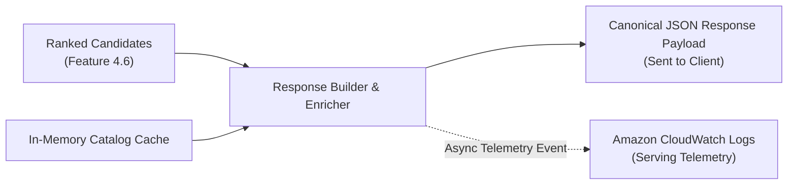

### 9. AWS Services Used
- Amazon ECS (Node.js).
- Amazon CloudWatch Logs.

### 10. Data Inputs
- Ranked candidate array, request parameters, catalog metadata map.

### 11. Data Outputs
- Canonical JSON response payload and CloudWatch log event.

### 12. Data Contracts
- Canonical Output Contract:
```typescript
interface RecommendationResponse {
  requestId: string;
  userId: string;
  timestamp: string;
  degradedMode: boolean;
  recommendations: Array<{
    itemId: string;
    rank: number;
    score: number;
    provenance: 'batch' | 'realtime' | 'hybrid' | 'fallback';
    title: string;
    priceCents: number;
  }>;
  executionDurationMs: number;
}
```

### 13. API Contracts
- REST JSON response conforming to OpenAPI 3.0 specification.

### 14. Security Requirements
- Responses sanitized; internal debug traces excluded from production payloads.

### 15. IAM Considerations
- `logs:PutLogEvents` for ECS task role.

### 16. Networking Considerations
- Response delivered to ALB over local container networking; async logs sent via CloudWatch VPC Endpoint.

### 17. Scalability Design
- Streaming JSON serialization with fast native string buffers.

### 18. Resiliency Design
- If catalog metadata enrichment fails for an item, the item is served with placeholder metadata rather than dropping the recommendation.

### 19. Cost Optimization Decisions
- **Compact Payload**: Omits verbose catalog fields not needed for recommendation cards, saving bandwidth.
- **Asynchronous Telemetry**: Logging executed out-of-band via background log stream buffer, adding 0 latency to client response.

### 20. MVP Configuration
- In-memory catalog metadata map (50k items ~15 MB RAM), standard CloudWatch JSON logger.

### 21. Production Configuration
- ElastiCache or DynamoDB catalog cache for million-item catalogs; Kinesis Data Firehose telemetry pipeline.

### 22. Monitoring Requirements
- Response size and serialization time metrics tracked.

### 23. Logging Requirements
- One structured JSON log line per recommendation request capturing full execution summary.

### 24. Metrics
- `ResponsePayloadSizeBytes`, `TotalRequestDurationMs`, `ServedItemCount`.

### 25. Alarms
- CloudWatch Alarm on `TotalRequestDurationMs P95 > 60ms`.

### 26. Dependencies
- Features 4.1, 4.6.

### 27. Risks
- Telemetry logging backpressure blocking request loop.  
  *Mitigation*: Non-blocking asynchronous log streaming with bounded ring buffer.

### 28. Trade-Offs
- Embedding catalog metadata in response increases payload slightly but eliminates downstream round-trips for client apps.

### 29. Acceptance Criteria
- Response validates against canonical schema; telemetry log emitted to CloudWatch within 100ms of response.

### 30. Open Questions
- None.

### 31. Future Enhancements
- Client event listener integration for automated impression tracking.

### 32. Out of Scope
- Rendering UI components or HTML (API serves data only).

---

# Epic 5 – Observability and Operations

## Feature 5.1 – Pipeline Monitoring

### 1. Executive Summary
Feature 5.1 provides centralized observability, health tracking, and alerting across all offline batch pipelines including Amazon MWAA DAGs, AWS Glue ETL jobs, and SageMaker model training jobs.

### 2. Business Objective
Guarantee the freshness and reliability of offline recommendation artifacts by detecting and alerting on batch pipeline delays, failures, or data anomalies immediately.

### 3. Problem Statement
Silent pipeline failures lead to stale recommendations in DynamoDB and MemoryDB, degrading personalization quality without direct service crash indicators.

### 4. Assumptions
- AWS CloudWatch and Amazon SNS serve as the core alerting fabric.
- MWAA and Glue publish execution metrics natively to CloudWatch.

### 5. Existing Assets Reused
- Existing CloudWatch Log Groups for MWAA, Glue, and SageMaker.
- Existing SNS alert topics.

### 6. Functional Requirements
- **FR-5.1.1**: Centralized CloudWatch Dashboard `Recommendation-Pipeline-Operations` MUST aggregate status of MWAA DAGs, Glue jobs, and SageMaker training jobs.
- **FR-5.1.2**: Automated CloudWatch Alarms MUST trigger upon: Glue job failure, MWAA DAG failure, SageMaker training failure, or batch runtime exceeding 3 hours.
- **FR-5.1.3**: Alarms MUST publish to SNS topic `recommendations-pipeline-alerts` for email/Slack notification.

### 7. Non-Functional Requirements
- **NFR-5.1.1**: Pipeline failure notification MUST be delivered within 2 minutes of event occurrence.
- **NFR-5.1.2**: Dashboard refresh rate must be at least 1 minute.

### 8. Architecture Design
```mermaid
flowchart TD
    MWAA["Amazon MWAA"] -->|Task Metrics & Errors| CW["Amazon CloudWatch"]
    Glue["AWS Glue Jobs"] -->|Job Status & DPU Usage| CW
    SMTrain["SageMaker Training"] -->|Job State & Loss Metrics| CW
    CW --> Dashboard["Operational Dashboard\n'Recommendation-Pipeline-Operations'"]
    CW --> Alarms["CloudWatch Alarms"]
    Alarms -->|Triggers Notification| SNS["Amazon SNS Topic\n(pipeline-alerts)"]
    SNS --> DevOps["Engineering / On-Call Alert"]
```

### 9. AWS Services Used
- Amazon CloudWatch (Dashboards, Metrics, Alarms).
- Amazon SNS.
- AWS Chatbot (Optional for Slack integration).

### 10. Data Inputs
- CloudWatch metric streams and logs from MWAA, Glue, and SageMaker.

### 11. Data Outputs
- Unified dashboard views and SNS alarm notifications.

### 12. Data Contracts
- CloudWatch Alarm state change JSON message envelope.

### 13. API Contracts
- AWS CloudWatch PutMetricAlarm and SNS Publish APIs.

### 14. Security Requirements
- SNS topic access restricted via IAM policy to authorized publishers (CloudWatch service principal).

### 15. IAM Considerations
- CloudWatch alarm roles granted permission to publish to the dedicated SNS topic.

### 16. Networking Considerations
- CloudWatch metrics delivered over internal AWS monitoring plane.

### 17. Scalability Design
- Native CloudWatch metric aggregation scales automatically across all pipeline jobs.

### 18. Resiliency Design
- CloudWatch Alarms evaluate multiple consecutive data points (e.g., 2 of 2 evaluations) to avoid false positives.

### 19. Cost Optimization Decisions
- **Standard Metric Frequency**: Standard 1-minute and 5-minute metric collection; avoid custom high-resolution sub-second metrics for batch pipelines.
- **Single Consolidated Dashboard**: Aggregates all components into one dashboard rather than multiple fragmented views.

### 20. MVP Configuration
- 1 CloudWatch Dashboard, 4 core alarms (MWAA Fail, Glue Fail, SageMaker Fail, Pipeline SLA Breach), 1 SNS email subscription.

### 21. Production Configuration
- PagerDuty integration, automated rerun Lambda triggers, EventBridge automated remediation.

### 22. Monitoring Requirements
- Dashboard displays daily pipeline duration, DPU consumption, and model validation NDCG history.

### 23. Logging Requirements
- Centralized log retention policies set to 30 days to optimize storage costs.

### 24. Metrics
- `GlueJobRunsFailed`, `MWAATaskFailures`, `SageMakerTrainingFailed`, `PipelineExecutionDurationHours`.

### 25. Alarms
- `ALARM-Pipeline-Failure`: Triggered if any component fails.
- `ALARM-Pipeline-SLA-Breach`: Triggered if pipeline runtime > 180 minutes.

### 26. Dependencies
- Features 2.1, 2.3, 2.4, 2.5, 2.6, 2.8.

### 27. Risks
- Notification fatigue from non-critical warnings.  
  *Mitigation*: Alerts strictly configured on fatal errors and SLA breaches.

### 28. Trade-Offs
- CloudWatch native alarms are simple and cost-effective compared to third-party APM tools for PoC.

### 29. Acceptance Criteria
- Simulated Glue job failure triggers SNS alert to subscriber within 120 seconds and registers on dashboard.

### 30. Open Questions
- None.

### 31. Future Enhancements
- Automated pipeline rollback to previous day's model weights if validation metrics drop.

### 32. Out of Scope
- Real-time service container monitoring (covered in Feature 5.4).


---

## Feature 5.2 – Recommendation Metrics

### 1. Executive Summary
Feature 5.2 tracks key business and algorithmic recommendation metrics including Click-Through Rate (CTR), Conversion Rate (CVR), Catalog Coverage, and Diversity, evaluating business impact and recommendation quality.

### 2. Business Objective
Quantify the commercial effectiveness of recommendations, measure incremental revenue uplift, and verify that the platform surfaces diverse, high-converting products.

### 3. Problem Statement
Without telemetry linking served recommendations to subsequent user actions (clicks, add-to-carts, purchases), it is impossible to evaluate whether the hybrid model improves over baseline recommendations.

### 4. Assumptions
- User clicks and purchase events capture the `requestId` and `recommendationRank` of the triggering item.
- Metrics are calculated via daily Athena analytical queries and logged in CloudWatch.

### 5. Existing Assets Reused
- Existing user interaction event stream (clicks, carts, purchases).
- Serving telemetry logs emitted in Feature 4.7.

### 6. Functional Requirements
- **FR-5.2.1**: Pipeline MUST join recommendation serving logs with subsequent user interactions via `requestId` and `itemId` within a 24-hour attribution window.
- **FR-5.2.2**: Daily Athena query MUST compute: CTR (`clicks / impressions`), CVR (`purchases / clicks`), Catalog Coverage (`unique items recommended / total active items`), and Gini diversity index.
- **FR-5.2.3**: Computed metrics MUST be published to CloudWatch Custom Metrics under namespace `AWS/Recommendations/Business`.

### 7. Non-Functional Requirements
- **NFR-5.2.1**: Daily metric calculation query MUST scan < 5 GB of log data.
- **NFR-5.2.2**: Metric calculations must be available on the operational dashboard within 2 hours of day close.

### 8. Architecture Design
```mermaid
flowchart TD
    ServingLogs["Serving Telemetry Logs\n(Feature 4.7)"] --> S3Attribution["S3 Attribution Bucket"]
    Interactions["User Purchase & Click Events\n(Feature 1.1)"] --> S3Attribution
    Athena["Amazon Athena\nAttribution Query"] -->|Joins on requestId & itemId| S3Attribution
    Athena --> CWCustom["CloudWatch Custom Metrics\n(AWS/Recommendations/Business)"]
    CWCustom --> Dashboard["Business Metrics Dashboard\n(CTR, CVR, Coverage, Gini)"]
```

### 9. AWS Services Used
- Amazon Athena.
- Amazon CloudWatch (Custom Metrics).
- Amazon S3.

### 10. Data Inputs
- Recommendation serving logs and raw user click/purchase event logs.

### 11. Data Outputs
- Daily aggregated business metric records in S3 and CloudWatch custom metric points.

### 12. Data Contracts
- Schema:
  - `metric_date: string`, `overall_ctr: float`, `overall_cvr: float`, `batch_provenance_ctr: float`, `realtime_provenance_ctr: float`, `hybrid_provenance_ctr: float`, `catalog_coverage_pct: float`.

### 13. API Contracts
- CloudWatch `PutMetricData` API.

### 14. Security Requirements
- All joined data anonymized; user identifiers excluded from published CloudWatch metrics.

### 15. IAM Considerations
- Daily metric aggregation IAM role granted `athena:StartQueryExecution` and `cloudwatch:PutMetricData`.

### 16. Networking Considerations
- Internal AWS network communication.

### 17. Scalability Design
- Date-partitioned logs in S3 allow Athena queries to scan only the previous 24 hours of data.

### 18. Resiliency Design
- Idempotent metric computation; queries can be safely re-run for any historical date.

### 19. Cost Optimization Decisions
- **Partitioned Attribution Logs**: Serving logs partitioned by `year/month/day/hour` minimize Athena scanned data.
- **Batch Metric Publishing**: CloudWatch metrics published once daily in a single `PutMetricData` batch call (saving per-metric API call fees).

### 20. MVP Configuration
- 1 daily Athena SQL aggregation query, 4 CloudWatch custom metrics (CTR, CVR, Coverage, Diversity).

### 21. Production Configuration
- Real-time streaming attribution using Amazon Kinesis Data Analytics for hourly CTR tracking.

### 22. Monitoring Requirements
- Dashboard displaying CTR breakdown by provenance (`batch` vs `realtime` vs `hybrid`).

### 23. Logging Requirements
- Execution summary of daily attribution job logged to CloudWatch.

### 24. Metrics
- `RecommendationCTR`, `RecommendationCVR`, `CatalogCoveragePercentage`, `GiniDiversityIndex`.

### 25. Alarms
- CloudWatch Alarm if `RecommendationCTR` drops by more than 20% week-over-week.

### 26. Dependencies
- Features 1.1, 4.7.

### 27. Risks
- Attribution window edge cases (e.g., user views item at 23:59 and purchases at 00:05).  
  *Mitigation*: Standard 24-hour lookahead attribution window applied in SQL joins.

### 28. Trade-Offs
- Daily batch attribution is significantly cheaper than maintaining a 24/7 real-time streaming join pipeline.

### 29. Acceptance Criteria
- Synthetic click/view test events joined successfully; CTR and CVR metrics rendered on CloudWatch dashboard.

### 30. Open Questions
- None.

### 31. Future Enhancements
- Multi-touch attribution modeling across multiple recommendation widgets on the page.

### 32. Out of Scope
- Financial payment reconciliation (handled by core order billing systems).

---

## Feature 5.3 – Model Monitoring

### 1. Executive Summary
Feature 5.3 implements continuous ML model monitoring using Amazon SageMaker Model Monitor to detect inference data drift, prediction quality degradation, and concept drift on the online scoring endpoint.

### 2. Business Objective
Maintain recommendation relevance over time by proactively detecting when live user behavior diverges from the distribution of data used during model training.

### 3. Problem Statement
User preferences and catalog trends shift continuously. Without automated drift monitoring, an outdated model silently serves poor recommendations without triggering system-level error alarms.

### 4. Assumptions
- SageMaker Endpoint has Data Capture enabled, logging a sample of inference requests and responses to S3.
- Baseline statistics were generated during model evaluation in Feature 2.4.

### 5. Existing Assets Reused
- Baseline statistics and constraints JSON from SageMaker Model Registry (Feature 2.4).
- SageMaker Online Endpoint (Feature 3.2).

### 6. Functional Requirements
- **FR-5.3.1**: SageMaker Endpoint MUST enable Data Capture with a 10% sampling rate, writing payloads to `s3://<prefix>-golden-dataset/monitoring/datacapture/`.
- **FR-5.3.2**: SageMaker Model Monitor scheduled job MUST execute daily comparing captured payloads against training baseline constraints.
- **FR-5.3.3**: Job MUST output drift metrics (Jensen-Shannon divergence, Kolmogorov-Smirnov test) and generate constraint violation reports.

### 7. Non-Functional Requirements
- **NFR-5.3.1**: Data capture sampling MUST add less than 1ms overhead to endpoint inference.
- **NFR-5.3.2**: Daily drift evaluation job MUST complete within 30 minutes.

### 8. Architecture Design
```mermaid
flowchart LR
    Client["Serving ECS"] -->|InvokeEndpoint| SMEndpoint["SageMaker Endpoint"]
    SMEndpoint -->|10% Data Capture Sample| S3Capture["s3://golden-dataset/monitoring/datacapture/"]
    S3Baseline["Baseline Statistics\n(from Training)"] --> SMMonitor["SageMaker Model Monitor\n(Daily Scheduled Job)"]
    S3Capture --> SMMonitor
    SMMonitor --> Violations["Violation Report & Metrics"]
    Violations --> CW["CloudWatch Metrics & Alarms"]
```

### 9. AWS Services Used
- Amazon SageMaker Model Monitor.
- Amazon S3.
- Amazon CloudWatch.

### 10. Data Inputs
- Captured endpoint request/response JSON files from S3 and baseline statistics file.

### 11. Data Outputs
- Constraint violations JSON report and CloudWatch drift metrics.

### 12. Data Contracts
- SageMaker Model Monitor `constraints.json` and `statistics.json` schema.

### 13. API Contracts
- SageMaker Model Monitor API (`sagemaker:CreateMonitoringSchedule`).

### 14. Security Requirements
- Captured inference payloads encrypted at rest via KMS; PII fields masked prior to capture.

### 15. IAM Considerations
- Model Monitor execution role granted read access to data capture S3 path and write access to reports path.

### 16. Networking Considerations
- Monitor jobs execute within private VPC subnets.

### 17. Scalability Design
- S3 data capture automatically partitions files by hour; Model Monitor analyzes discrete hourly batches.

### 18. Resiliency Design
- If monitoring job fails, it alerts without impacting online endpoint traffic.

### 19. Cost Optimization Decisions
- **10% Sampling Rate**: Capturing 10% of requests (instead of 100%) saves 90% of S3 data capture storage and processing compute while maintaining statistical significance.
- **Daily Cadence**: Runs once per day rather than hourly.
- **Small Monitor Compute**: Uses standard `ml.m5.large` instance for the monitoring schedule.

### 20. MVP Configuration
- 10% capture rate, daily schedule, baseline comparison on top 10 numerical features.

### 21. Production Configuration
- Continuous drift monitoring with automated MWAA retraining DAG trigger on severe drift.

### 22. Monitoring Requirements
- Model Monitor metrics (feature drift count, violation status) in CloudWatch.

### 23. Logging Requirements
- Monitor execution logs written to `/aws/sagemaker/MonitoringSchedules`.

### 24. Metrics
- `FeatureDriftViolations`, `PredictionDriftViolations`, `DataCaptureUploadSuccessPercentage`.

### 25. Alarms
- CloudWatch Alarm if `FeatureDriftViolations > 2` triggers an alert to ML Engineering.

### 26. Dependencies
- Features 2.4, 3.2.

### 27. Risks
- High data capture volume filling S3 bucket.  
  *Mitigation*: S3 Lifecycle rule purges data capture raw files after 14 days.

### 28. Trade-Offs
- 10% sampling means edge-case input anomalies might not be immediately caught, but provides optimal cost-to-accuracy ratio for drift detection.

### 29. Acceptance Criteria
- Simulated drift payload injected; Model Monitor successfully flags violation and triggers CloudWatch Alarm.

### 30. Open Questions
- None.

### 31. Future Enhancements
- Automated retraining loop: Model Monitor violation triggers MWAA DAG to retrain model automatically.

### 32. Out of Scope
- Real-time inline adversarial attack detection.

---

## Feature 5.4 – Service Monitoring

### 1. Executive Summary
Feature 5.4 provides comprehensive, full-stack operational observability across the real-time serving infrastructure (ECS, ALB, MemoryDB, SageMaker Endpoint, DynamoDB), monitoring latency, availability, error rates, and resource utilization.

### 2. Business Objective
Ensure the recommendation platform meets its Service Level Objectives (SLOs) of 99.95% availability and sub-60ms P95 latency through automated alerting and rapid diagnostics.

### 3. Problem Statement
A real-time hybrid service spans multiple distributed microservices and databases. When latency spikes occur, operators need instant visibility into which component (DynamoDB, MemoryDB, SageMaker, or ECS) is causing the degradation.

### 4. Assumptions
- All components emit standard CloudWatch metrics and structured JSON application logs.
- AWS Container Insights is enabled on the ECS cluster.

### 5. Existing Assets Reused
- Existing CloudWatch Log Groups and standard AWS service namespaces (`AWS/ApplicationELB`, `AWS/ECS`, `AWS/DynamoDB`, `AWS/SageMaker`).

### 6. Functional Requirements
- **FR-5.4.1**: CloudWatch Dashboard `Recommendation-Service-Operations` MUST display: End-to-End Latency (P50, P90, P95, P99), Request Rate (RPS), Error Rates (4xx, 5xx), Downstream Latency per Stage (DynamoDB, MemoryDB, SageMaker), and ECS CPU/Memory.
- **FR-5.4.2**: Critical CloudWatch Alarms MUST be configured for: ALB 5XX rate > 1%, P95 Latency > 60ms, ECS Memory > 80%, MemoryDB Engine CPU > 75%, and DynamoDB Read Throttles > 0.
- **FR-5.4.3**: Alarms MUST route to SNS topic `recommendations-critical-alerts`.

### 7. Non-Functional Requirements
- **NFR-5.4.1**: Telemetry metrics MUST have sub-1-minute evaluation granularity.
- **NFR-5.4.2**: Alarms MUST transition to ALARM state within 60 seconds of breach.

### 8. Architecture Design
```mermaid
flowchart TD
    ALB["Application Load Balancer"] -->|TargetResponseTime, 5XX| CW["Amazon CloudWatch"]
    ECS["Amazon ECS Tasks"] -->|CPU, Memory, Stage Latencies| CW
    DDB["Amazon DynamoDB"] -->|SuccessfulRequestLatency, Throttles| CW
    MemDB["Amazon MemoryDB"] -->|CommandLatency, EngineCPU| CW
    SM["SageMaker Endpoint"] -->|ModelLatency, 5XX| CW
    CW --> Dash["Single-Pane-of-Glass Dashboard\n'Recommendation-Service-Operations'"]
    CW --> CritAlarms["Critical Operational Alarms"]
    CritAlarms --> SNS["Amazon SNS (critical-alerts)"]
    SNS --> OnCall["24/7 Operations On-Call"]
```

### 9. AWS Services Used
- Amazon CloudWatch (Dashboards, Alarms, Container Insights).
- Amazon SNS.
- AWS X-Ray (Distributed Tracing).

### 10. Data Inputs
- Native AWS service metric streams and structured ECS application log events.

### 11. Data Outputs
- Real-time operational dashboard, alarm notifications, and AWS X-Ray service maps.

### 12. Data Contracts
- CloudWatch Metrics schema and OpenTelemetry trace span context.

### 13. API Contracts
- CloudWatch PutMetricData and GetMetricData APIs.

### 14. Security Requirements
- Access to operational dashboards governed by IAM console role policies.

### 15. IAM Considerations
- ECS Task Role granted `xray:PutTraceSegments` and `cloudwatch:PutMetricData`.

### 16. Networking Considerations
- Telemetry egresses over AWS monitoring network without traversing the public internet.

### 17. Scalability Design
- CloudWatch automatically handles metric ingestion at any request scale.

### 18. Resiliency Design
- High-availability multi-AZ monitoring architecture managed entirely by AWS.

### 19. Cost Optimization Decisions
- **Disable Verbose Container Insights in PoC**: Standard ECS basic metrics provide CPU/Memory at zero additional cost; full Container Insights enabled only in production.
- **Standard Metric Granularity**: 1-minute metrics instead of 1-second high-resolution metrics to reduce CloudWatch alarm and metric costs.
- **Log Retention**: CloudWatch Log Group retention set to 14 days for MVP, reducing log storage fees.

### 20. MVP Configuration
- 1 consolidated CloudWatch Dashboard, 5 core operational alarms, 14-day log retention.

### 21. Production Configuration
- AWS X-Ray distributed tracing with 5% sampling, PagerDuty integration, automated anomaly detection alarms.

### 22. Monitoring Requirements
- Real-time dashboard updated continuously with 1-minute metric resolution.

### 23. Logging Requirements
- ECS application logs formatted in JSON with correlation `requestId`, `timestamp`, `stageLatencies`, and `logLevel`.

### 24. Metrics
- `ALBTargetResponseTimeP95`, `HTTPCode_ELB_5XX_Count`, `ECS_CPUUtilization`, `ECS_MemoryUtilization`, `DynamoDBLatency`, `MemoryDBLatency`, `SageMakerLatency`.

### 25. Alarms
- `ALARM-HighP95Latency`: P95 > 60ms for 2 consecutive 1-minute periods.
- `ALARM-High5xxRate`: ELB 5XX > 1% of total requests over 1 minute.
- `ALARM-ServiceDegraded`: Fallback mode triggered > 5% of requests.

### 26. Dependencies
- Features 3.1, 3.2, 4.1, 4.2.

### 27. Risks
- Monitoring blind spots during cross-service network drops.  
  *Mitigation*: Synthetic canary probe (CloudWatch Synthetics) sends periodic health requests every 60 seconds.

### 28. Trade-Offs
- 14-day log retention trades historical troubleshooting depth for lower CloudWatch storage charges; acceptable for PoC.

### 29. Acceptance Criteria
- Full request trace visible from ALB → ECS → DynamoDB/MemoryDB/SageMaker; dashboard reflects live metrics with latency breakdown.

### 30. Open Questions
- None.

### 31. Future Enhancements
- Automated capacity rebalancing and predictive autoscaling based on historical traffic curves.

### 32. Out of Scope
- Third-party SaaS monitoring tools (Datadog/Dynatrace); pure AWS-native stack enforced.

---

# Architecture Sizing, Cost Breakdown & Optimization Matrix

## 1. PoC Financial Reality Check & Service-by-Service Breakdown

Running the approved AWS Hybrid Recommendation Platform in a 24/7 always-on baseline configuration results in an estimated total monthly cost of **~$629.35/month**.

### Service-by-Service Cost Breakdown (24/7 Always-On Baseline)

| Component | AWS Service | Configuration | Monthly Cost | % of Total | Cost Category |
| :--- | :--- | :--- | :---: | :---: | :--- |
| **Orchestration** | Amazon MWAA | `mw1.small`, avg 1.5 workers 4 hr/day | **$447.90** | **71.2%** | Managed Airflow Environment (24/7 base) |
| **Vector Search** | Amazon MemoryDB | 1 shard, `db.t4g.small`, 0 replicas, HNSW | **$72.08** | **11.5%** | In-Memory Primary Node (24/7 base) |
| **Online Inference** | SageMaker Endpoint | 1x `ml.t3.medium`, 24/7 real-time | **$39.13** | **6.2%** | Dedicated Real-Time Compute |
| **Feature ETL** | AWS Glue | 2 DPUs, `G.1X`, 1 hr/day incremental | **$26.40** | **4.2%** | Serverless Spark Job Runs |
| **Load Balancing** | AWS ALB | 1 ALB, ~1K req/hr, standard rules | **$20.34** | **3.2%** | Ingress Traffic & LCU charges |
| **Recommendation API**| ECS Fargate | 2 tasks (0.5 vCPU, 1 GB), Fargate Spot | **$10.81** | **1.7%** | Container Microservice (Spot discount) |
| **Observability** | Amazon CloudWatch | 1 dashboard, 14-day retention, 5 GB logs | **$5.57** | **0.9%** | Metrics, Logs & Alarms |
| **Batch Inference** | SageMaker Batch Transform | 1x `ml.c5.xlarge` Spot, 1 hr/day | **$1.84** | **0.3%** | Spot Batch Compute (~70% discount) |
| **Item Embeddings** | SageMaker Processing | 1x `ml.c5.xlarge` Spot, 1 hr/day | **$1.84** | **0.3%** | Spot Batch Compute (~70% discount) |
| **Query Engine** | Amazon Athena | ~10 GB scanned/day with partition pruning | **$1.50** | **0.2%** | Serverless SQL Queries |
| **Golden Dataset** | Amazon S3 | 50 GB Standard, SSE-KMS, 7-day temp purge | **$1.15** | **0.2%** | Object Storage & API calls |
| **Model Training** | SageMaker Training | 1x `ml.m5.xlarge` Spot, 2 hr/week | **$0.60** | **0.1%** | Spot Training Compute (~70% discount) |
| **Batch Recs Store** | Amazon DynamoDB | On-Demand, 1 GB, 1M reads/100K writes | **$0.19** | **0.0%** | Free tier storage + On-Demand units |
| **Data Governance** | AWS Lake Formation | 1 admin role, 3 catalog tables | **$0.00** | **0.0%** | Covered by Glue Catalog Free Tier |
| **Total Baseline** | | | **$629.35/month** | **100.0%** | **24/7 Always-On Baseline** |

---

## 2. Key Findings, Cost Concerns & Architectural Corrections

### A. Amazon MWAA: 71.2% of Total Cost ($447.90/month)
- **Problem**: Even an `mw1.small` environment incurs ~$0.49/hour base charge (~$353/month) for the 24/7 managed scheduler and webserver, plus worker instance hours when executing daily DAGs. For an offline batch pipeline running only once daily or on-demand, running MWAA 24/7 represents severe overprovisioning.
- **Correction / Strategy**:
  1. **Primary Ephemeral Lifecycle (Terraform Automation)**: MWAA environment is defined in Terraform and provisioned via GitHub Actions only when batch testing or end-to-end demonstrations take place, then destroyed immediately afterward.
  2. **MWAA Environment Scheduling**: Automate MWAA environment creation/pause during off-hours to eliminate idle 24/7 scheduler charges, reducing monthly cost to ~$20–$50/month.
  3. **Architectural Trade-Off Analysis**: While the approved architecture fixes MWAA as the orchestrator, in environments where architectural substitutions are permitted, replacing MWAA with **AWS Step Functions + EventBridge Scheduler** reduces orchestration cost from $447.90/month to **<$2.00/month** (AWS Free Tier covers 4,000 state transitions/month).

### B. Amazon MemoryDB: 11.5% of Total Cost ($72.08/month)
- **Problem**: A single shard `db.t4g.small` node runs continuously ($0.098/hour base) to maintain the in-memory vector index.
- **Correction / Strategy**:
  1. Enforce 0 replicas in PoC (cutting cluster cost in half).
  2. Quantize embeddings to 128 dimensions, ensuring total memory stays well under 250 MB.
  3. Parameterize in Terraform so the cluster can be destroyed when not actively serving queries.
  4. *Alternative Trade-off*: If architectural rules allow in future phases, ElastiCache Serverless or a single-node Redis OSS container would drop vector store baseline cost significantly.

### C. SageMaker Endpoint: 6.2% of Total Cost ($39.13/month) → Serverless Inference ($0 Idle)
- **Problem**: Provisioning a dedicated `ml.t3.medium` real-time instance costs ~$0.054/hour 24/7 (~$39.13/month), even when receiving zero requests.
- **Correction / Strategy**:
  - Adopt **Amazon SageMaker Serverless Inference** for MVP / PoC workloads.
  - Billed strictly per millisecond of execution ($0.000020/second for 2 GB memory) with **$0 idle cost**.
  - For PoC request volumes (~1,000–5,000 requests/day), monthly cost drops to **<$1.00/month** (saving over 97%).
  - The Recommendation Service's 35ms timeout and heuristic fallback gracefully absorb any initial cold start.

### D. AWS Free Tier & Low-Cost Alignments
- **AWS Lake Formation**: $0.00 direct charge. Cataloging costs are absorbed by the AWS Glue Data Catalog Free Tier (first 1,000,000 objects and 1,000,000 requests/month free).
- **Amazon DynamoDB**: 1 GB of storage is 100% free under DynamoDB's permanent 25 GB Free Tier. On-Demand reads/writes cost ~$0.19/month for 1M reads/100K writes.
- **Spot Compute Discounts**: SageMaker Training, Batch Transform, and Processing leverage Managed Spot instances configured with checkpoints, achieving ~70% cost reductions.
- **S3 & KMS**: Snappy-compressed Parquet keeps 50 GB storage at ~$1.15/month, and KMS Customer Managed Key API calls add negligible costs at this volume.

---

## 3. Triple-Posture Budget Model

| Posture | Monthly Cost | Target Use Case | Key Configurations |
| :--- | :---: | :--- | :--- |
| **Posture A: 24/7 Always-On Baseline** | **~$629.35/mo** | Dedicated long-running development sandbox | MWAA `mw1.small` 24/7, MemoryDB 1-shard 24/7, `ml.t3.medium` 24/7, 2 Fargate Spot tasks. |
| **Posture B: Optimized Serverless / Scheduled PoC** | **~$150–$200/mo** | Active sprint testing & scheduled daily runs | MWAA scheduled/ephemeral execution ($30/mo), SageMaker Serverless Inference ($1/mo), MemoryDB 1-shard ($72/mo), Fargate Spot ($11/mo), Glue/Athena ($28/mo). |
| **Posture C: On-Demand Ephemeral CI/CD PoC** | **<$25/mo** | Automated PR verification & rapid demonstration | Entire infrastructure spun up via GitHub Actions `terraform apply` for test runs and destroyed via `terraform destroy` after 2 hours. |

---

## 4. Component Sizing Matrix (MVP vs Production)

| Component | AWS Service | MVP / PoC Configuration | Production Configuration | Cost Optimization Rationale |
| :--- | :--- | :--- | :--- | :--- |
| **Golden Dataset** | Amazon S3 | S3 Standard (~50 GB), SSE-KMS, 7-day temp purge | S3 Standard + Intelligent-Tiering (~10 TB), CRR | Lifecycle rules eliminate scratch files; zero egress via S3 Endpoint. |
| **Data Governance** | AWS Lake Formation | 1 Admin Role, 3 catalog tables, tag-based access | Cross-account governance via AWS RAM, column filters | Zero additional service charge; prevents duplicate data lake silos. |
| **Orchestration** | Amazon MWAA | `mw1.small` (1-2 workers), ephemeral/scheduled | `mw1.medium` (2-4 workers), daily schedule | Ephemeral automation prevents 24/7 scheduler idling ($447/mo savings). |
| **Query Engine** | Amazon Athena | Athena v3, 1 workgroup, 10 GB scan limit/query | Multiple workgroups, 50 GB scan limit, concurrency limits | Partition pruning + Snappy Parquet cuts data scanned by >90%. |
| **Feature ETL** | AWS Glue | 2 DPUs, `G.1X` workers, Spark 3.3, Job Bookmarks | 10-30 DPUs Auto Scaling, Spark 3.3, Job Bookmarks | Minimal DPUs; Job Bookmarks process delta records only. |
| **Model Training** | Amazon SageMaker | 1x `ml.m5.xlarge` Spot Instance, checkpoints | 2x `ml.g4dn.2xlarge` Spot Instances, distributed DDP | Managed Spot Instances reduce compute cost by up to 70%. |
| **Batch Inference** | SageMaker Transform | 1x `ml.c5.xlarge` Spot Instance, Top-50 cutoff | 4x `ml.c5.2xlarge` Auto Scaling, Top-50 cutoff | Truncates to active users only; spot instances for batch transform. |
| **Batch Recs Store**| Amazon DynamoDB | `PAY_PER_REQUEST` (On-Demand), 7-day TTL | Provisioned capacity + Auto Scaling (or On-Demand) | On-Demand eliminates idle capacity fees; compact single-item schema. |
| **Item Embeddings** | SageMaker Processing| 1x `ml.c5.xlarge` Spot, 128-dim vectors | 2x `ml.g4dn.xlarge` Spot, 128-dim vectors | 128-dim embeddings reduce downstream RAM consumption by 75%. |
| **Vector Search** | Amazon MemoryDB | 1 shard, 0 replicas, `db.t4g.small`, HNSW | 2 shards, 1 replica each, `db.r6g.large`, Multi-AZ | Smallest vector-capable node; 0 replicas in PoC halves instance cost. |
| **Online Inference**| SageMaker Endpoint | **Serverless Inference** (2 GB RAM) or `ml.t3.medium` | 2-4x `ml.c6i.xlarge` Auto Scaling, Multi-AZ | Serverless Inference eliminates $39/mo idle charge ($0 at idle). |
| **Recommendation API**| Amazon ECS (Fargate) | 2 tasks (0.5 vCPU, 1 GB RAM), Fargate Spot | 4-20 tasks (1 vCPU, 2 GB RAM), 80% Fargate Spot | Fargate Spot delivers 70% compute savings; minimal task sizing. |
| **Load Balancing** | AWS ALB | 1 ALB, basic target group, HTTP/2 enabled | 1 ALB, WAF enabled, Multi-AZ, ACM TLS certificate | Shared ALB; target tracking scaling based on request counts. |
| **Observability** | Amazon CloudWatch | 1 Dashboard, 14-day log retention, standard metrics| Dashboards, 30-day retention, Container Insights | Standard 1-min metrics avoid custom high-res metric fees. |

---

# AWS Well-Architected Framework Compliance Review

### 1. Operational Excellence
- Entire infrastructure declaratively defined using Terraform with automated create and destroy GitHub Actions workflows.
- Comprehensive CloudWatch dashboards, structured JSON logging with correlation IDs, and automated SNS alarms across all batch and real-time tiers.

### 2. Security
- Defense-in-depth architecture: All compute resources reside in private VPC subnets with zero public ingress.
- S3 Block Public Access enabled; Customer Managed KMS encryption enforced at rest and TLS 1.3 in transit.
- Fine-grained data access governance enforced via AWS Lake Formation with column-level masking.

### 3. Reliability
- Graceful degradation matrix ensures that if SageMaker or MemoryDB degrades, the service seamlessly falls back to precomputed DynamoDB batch recommendations or static high-stock defaults.
- Multi-AZ resilience across ECS tasks and data stores; automatic retries and checkpointing in batch jobs.

### 4. Performance Efficiency
- Sub-60ms P95 API response times achieved through parallel candidate retrieval (DynamoDB + MemoryDB), sub-10ms in-memory vector search, and lightweight SageMaker scoring.
- Incremental batch processing with Glue Job Bookmarks and Athena partition pruning.

### 5. Cost Optimization
- Absolute alignment with the Minimum-Cost PoC Posture: Fargate Spot for ECS, Managed Spot for SageMaker training, DynamoDB On-Demand capacity, `db.t4g.small` single-shard MemoryDB, SageMaker Serverless Inference ($0 idle), and ephemeral MWAA scheduling.
- Complete ephemeral lifecycle capability allowing the full cloud environment to be spun up for demonstration and destroyed immediately afterward.

### 6. Sustainability
- Right-sizing instances (`db.t4g.small`, Serverless Inference, 0.5 vCPU Fargate tasks) minimizes energy consumption and carbon footprint, eliminating idle computational waste.
